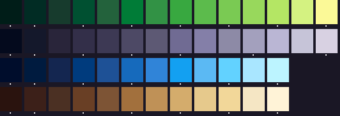

# The extended palette: a proposal

**A proposal for the owner's review, not signed.** The owner (on the approved terrain mockup): "you're using too few colors, you could use more for shading, details, borders."

*Grass, rock, water and earth/wood ramps, dark to light. The signed colours are unmarked; a dot marks a new one.*

- **What it is.** The signed 48, unchanged and first, plus 29 new colours: 77 in all ([`palette-ext.json`](palette-ext.json), made by `tools/extend-palette.py`).
- **How it is built.** Each ramp gains, in CIE LCh so the colour keeps its strength and does not grey:
  - a step between every two signed shades more than 7 L* apart;
  - a deeper shadow, turned toward cool blue-violet;
  - a brighter highlight, turned toward warm yellow;
  - an edge tone 14 L* below the darkest, for borders.
- **Rules kept.** One light: shadows cool, highlights warm. No teal-led colours.
- **The two screens re-quantised.** `screen-*-ext-*.png` use the 77; `screen-*-48-*.png` use the 48. The mean colour error against the painting falls from 5.10 to 4.73 (pond) and from 5.57 to 5.25 (cliffs). The colours used rise from 33 to 62 and from 27 to 47.
- **Next.** The Station would take the same rule later, through the art director's sign and the checks.
