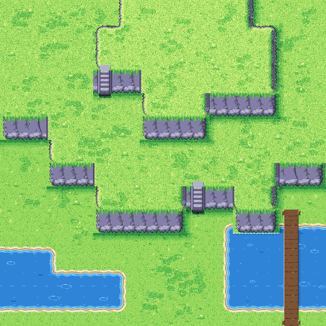

# Terrain, grass biome: the first slice

**A candidate, not signed.** These are the cliff, stair and bridge pieces for the grass biome, and a new grass ground. Everything is on the [signed 48 colours](../../palette/README.md).
- **Paid materials:** the rock, the planks and the water come from one Gemini painting and Retro Diffusion tiles (see Materials).
- **Scripted:** the edges, the joins and the shapes.
- **The review place's:** the sand. The shore is cut again from the new grass.

*The test map at 1× under the clear table. It shows organic plateaus on three levels with one-level steps (a peninsula, notches, an L-shaped rise), two stairs, a cliff standing in a pond, two ponds and a bridge. Candidate.*

**How it is drawn:** the principles in the internal art section §5, from published tilesets.
- Rounded outer and inner corners.
- Directional edges: north and west a lit rim, east a face in shade with its cast shadow, south the face.
- Raised tops a touch lighter.
- A broken lip with hanging clumps.
- Faces with uneven ends and foot.
- A stair of treads, risers, cheeks, a landing and a bottom step.

## The ground (`ground/`, `decals/`, `shore/`, made by `tools/build-meadow-decals.py` and `tools/build-shore.py`)

The review place's grass tiles keep their tuft patches 12 px clear of the edges, so at 1× the patches line up on the 48 px grid. Here the ground is split in two:

- **Bodies.** `body1` to `body4` are grass with single-pixel specks and short blades, and nothing for the eye to find again 48 px later.
- **Decals.** The tuft patches, tall grass and flowers are cut from the review place's own tiles. A seeded rule places them on a 23 px jittered grid, which shares no period with the tiles, as the ripples are placed on water.
  - They go only where their whole footprint lies on plain ground.
  - The page can place them the same way.
- **Shore.** The shore set is cut again from `body1`.

## Materials (`materials/`, made by `tools/terrain-materials.py` from `sources/`)

Every input is project-owned: our own meadow still and our own test map. No third-party image was used.

| Source | Made by | Used for |
| --- | --- | --- |
| `sources/terrain-grass-cliffs-a1.jpg` | Gemini Pro, 1K: our test map repainted in the meadow still's style | water bodies `water1`–`water3`, and the crops fed to Retro Diffusion |
| `sources/t-rock-rd.png`, `t-rock2-rd.png` | Retro Diffusion `rd_tile__single_tile`, 48 px, img2img from two rock crops of the painting, with `palette.png` as the palette | the faces: `face-rock`, `face-rock2` |
| `sources/t-planks-rd.png` | the same, from the painting's bridge | the bridge decks |
| `sources/t-waterA-rd.png`, `t-waterB-rd.png` | the same, from the painting's stream | **not used**: both came back as one flat colour |

How the sources are made usable:
- **Rock:** made to repeat left to right by cross-fading each tile with itself rolled by half a tile. The second rock's 10 px edge bands fade into the first rock's edges, so the two join in any order.
- **Planks:** made to repeat both ways.
- **Water:** three painting crops, area-averaged to 48 px and made to repeat both ways. They are calm, so their life comes from the review place's ripple sprites and short dark streaks, placed by a seeded rule on a 31 px grid that shares no period with the tiles, as the meadow decals are.

Each source's sidecar `.json` holds its prompt, input hash and cost.

## Pieces (`pieces/`, made by `tools/build-cliffs.py`)

- **Cliff lip quarters, 24×24.** There are four corners (nw, ne, se, sw) in seven states: fill, edgeh, edgev, edgev0, outer, outer0 and inner. They are overlays on the plateau's grass.
  - **Geometry first.** The edge sits 6 px inside the cell on a lower north, west or east side; it is 0 on the south, where the face hangs from the cell edge, and 0 on a side that meets a face (the `0` states).
  - **Corners.** Outer corners are cut on a 12 px radius. Inner corners are a 6 px notch rounded on its inner corner, so the edge turns in a curve.
  - **The straight runs waver** by a 24 px periodic offset that is 0 at the quarter's ends, so every quarter joins every other.
  - **Light by side.** North and west: a 3 px lit rim of rock, with the grass at the edge one LIGHT step lighter. East: a 9 px face of the rock in shade, grass clumps hanging over it, the grass behind it one DARK step darker, and the cast shadow on the ground beyond the edge. South: grass drips over the face, with no straight line.
  - `region/` holds each quarter's top as a mask. The test map lightens a raised top only inside it, by 22 % of its grass per level, on a dither with no period.
- **Faces, 48×48.** A face is drawn on the cell below a plateau's south edge.
  - With `materials/`, the rock is `face-rock`, and `face-rock2` on the variant, with occlusion toward the foot.
  - The turf hangs over the rock in uneven clumps of 1 to 8 px, with gaps where the rock's lit lip shows.
  - The foot is uneven: boulders bulge 0 to 5 px, with the ground under them in shadow.
  - An open end starts 6 px in, under the plateau's side. Its edge wobbles, its foot is rounded on a 12 px radius, and it shades like a column: lit on the west end, dark on the east, with the cast shadow beyond.
  - Without `materials/`, the script lays its own rock: courses that lean, each piece lit at its top and left and shaded at its foot and right.
  - The name gives each side's state: `e` is an open end, `c` continues into the next face or against the plateau's side. So the faces are `ee`, `ec`, `ce` and `cc`, with three middle variants `cc-v` to `cc-v3` (the two rocks, each with and without its own cracks). A wall picks them by a hash of its position, so it has no two-tile rhythm.
  - The courses are 0 at both tile edges, so any face joins any other.
- **Shadows and foam.** The shadows are broad, as in the painting: two DARK steps near the rock and one beyond, dithered off over 16 px.
  - `foot-shadow` falls on the cell under a face.
  - `side-shadow-e` falls on the lower cell east of a plateau's east side or a face's open east end; the light is at the top left.
  - `corner-shadow-se` wraps the corner diagonal from a face's open east end.
  - `foot-foam-1` and `foot-foam-2` are the foam where a face stands in water, in two frames.
  - Shade pixels are kept as masks in `pieces/shade/`: 128 means one DARK step for the cell underneath, 255 means two. Light pixels are in `pieces/light/`, one LIGHT step.
- **Stairs.**
  - `stairs` replaces a face. It has five steps, each a lit tread with a light nosing, a shadow under the nosing and a riser one step darker. Rock cheeks stand on both sides, the left lit and the right in shade, and the right cheek casts a little shadow across the treads.
  - `stairs-top` is the landing: worn stone flush with the grass, breaking up into the turf at its far edge.
  - `stairs-foot` is the wider bottom step on the ground, with its shadow.
- **Bridge.** The east–west deck is `bridge-ew-w`, `-m` and `-e`; the north–south deck is `bridge-ns-n`, `-m` and `-s`. Each is an overlay, with posts at the ends and its shadow cast on the water.

## The level model drawn here

- Each cell has a height of 0 to 2 and may be water, which is height 0.
- A cell whose north neighbour is one level higher is a face cell.
- Layer order: water < low ground < cliff top.
- The proof script reports three cases as breaking the rules:
  - a plateau cell touching water;
  - a face with water on its east or west side;
  - a step of two levels.

## Checks (`tools/terrain-map.py`, `proof/checks.json`)

| Check | Result | Pass |
| --- | --- | --- |
| The test map obeys the junction rules (two-level steps, plateaus touching water, faces with water at the side, one-cell trenches) | no breaks | yes |
| Off-palette or semi-transparent pixels, all pieces and maps (`check.py`) | 0 | yes |
| Rim class across every join between two plateau cells, over all legal neighbourhoods | 350 px, worst join 19 px | see below |
| Luminance step across every face-to-face join, against the step inside | 0.80 | yes (≤ 1.25) |
| Luminance step across plain-grass joins, against the step inside the tiles | 1.11 | yes (≤ 1.25) |
| Repeat: autocorrelation at 48 px, minus the mean at nearby lags, on plain grass | 0.072 | yes (≤ 0.10) |

**Rim joins.** Where a side runs beside a face, its rim sits at the cell edge, against the face's end. Below the face it moves back to its 6 px inset. That jog of up to 19 px at a join is designed, at the foot of the face. Every other join differs by at most 1 px, which is a strip edge's one-pixel offset where a rounded notch meets a straight run.

**The repeat check, before and after.** On the review place's grass tiles the repeat scores 0.387 (the current tiles 0.319, round 10's 0.319, round 8's 0.377). Bodies with decals score 0.015 to 0.016, and 0.072 with the raised tops lightened.

**Still open:** the stairs are scripted.

`proof/` holds the test map at 1× and 3×, under the clear, rain and fog tables, and in four greys.
