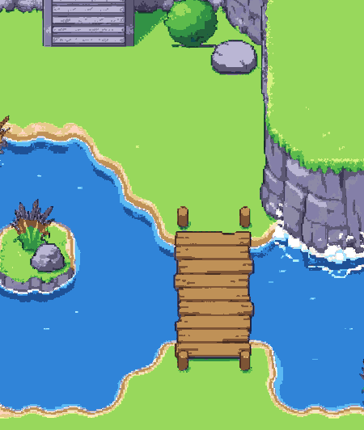
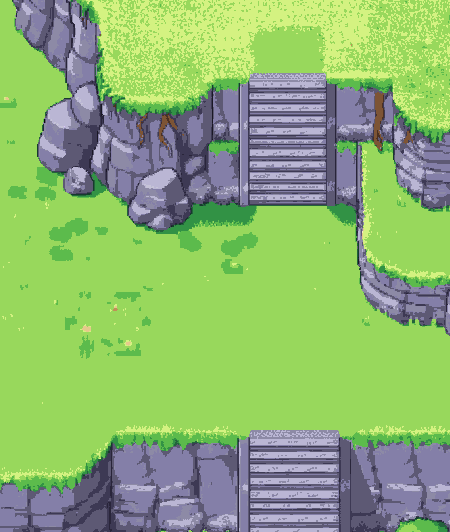

# The grass terrain: painted target mockup

**For the owner's review: the look the tileset must match. Not a tileset, and not signed.**

 

*Two game-screen crops (450×532) at 1× on the 48 colours. [`scene-1x.png`](scene-1x.png) is the whole scene; the 3× versions are beside them.*

- **What it is.** One painted scene: a high plateau with an organic boulder cliff and a wide stair, a middle meadow with a curving cliff, a peninsula and a second wide stair, and low ground with a natural pond. The pond has bays and points, a rocky island with reeds, a cliff standing in the water with foam, and a plank bridge.
- **How it was made.** Gemini Pro was given our own meadow still for the style and our own first cliff study for the cliff style, with the layout described in words. The result was area-averaged so a tile of the scene is 48 px, then snapped to the 48 colours (`tools/mockup-snap.py`).
  - Sources: `../sources/terrain-grass-scene-a2.jpg`, and the first attempt `-a1.jpg`, which copied a blocky layout and is not used.
- **What follows, once the owner approves the look.** The tileset is cut from this painting:
  - wall pieces two and three cells wide, so no crack repeats along a wall;
  - corners as one piece across the plateau cell and the face cell, from the painting's own curves;
  - light and shadow baked in from the painting;
  - props only on whole cells of one level, never over an edge.
