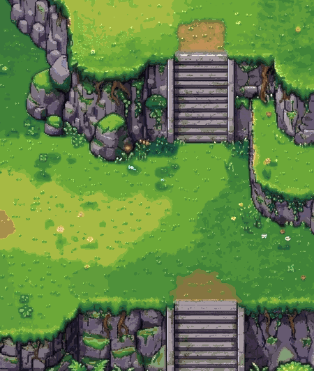
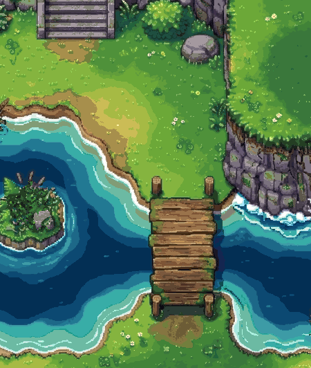

# The meadow scene at the owner's quality bar, on an 8-bit biome palette

**For the owner's review. Not signed.**

 

*Two game screens (450×532) at 1×, on flat ramps. The 3× versions are beside them; the whole scene is `scene-1x.png`. Teal is welcome in the water (owner). The blue-violet swap (`screen-*-noteal-*`) is kept only for the record.*

- **The repaint.** One Gemini Pro call (`../../sources/terrain-grass-scene-b1.jpg`).
  - Inputs: our approved scene as the image to improve, and the right halves of the owner's two targets as style references (cleared by the owner).
  - The prompt starts from the owner's own: "improve the coloring of this tileset, more colors, better shadowing, HiBit pixel art; correct corners, materials, textures".
  - The deep water was asked for blue to navy, not teal-green.
- **The palette** (`biome-meadow.json`, `biome-meadow.png`, made by `tools/biome-palette.py --flat`).
  - 8-bit indexed: the signed 48 as the core, plus 48 meadow colours, 96 in all.
  - Flat ramps, by the owner's word ("the samples have gradients, that doesn't play well in tilesets"): fewer, wider steps per material, found in CIE Lab with chroma kept (grass 12, earth 8, wood 6, rock 12, water 12). Shades the core already has are dropped.
- **The snap.** The scene is area-averaged so a tile is 48 px, and each pixel takes the nearest colour in Lab.
  - **No soft gradients.** On lawn and water, a pixel takes the most common colour of its 3×3 neighbourhood when that colour holds 5 of the 9 and is the same material. Gradients become hard-edged bands; tuft and clover clusters, rock, wood, outlines and flowers stay as drawn.
  - Mean colour error against the repaint: 4.5.
- **The hand pass** (`tools/b1-hand.py`). The wooden sign the repaint put on the island is painted out, regrown from the island's own greens.
- **Checks.**
  - Both screens use only the 96 colours: the cliffs 65, the pond 78.
  - **Value gap** (`tools/value-gap.py`): the explorer was set on every all-grass spot (94 on the cliffs screen, 26 on the pond screen). Its edge falls in a different four-grey band from the ground beside it on 94 % and 86 % of edge pixels, worst placing 71 %. The signed meadow scores 95 %, worst 33 %.
