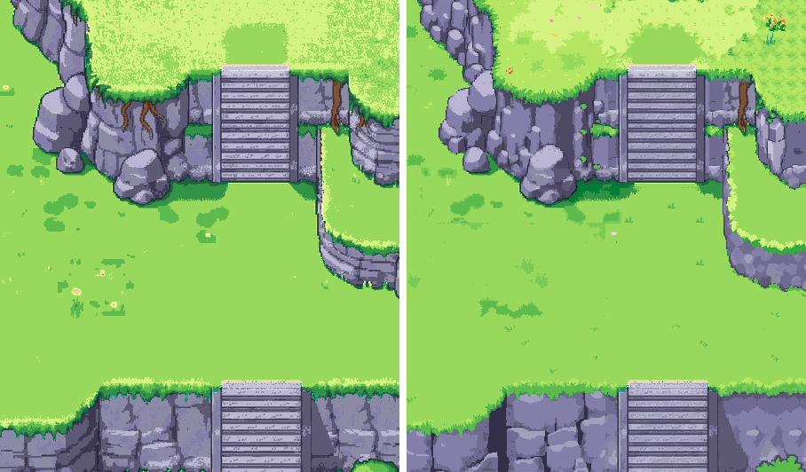
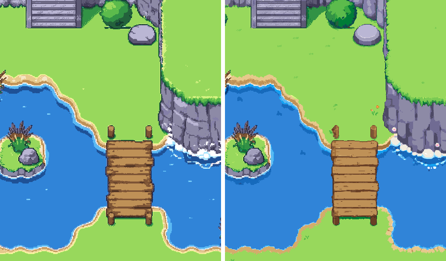

# The mockup redrawn on the extended palette

**For the owner's review. Not signed.**

*Each screen at 1×: on the left, the approved painting on the 48 colours; on the right, the pixel pass on the 77, cleaned. The 3× versions are `screen-*-clean-3x.png`.*

- **The pixel pass.** Retro Diffusion `rd_plus__topdown_map` redrew each screen in six overlapping 256 px tiles.
  - Each tile was made img2img from the painting at strength 0.45, with one seed, and the 77-colour proposal (`../../../../palette/extended/palette-ext-strip.png`) as its palette.
  - The tiles are in `../../sources/px/`, each with its sidecar.
- **Assembly** (`tools/px-assemble.py`):
  - each tile's tone is matched to the painting crop it came from;
  - each pixel comes from the tile it is most central in, with a 16 px cross-fade between tiles;
  - the result is snapped to the 77 and cleaned of stray pixels.
- **The hand clean** (`tools/px-keep.py`). Where the pass drifted from the approved painting, the painting on the 77 is put back, with a 6 px cross-fade. The drifts were:
  - the stairs turned into a stone block;
  - the reeds turned into stumps, and the island moved;
  - a stray post appeared;
  - a hard-edged shadow rectangle was drawn.
  Everywhere else the pass stays: the boulders' shading and borders, the cliff in the water, the planks.
- **Checks.** Both screens use only the 77 colours.
