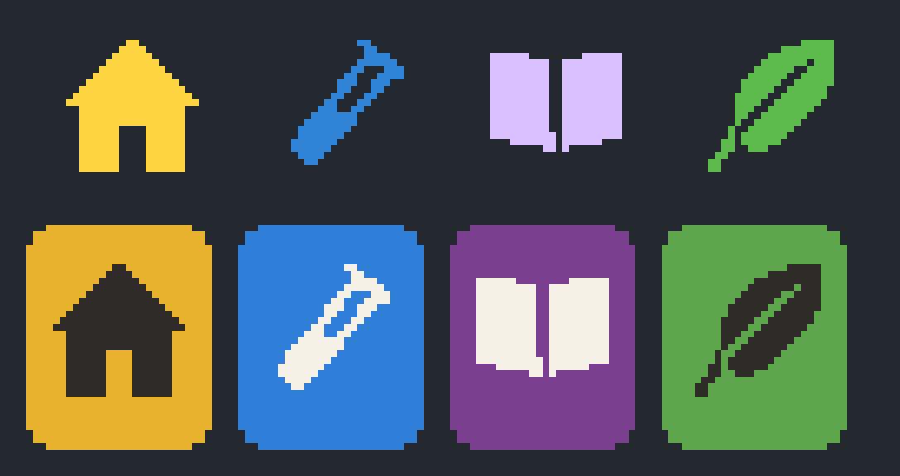

# Title marks

The Station's title marks, 24 × 24 at (16, 8) in the top bar: the icon of the device key that leads to each section, hand-placed pixel by pixel from the same drawings as the key caps ([device buttons](../README.md)), each in one Station palette colour matching its key. `slices/manifest.json` gives each mark's size, place and hash.

## Title marks (signed)

| Mark | Key | Colour |
| --- | --- | --- |
| `frame-room-home-24` | Home: the solid house | `#ffd441` |
| `frame-room-vivarium-24` | Vivarium: the leaf | `#5cbb4c` |
| `frame-room-research-24` | Research: the test tube | `#3084d8` |
| `frame-room-library-24` | Library: the open book | `#dbc0ff` |

The sandbox key icons `shell-key-{home,research,library,vivarium}-24` share each mark's alpha in their key's ink (`#2f2b28` on Home and Vivarium, `#f6f1e6` on Research and Library). Every mark inks only inside the 20 × 20 live area at inset 2.

*marks-proof-8x.png: the four marks at 8× on the bar's slate, and the sandbox key icons on their keys. Hand-drawn masters (`source/original.py`).*
