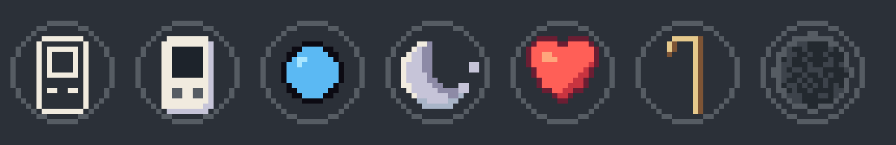
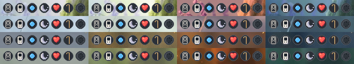

# The mibi collection, v2: the art job

The art job of the collection v2 build (the collection v2 design, the Builder checklist's art job; the collection v2 art direction), code and hand work on the signed masters only: no new painting and no paid image call.

## The rooms (art job items 1 to 4)

`source/rooms_v2.py` takes the rooms folder of masters-pods at the commit the Station places (rooms.json `source.commit`, b7bc7c9e) and writes a copy of it with the changes; the placer places the copy:

```
git -C <masters-pods> archive b7bc7c9e art/station-masters/pods/rooms | tar -x -C /tmp/mp-b7bc7c9e
python3 art/station-masters/collection/source/rooms_v2.py /tmp/mp-b7bc7c9e/art/station-masters/pods/rooms /tmp/mp-v2/art/station-masters/pods/rooms
node prototypes/ui/tools/place-masters.mjs --rooms /tmp/mp-v2/art/station-masters/pods/rooms/rooms-manifest.json --source-commit "b7bc7c9e + collection v2 art job"
node prototypes/ui/tools/place-masters.mjs --check
```

- **The windows.** Each room's `view` in the manifest, carried into rooms.json as `crop`, `keep` and `drops`: the crops of §4 ([0, 96], [176, 96], [178, 96], [152, 96]), the key props each window holds whole (the starting boxes of §4 tightened to their ink at 1x), and the eight drop spots of §4's table, all checked at 1x (place-masters `--check`, guard 8: every piece left in the view, every join, the bed and every key prop inside the window, a prop that runs off the painting reaching the painting's edge on that side; each drop on a level, off the keep-outs, the bed and the joins, inside [cx + 56, cx + 632], 88 apart at one depth). reeds-sedge-1 and ferns-fern-1 leave the room view's pieces (`view: false`).
- **The moved pieces** (§4): Roots' bed [248, 496, 192, 56], stone-2, mister and mist-2; Reeds' rain cup (its drop from the lip at x 844); Boulders' stone-2, shishi, the arm and its pivot (+32 px; the trickle with them), cushion-1, and the lantern on the mound's crest between the maple and the tall stone, its foot on the moss at 1x ([677, 282, 34, 44]); Ferns' copper lines and crozier-1. Each occluder's keep-out moves with it (derived, never typed).
- **Boulders' rear stone** (x 842 to 915) painted out of the four seated idle bases: the haze row by row between the haze on each side with its own grain, the moss mound closed behind it from the tall stone's shoulder to the moss it meets (the mound's moss 50 px to the right, its rows aligned on the two tops), the tall stone carried down with its own texture.
- **Roots' bed** re-lit for its new ground on the path in the four lights: the ground's light matched part way (the gain per light is in the manifest's `collection_v2.bed_gain`) and a contact shadow of the path's own soil under the nest, inside its 192 x 56 rect.
- **The room chips**: 128 x 32 cuts, 1:1, from inside each window in the four lights: Roots the burrow's dark mouth, Reeds the sedge blades over the rock's dark foot, Boulders the pond's water inside its rim stones, Ferns the log under its moss. The name's area sits on the cut's calm dark band.

Every changed file is placed as `new`, not final (the manifest's `unsigned`), for the art director's check at 1x; the rest keep their signatures.

## The marks (art job item 5)

`source/marks.py` draws the 16 x 16 state marks, palette-exact pixel work, none painted; `slices/manifest.json` gives each size and hash and `slices/status.json` places them as new, for the art director's 1x proof:

```
python3 art/station-masters/collection/source/marks.py
node prototypes/ui/tools/place-masters.mjs --from art/station-masters/collection --group collection --status --by "code-drawn by the builder, collection v2 art job 5, for the art director's 1x proof"
```

| Id | Size | What |
| --- | --- | --- |
| `mark-heart-16` | 16×16 | bonded: the enamel heart re-cut at 16 from the signed `heart-full-24` (its shape and its four colours) |
| `mark-elder-16` | 16×16 | elder: a walking stick, a 2 px shaft and a 4 px hooked head at the top left, `sand` with a `bark` shadow side, its foot on row 15, no notches |
| `mark-asleep-16` | 16×16 | resting after a cross: the placed asleep mark cut at 16, the moon whole and its dots drawn closer |
| `mark-cold-16` | 16×16 | tucked away: the placed cold mark (`mark-species-frost-24x24`) cut at 16, its rim and its speckle |
| `mark-companion-outline-16` | 16×16 | away with the Companion: the handheld's outline in `bone` |
| `mark-companion-solid-16` | 16×16 | on the Companion, docked: the handheld solid, `bone` with a `fog` shade, its screen `ground` |

The coming-out mark is the waiting lamp at 12 as it is (`home-lamp-sky-12x12`). The Incubator capsule (a child growing) comes later, with breeding.



*proof-marks-8x.png: the set side by side at 8x, each on the 20 px disc the build draws (`panel` fill, a 1 px `bevel` rim): the Companion outline and solid, the lamp, the moon, the heart, the stick, the cold mark.*



*proof-marks-1x.png: rows Roots, Reeds, Boulders, Ferns; columns dawn, day, dusk, night; each mark on its disc over a patch of the room's window.*
