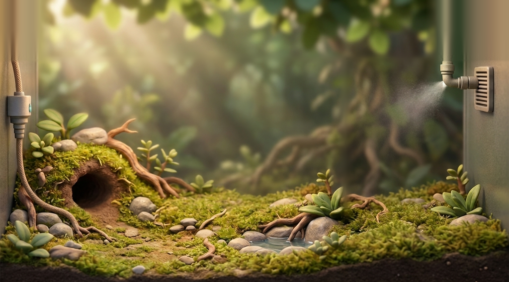
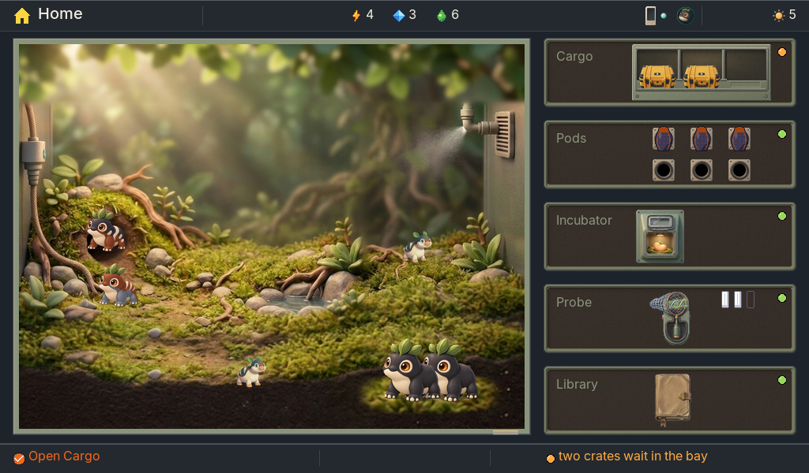

# Art direction

The look of Miniature Beasts, for artists and for builders placing art. The
style guide in [`style-guide/`](style-guide/README.md) holds the per-screen
rules; how a mibi's art is made is in the [art pipeline](proposals/art-pipeline.md).

Mibis have to be appealing enough to care about and clear enough to read. A player
should be able to see an inherited difference, recognize an individual and
understand what changed without reading a label. The art carries the game.

## The look and feel

This is the general guideline. Every screen on both devices, new or changed, is judged by it. The screens are prototypes and keep changing, and newer direction for the game overrides any rule on this page. The detailed [style guide](style-guide/README.md) sits below it as the current implementation reference: it holds the values and sizes, and this page holds none.

### The feel

A small, well-made field kit for keeping living things. You hold it, and it is warm, calm and a little worn from use. The life inside it is the point: soft, bright and full of character. The device around that life is quiet and practical.

It should feel like a naturalist's instrument made by someone who loves animals. It is not a gadget showing off, and it is not a toy.

<table><tr><td valign="top"> <em>station-research-hands: the finish and the light to aim for. Approved concept, generated. Its blue display and orange corners are not the rule.</em></td>
<td valign="top"> <em>companion-resident-home: the warmth of a life at home. Approved concept, generated.</em></td></tr></table>

### Textures and materials

**The life** is soft and tactile:
- fur you could stroke, and leaves with a waxy sheen;
- damp moss, smooth stones and clear water;
- creatures modelled like small sculptures, with weight and a soft surface.

**The device** is handled gear:
- matte powder-coated polymer in sage and sand, dark rubber and recessed screws;
- engraved marks, and canvas or braided hose where something is carried or fed;
- a little wear at the edges.

Displays are dark matte screens that the life and the light stand out against. Paper and labels appear only as things that never change, such as a collector's tag on a pod or the pages of the field journal.

Nothing is glossy, chrome, holographic or plastic-shiny.

### Light

**One warm daylight** from the top left falls on everything, with soft shadows that ground every object where it sits. The light gives form; it never decorates.

**The device's own light** is small and purposeful. A lamp lights what it is for, and a lit mark shows what changed or what is ready. It casts onto what it lights and never glows for show.

<table><tr><td valign="top"> <em>The vivarium by day: warm key light, soft shadows, moss and water. Master.</em></td>
<td valign="top"> <em>Pip lit from the top left: form shading, catch-lit eyes, a soft shadow under the feet. Accepted.</em></td></tr></table>

### Colour mood

Bright life on a calm ground.
- **The life** carries the colour: saturated and playful, with clear highlights, and never dull browns and greys.
- **The device** recedes: sage, sand, rubber and slate.
- **The device speaks in colour only when it means something:** its light for progress and change, a warm amber when something needs you, and orange for the one action.

If a screen looks colourful because of its panels, frames or bars rather than its life, the mood is wrong.

### Information density

*Written by the game designer. The numbers that put these principles into practice (words per element, mark sizes, counts) are in the [style guide](style-guide/README.md); this section is the reason behind them.*

<table><tr><td valign="top"> <em>Home: one living subject, a column of quiet modules, one line of words. Capture.</em></td>
<td valign="top"> <em>station-research-hands: one lit subject on a clean display. Approved concept, generated.</em></td></tr></table>

- **One subject per screen.** Every screen is about one thing the player cares about: a mibi, a pod, a crate, a choice. That thing is the largest, best-lit and most detailed thing there. Everything else is smaller, quieter and in its service.
- **Show what the player acts on or watches change, and nothing else.** An object earns its place by doing something the player can see, or by changing over time. Equipment that serves nothing, decoration that explains nothing, and a second picture of something already shown all go.
- **Rich where it matters, calm everywhere else.** The life is dense: fur, markings, moss, light. The machine around it is sparse: a few panes, a few lit marks. Detail is spent on what the player came to see, never spread evenly.
- **Depth is present but folded.** The genome, the rules between copies and the numbers behind a forecast are really there, one press away, for the curious. The first view gives a child the whole meaning without them; the folded view gives a parent the mechanism.
- **A glance before a read.** Each screen is understood in a few seconds by looking, before any word is read: what it is for, what changed, what is waiting. If understanding needs reading, the screen is too dense or draws the wrong thing.
- **Every mark means one thing, everywhere.** A mark the player learns on one screen means the same on every screen and on both devices. Meaning never depends on a legend, a tiny glyph or colour alone.
- **The Companion says less than the Station.** It is a smaller screen carried outdoors, held in a moment of play. It shows the place, the pawn and the next step; the Station holds the reflection, the comparison and the depth.

### Tone of voice

*Written by the game designer. The words budget per element is in the [style guide](style-guide/README.md).*

- **The devices speak little, and plainly.** Words name things and say what happens; they never explain what a picture already shows. A line is short enough to read in a glance, and most screens need only the bottom line.
- **Warm, never cute.** The voice is a calm, kind field companion who knows these animals well. It is never babyish, never gushing, never a lab report. "Moss has grown up", not "Yay! Moss levelled up!" and not "Specimen 12 reached maturity".
- **Play language, not science words.** Pods, mibis, looks, chapters, what it does. Never locus, allele, phenotype, specimen or percentage on the main view. The real terms live in the detail view, for those who open it.
- **Talk about this animal.** "Your Loika", "Moss", "this pod": the player's own mibi by name, the species by its name alone. The device never calls a mibi a creature, a unit or an item.
- **Say what a choice will do, not what to press.** A choice reads as its outcome ("Gone for good. Its place will remember it."), not as an instruction ("Press ✓ to confirm release"). A loss is said once, plainly, and never as a scare.
- **Describe, never promise.** A trait is told by what the animal looks like or does ("nothing ruffles it"), never by an effect the game doesn't have. The voice never sells, nags or hurries the player. Waiting is described ("ready in about ten minutes"), never pushed.
- **Never punish absence.** Coming back is invited by something new to see, never by guilt. There is no "you missed", "hurry" or "don't forget"; there is "Face cleared on your Loika".
- **Honest about the unknown.** What isn't known yet is a surprise, not a blank. "Still a surprise", "something new is under here": the voice makes the unknown tempting, and never guesses.

### Motion character

**The life moves all the time.** It breathes, looks around, potters, sleeps, and water and leaves move.

**The device moves only when something happens.** A door opens, a lamp turns on, a crate slides in or a frost clears. These are short, eased and physical, the way a well-made mechanism moves.

Reveals take their time, because they are the reward. Nothing blinks to get attention, and nothing means something only by moving.

On the Companion the same character is drawn in stepped frames.

 <em>companion-storm: weather and life moving in a place, the pawn always readable. Approved concept, generated.</em>

### What it is not

- Not childish: no sticker faces, nursery colours, cartoon simplification or storybook ornament.
- Not a sci-fi HUD: no neon, holograms, glowing outlines, chrome or glass gloss.
- Not a sterile lab, a display cabinet or a desk with papers.
- Not a cosy cottage with no equipment.
- Not brown on brown, and not cream panels.
- Not a list, a table or a wall of text where a picture would do.
- Not equipment for show: every lamp, line and gauge works for the life.

## Miniature Lives

The look is Miniature Lives. It is cute by charm and craft, as Pip is: tactile,
softly modelled, grounded, with real weight and real anatomy under the charm. It
is never childish: no cartoon simplification, no sticker faces, no toy-like
rendering, no nursery colours, no storybook ornament.

- **Creatures:** sculpted, rounded bodies, soft tactile materials, directional
  light, expressive eyes and clear markings. They should feel alive and physical
  even when small.
- **Companion:** a crisp HiBit treatment, meaning detailed pixel art that keeps
  rounded volume, eyes and markings readable at about 280×300 pixels.
- **Station and larger displays:** a matched richer treatment of the same
  creature, with the same trait boundaries.
- **The Station itself:** rugged, matte field gear, the Companion's sibling,
  whose job is keeping small lives going. Its look is in the
  [style guide](style-guide/README.md#the-station).

The reference is the Pip device proof in
[`art/miniature-lives/`](../art/miniature-lives/README.md). It shows the plain
saved Pip and a pale-marked comparison, at Companion and Station size.

## Rules

- **Design at device size.** Judge art at 450×600 and 1024×600 at 1×, not as a
  scaled-down poster.
- **The creature comes first.** Identity and inherited meaning must read from the
  creature; text supports it.
- **The art is the interface.** The player acts on the picture; art never
  decorates a process, a list or a table.
- **Art never changes genes.** Rendering can't invent body parts, move pigments or
  "repair" a weak result by changing what was inherited. If art fails, the creature
  remains and the failure is shown.
- **Draw only what is known.** During partial research, show reference views that
  reveal no unknown anatomy. Full portraits require full knowledge.
- **Same individual everywhere.** Silhouette, markings and identity survive color,
  four-gray, monochrome and paper.
- **Keep originals.** Original images, exact prompts and source files keep their
  bytes and hashes. Generated images are labelled as generated.
- **Text is separate.** Never bake numbers or labels into artwork.

## From genome to creature

A mibi's genome is the seed of its look. The rig sets its structure, proportions
and attachments; the painter gives each mibi its standard look when it grows,
painted over the rig's control passes, and the Companion picture, the 48 px
token and the idle and walk frames are derived from that painting. Each painting
is made once and kept. Until it arrives, the player sees the rig placeholder,
which is never the final look. Nothing is hand-made for an individual; species
pieces are painted once per species. The [art pipeline](proposals/art-pipeline.md)
describes the mechanism.

Creatures range from bear-like to cat-, cow- or firefly-like and beyond, with
broad body plans, fur, scales, feathers or skin and real facial features, and
always read as pets. Color is saturated and playful, with clear highlights,
never dull browns and greys. Every expression a genome allows is a cute pet: the
rig's ranges (head and eye size floors, limb bulk caps, roundness) and each
species' colour pools stay inside a cute envelope, and the worst case in each
species' range is what the painting is tested on.

Pods come from one renderer with species parameters (size, proportion, shell
pattern, colour pair, glyph). The pods of a species match, and a shell never
shows its individual's genes; only the dust or moss of its place of origin
varies from pod to pod.

## Not designed yet

- **Species designs:** each species' body plan and cute envelope, with body
  plans that vary within each species.
- **Animation:** idle, movement and reactions; growth stages that keep identity.
- **World art beyond the meadow:** the biomes after the first terrain slice
  (grass with cliffs, water, a bridge and stairs).
- **Caddy and paper:** four-gray and print versions of the same mibi.
