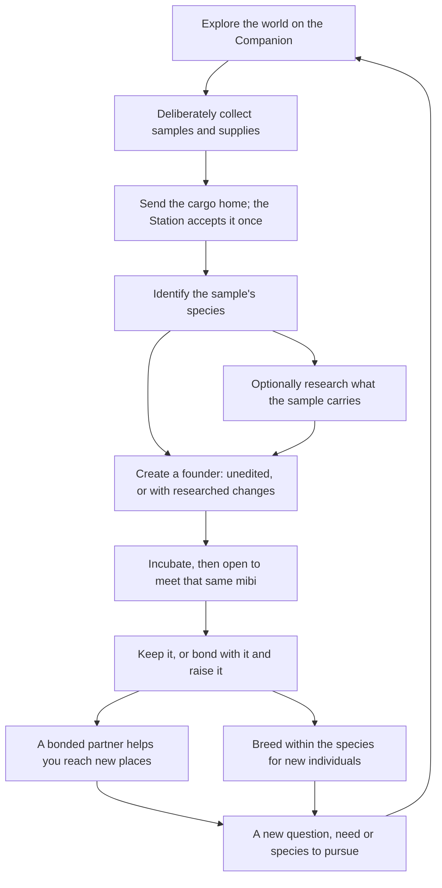

# The game

Miniature Beasts is a game about bringing something mysterious home, finding out
what it could become, and living with the creature that results. Players explore
on a portable Companion, carry samples back to a home Station, learn what those
samples' inherited traits can do, create a mibi, and, if they choose, raise it and
breed families within its species. Each part gives the others a reason: a trip
feeds the research bench, research leads to a new pet, and that pet and its family
give the next trip a purpose.

It is also a genetics toy. Appearance and abilities follow inherited traits, and
the player learns how through pictures, comparison and consequences rather than
lessons or notation.

**How this page is built.** It is written for the designers, artists and developers who make the game, in the order they need it. It opens with the **pillars**, the few things the game must always be, which settle arguments, and the **rules** every mechanic keeps. Then it covers the **loop**, the moment-to-moment play and its verbs, and the **systems** that loop runs on. After that come the **economy** that paces them, the **progression** that makes them add up, **engagement** (why players come back, and what we refuse to do to make them), and the **devices**, where all of it is played. It ends with the **mechanics reference** and the **open questions**. Each section says what the game does and why, and links to the document that holds the rules and numbers. When something here and a rules document disagree, the rules document is fixed. The game is a prototype and changes as it is played; the direction of the game's owner overrides anything on this page.

## Who it is for

The game works for two audiences at once. Children explore, uncover and pursue
possibilities visually, without any genetics vocabulary. Curious parents and STEM
enthusiasts can dig into the real genetics, one press away and never required. It
is never a text-heavy school lesson, and never childish, in tone or in reward. It
is a sandbox: a pretty mibi, a rare one and a capable one are all valid goals.

## Pillars

Every design decision is checked against these four. A feature that serves none of them is cut; a feature that breaks one needs a very good reason.

1. **Discover something alive.** The world is full of creatures and secrets, and the player finds them by going out and looking. Exploration rewards curiosity, never reflexes. *Rules out:* combat, timed challenges, grinding for drops.
2. **Author life you understand.** The player reads real genetics as pictures and shapes a creature from what a pod really carries. Every result is explained by what was inherited, never by luck at the moment of creation. *Rules out:* random rolls on creation, hidden stats, notation the player must learn.
3. **Live with what you made.** Each mibi is an individual with a name, an origin and a family. It grows, walks with you, opens places and has children. Attachment comes from its story. *Rules out:* disposable units, rarity tiers as the point, mibis as currency.
4. **Respect the player's time.** The game rewards attention and never demands attendance. Nothing is lost by being away, and every choice is shown before it is made. *Rules out:* decay, streaks, FOMO, paid speed or randomness, hidden costs.

## The rules every mechanic keeps

These hold across every system, below the pillars.

- **Curiosity must be actionable.** Show enough of a place, creature or clue to
  support a choice. Variety must change what you can do or what happens, not just
  the scenery or the wait.
- **Discoveries accumulate.** Findings, origins and learned possibilities are kept.
  Running out of supplies changes what you can afford, never what you know.
  Looking again is always free.
- **Explain by showing.** Players compare, see the result of an action and
  recognize individuals. Short text covers uncertainty and cost. No chemistry
  lessons, quizzes or hidden-answer puzzles.
- **Variety must still make good pets.** Every result must be coherent, viable and
  appealing. Rare, complex, powerful and personally loved are different kinds of
  value, all valid goals.
- **Commitments are deliberate.** Browsing, previewing and docking spend nothing.
  Before anything is spent or created, the player sees what, with what, and what
  follows.
- **Reward attention without demanding attendance.** A glance should show what
  matters. No punishment for being away, and no reflex challenges.
- **Players choose their goals.** An attractive pet, an unusual ability, a complete
  collection and a beloved lineage are equally valid. Performance is not the only
  measure.
- **Any wait has a purpose.** A minigame must add a decision or a discovery, not
  an input ritual. Waiting never happens in exploration, the most interactive part;
  if the game has waits, they belong to research or incubation running in the
  background.

## The core loop

One trip and what comes of it: **go out, bring something home, find out what it is, make a mibi from it, live with it.** Each step is a verb the player does, on a device:

| Step | The player… | Device | Pillar |
| --- | --- | --- | --- |
| Explore | picks a start, walks the reach, calls, reads the weather, enters places | Companion | 1 |
| Gather | digs up pods, gathers materials, causes creature moments for Data, lights outposts and beacons | Companion | 1 |
| Send home | ends the expedition; the hold seals into a crate; docking brings it home | Companion, Caddy | 1, 4 |
| Open | opens the bay, crate by crate | Station | 1 |
| Identify and read | breaks a pod's seal, reads chapters, follows glints, compares | Station | 2 |
| Shape and grow | turns genes, sees the founder change, grows it | Station | 2 |
| Incubate and hatch | checks on the candled pod, sees what clears, opens it | Station | 2, 3 |
| Live | names, greets, tends, takes mibis out, returns them to the wild | Station, Companion | 3 |
| Partner | brings a grown mibi on the next trip; it opens places and finds | Companion | 1, 3 |
| Cross | pairs two adults toward a wish; reads the forecast | Station | 2, 3 |

**The arcs around the loop.** The loop repeats inside longer arcs, each with its own question: the **trip** (what's out there?), the **pod** (what does it carry?), the **mibi** (who is this one?), the **species** (what looks can it have?), the **family** (can I breed what I imagine?) and the **world** (what changed while I was away?). Every arc is optional except the trip. A player who only explores and hatches is playing the game.

## Systems

The loop runs on these systems. Each has one purpose; its rules are in the linked document.

| System | Its purpose | What it takes in, and what it gives | Rules |
| --- | --- | --- | --- |
| **World and exploration** | A living, fogged world worth walking | Probe reach and Shield in; pods, materials, finds, Data, map knowledge out. The world turns once per expedition | [World and exploration](world-and-exploration.md) |
| **The Probe** | The player's reach and risk | Mending and upgrades in; reach, pod capacity and survival out | [World and exploration](world-and-exploration.md) |
| **Cargo** | The trip coming home as an event | The sealed hold in; crates opened once at the Station | [Architecture](architecture.md) |
| **Research** | Knowing what a pod carries | Data in; chapters read, glints, the field guide out | [Research and breeding](research-and-breeding.md) |
| **Creation** | Making one fixed founder from one pod | A read pod, Energy, Essence and Data in; a committed genome out | [Research and breeding](research-and-breeding.md) |
| **Incubation** | The wait between choice and meeting | A bud in; time, reveals and a hatch out; Grow now spends Essence for time | [Research and breeding](research-and-breeding.md) |
| **Life** | Mibis as individuals over time | Growth stages, care, bonding, the carried set, partners, self-changing traits | This page's table below; [Genomics](creatures-and-genomics.md) |
| **Breeding** | Families toward a wish | Two adults, Energy and Essence in; one child with real parents out | [Research and breeding](research-and-breeding.md), [Genomics](creatures-and-genomics.md) |
| **Genomics** | The truth underneath everything | Species frames, loci, copies, inheritance; never shown as notation | [Genomics](creatures-and-genomics.md) |
| **Collection** | The record of what the player knows | The Library and field guides, wishes, portraits earned by research | [Research and breeding](research-and-breeding.md) |

**How the systems connect.** Exploration feeds research (pods, Data). Research feeds creation (read genes can be shaped). Creation feeds life (a mibi). Life feeds exploration (partners open places) and breeding (adults cross). Breeding feeds research (children to read) and collection (looks never seen). Every system both receives and gives, so no part of the game is a dead end.

## Economy

Three supplies pace the game. Each has one job, so the player learns what each is for by using it.

| Supply | Its job | Comes from | Spent on | The pressure it creates |
| --- | --- | --- | --- | --- |
| **Energy** (bolt) | runs the machines | charged and warm stones, found and caused in the world | growing, crossing, mending, upgrading, lighting outposts | The scarce one: it makes the player choose between growing now and preparing the next trip |
| **Data** (diamond) | buys knowledge | creature moments the player causes; a little each day at the bench | identifying, reading, shaping | Where curiosity goes: read this pod or that one; the glint says where it's worth it |
| **Essence** (drop) | builds bodies | dew, pressed fruit, tufts; returning pods and mibis to the wild | growing, crossing, Grow now | The body budget: more mibis or faster ones |

- **Knowledge never costs twice.** What is read stays read; looking again is free.
- **Running out limits what you can do, never what you know.**
- **Time is a resource the player can trade for Essence,** never for money.
- **Nothing in the economy is ever sold.** The paid cloud layer adds services, never supplies, speed or randomness.
- Prices and waits are set low so the loop can be played through quickly. Their final pacing is an open question.

## Progression

Progression is the world and the collection getting richer, never levels, experience or scores. The only numbers on screen are prices and supplies.

| What grows | How the player sees it |
| --- | --- |
| **Knowledge** | pods' rings fill chapter by chapter; species' field guides fill look by look; the Library's frames go from empty to met to found |
| **The collection** | the vivarium fills; mibis grow from juvenile to adult to elder |
| **Capability** | the Probe's tier (reach and capacity); partners that open places and finds; outposts and beacons lit |
| **The world** | the map clears of fog; the world turns, with consequences the player can read |
| **Lineage** | families traced across generations; a wish coming closer as its pieces light up |
| **Recognition** | portraits earned by research, arriving as an event |

## Engagement

### Why players come back

| Span | The pull |
| --- | --- |
| **Minutes** | a bud's next reveal; a chapter clearing; crates waiting in the bay |
| **A day** | a trip to take; the bench's small daily Data; a young mibi growing up |
| **Weeks and longer** | a field guide nearly complete; a wish one generation away; a place a grown partner can open; a portrait on its way |

The Station shows what is new or ready at a glance, from Home and Idle, so the reason to come back is visible without opening anything. The return is always to something new, never to repair a loss.

### The hooks we use

- **The curiosity gap, honestly paid.** A sealed pod, a frosted chapter, a glint that says "something new is here" but never what. The answer is fixed when the pod is found; reading reveals, it never rolls. (The opposite of a loot box.)
- **Authorship.** The player shapes their founder and sees it change under their hand. People care most about what they made.
- **Ownership and origin.** Every mibi has a name, a pod it came from and a place where that pod was found.
- **Collection with meaning.** Each field guide entry is something the player found and understood.
- **Mastery of a real system.** Learning the genetics makes better breeding; the game teaches by results.
- **A gentle appointment.** A bud grows in real time and rewards each visit with a reveal.
- **Goals the player sets.** The wish turns the player's dream mibi into a long goal the game helps with.
- **Physical ritual.** Docking makes three devices react together; the trip comes home as an event.

References for these patterns, not to copy: the check-in pleasure of *Neko Atsume*, the genetic pets of *Creatures*, and the partner bond of the *Pokémon* games, without their battling.

### The hooks we refuse

- **Punishing absence:** nothing dies, sickens, decays or leaves while the player is away (the Tamagotchi pattern).
- **Streaks and daily-login rewards.**
- **Fear of missing out:** no limited-time events, vanishing offers or countdowns to loss.
- **Paid randomness and paid speed.**
- **Nagging:** the devices signal what is new; they never hurry, scold or guilt.
- **Comparison pressure:** no global rankings and no "first to find".
- **Manipulative choices:** no pre-ticked options, no shaming the "no", no hidden cost.

## Devices and interactions

**Three devices, one world.** Each does what only it can:
- **The Companion** is for going out. Play there is active and in the moment: the place, the pawn, the creatures, the mibis walking with you.
- **The Station** is home. Play there is reflective: reading, shaping, growing, living with mibis and deciding with time to think.
- **The Caddy** is the bridge. It charges both handhelds, carries the cargo across at the dock, and prints.

**The dock is the shared moment.** When the Companion docks, all three react in step and the trip comes home as an event. Cargo moves only then, and nothing is accepted until the player opens it.

**Input.** Both handhelds use a few physical keys, and each means one thing everywhere. The pad moves (and on Create turns the focused gene). ✓ does exactly what the bottom line says. ← goes back. The Companion adds Call, which sends a signal that things answer. The Station adds room keys that jump to Home, Research, the Library and the Vivarium. Details are in [Interaction](interaction.md).

**How decisions are communicated.**
- **Browsing is free.** Looking, comparing and previewing never spend.
- **Every choice shows its options, its cost and its outcome before the press,** with the outcome as a picture.
- **Only real decisions ask.** A spend, a commitment, something irreversible or a fork opens a decision panel. Everything else is one press with no confirmation.
- **Irreversible is said once, plainly.** It is never asked twice and never meant to frighten.
- **The player chooses where they land.** No choice drops them somewhere they didn't pick.

## Feel and tone

A naturalist's expedition that ends in a home full of life: curious, unhurried and warm, a hobby you return to rather than a job. The look and the voice are in [art direction](art-direction.md), "The look and feel".

## What it is not

- Not a care chore: no needs meters, decay or guilt.
- Not a slot machine: no paid randomness, and no randomness at the moment of creation.
- Not a lesson: no quizzes, no required notation, no wall of text.
- Not a race or a ladder: no leaderboards and no punishing timers.
- Not a battler: mibis are companions and partners, never fighters ranked by power.
- Not childish: never babyish in tone, art or reward.

## Mechanics

| Mechanic | How it works |
| --- | --- |
| **Exploration** | A fogged world map of living places that turns once per expedition. The player starts on any cell they can see; the Probe's tier sets the reach; walking and Call survey a place; storms, fog banks, outposts and beacons shape the trip ([world and exploration](world-and-exploration.md)) |
| **Gathering** | Collecting is deliberate, in whole items. A full hold offers a swap, and nothing is lost. The Probe carries 2 pods at tier 1 and 3 at tier 2, and up to 20 of each material |
| **Return** | End expedition works only on the start cell or a lit outpost, and it ends the expedition. It seals the hold into a crate that travels in the Companion's bay until it docks; the player may keep exploring with crates aboard. The Station opens each crate exactly once. A break sends nothing home: the pods drop where the Probe broke |
| **Identification** | Shows the species, not the pod's hidden traits; an identified pod can be grown unedited ([research and breeding](research-and-breeding.md#identify)) |
| **Research** | Optional, and the core of play. A chapter at a time, as pictures; glints say where something new is; findings are kept; sealed chapters open with finds ([research and breeding](research-and-breeding.md#reading-a-chapter)) |
| **Creation** | One pod makes one fixed founder, unedited or shaped among the copies that pod carries ([research and breeding](research-and-breeding.md#creating-a-founder)) |
| **Incubation** | Reveals the same individual, never a reroll; Grow now shortens the wait for Essence; opening is a press ([research and breeding](research-and-breeding.md#the-bud)) |
| **Life and bonding** | A mibi grows from an embryo in the bud into a juvenile, an adult and an elder. Care happens only on the Companion: **Tend** works on any carried mibi once a day, and a few Tends (three) bond it; walks grow a mibi but never bond it. An unbonded juvenile grows on the clock; a bonded juvenile grows through care, and waits at home, not growing, until it is carried and tended. Missing care loses nothing. There is no limit on bonds, and a bond is never lost. Bonding is not needed to breed. A bonded mibi cannot be returned to the wild |
| **Partners** | The Companion carries up to three mibis. One of them at a time is the partner on expeditions: an adult or elder, never a juvenile. Partners use their species' abilities to open events, places and finds. They gate the higher tiers of exploring and never block exploring alone ([world and exploration](world-and-exploration.md#partners-and-gates)) |
| **Breeding** | Two adults or elders of one species make one child with real parents; the forecast shows pictures of what is read; a wish guides it ([research and breeding](research-and-breeding.md#the-cross), [genomics](creatures-and-genomics.md)) |
| **Supplies** | Three supplies in whole units, each spent for its function: Energy runs the machines, Data reads genomes, Essence grows bodies. Energy comes from struck and warm stones and stays scarce; Data from creature moments the player causes; Essence from dew, pressed fruit and tufts ([world and exploration](world-and-exploration.md#materials), [research and breeding](research-and-breeding.md#data-and-the-other-supplies)) |
| **The vivarium** | The player keeps as many mibis as the vivarium holds: six bays at the start; upgrades add two at a time, up to twelve, the most one vivarium holds. Returning a grown, unbonded mibi to the wild frees its bay and gives 2 Essence; its place remembers it and later sheds one pod of its line. More room comes from more vivariums |
| **Crafting** | Discovery with clues. Recipes are personal once learned; a failure wastes the ingredients or returns a fraction. It runs deep over the long term and stays simple at first |
| **Wild capture** | Not in the game |
| **Upgrades** | Tiered upgrades for the Station, the Probe and the Companion. The tier 2 Probe reaches further and carries 3 pods. The Station takes virtual research chips, which are found, crafted, traded or dropped by rare mibis |
| **Sharing and paper** | One household kit serves several players, each with their own progress. Sampling someone else's mibi needs its owner's consent. There is no global ranking of who found something first. A mibi's stamp and its code can be shared; a scanned stamp shows what its keeper has read, and never creates or moves a mibi ([research and breeding](research-and-breeding.md#stamps-and-scans)). Only portrayed mibis can be traded |
| **Online play** | The kit plays standalone, with no account or internet. The cloud is an optional, paid layer on top, never needed to play |

## Not designed yet

- What bonding involves and gives the player beyond growth, what care looks like, what missing it means, and how
  long a mibi lives.
- Which ability each species brings as a partner, and how traits shape it. This carries the mibi arc's "what can it do with me?": until it is designed, a mibi has no payoff on the Companion beyond company.
- Fertility, and how a cross that fails is shown.
- What crafting makes: its recipes, feed and habitat items.
- Probe tiers beyond 2, mods, chip slots and Station upgrades.
- The cloud layer's contents: sync, an exchange, mini-games, lineage and
  printer play.
- The real transfer of crates between devices.
- Research and breeding's open questions, prices among them, are in
  [research and breeding](research-and-breeding.md#not-designed-yet).
- Vivariums beyond the first as living ecosystems: food, light and environmental constraints that shape a mibi population.
- **The long term:** what a player does after completing a field guide or reaching a wish, beyond new species in drops.
- **The first session:** how a new player meets the loop, and how soon their first mibi arrives.
- **Printing in play:** whether the Caddy's print and scan are part of play or keepsakes only.
- **The economy's pacing** in the finished game.
