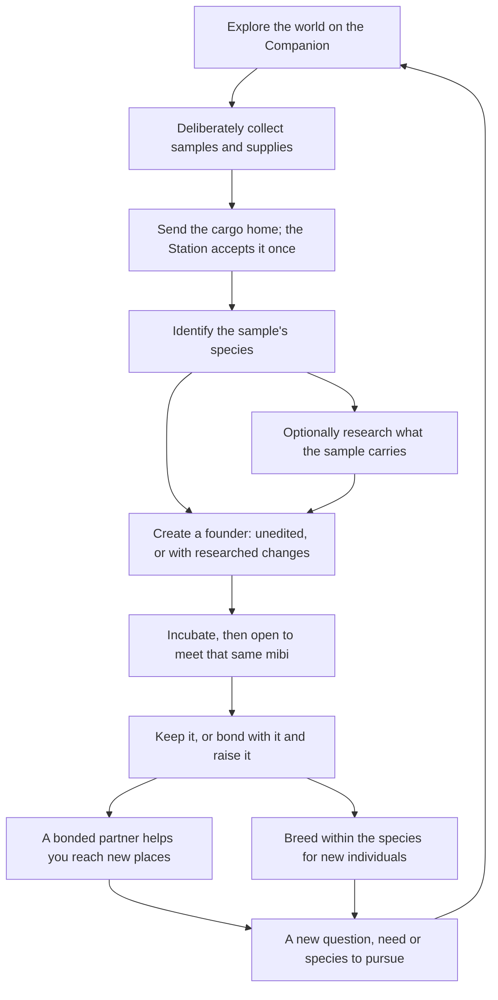

# The game

Miniature Beasts is a game about bringing something mysterious home, finding out
what it could become, and living with the creature that results. Players explore
on a portable Companion, carry samples back to a home Station, learn what those
samples' inherited traits can do, create a mibi, and, if they choose, raise it and
breed families within its species. Each part gives the others a reason: a trip
feeds the research bench, research leads to a new pet, and that pet and its family
give the next trip a purpose.

It is also a genetics toy. Appearance and abilities follow inherited traits, and
the player learns how through pictures, comparison and consequences rather than
lessons or notation.

## Who it is for

The game works for two audiences at once. Children explore, uncover and pursue
possibilities visually, without any genetics vocabulary. Curious parents and STEM
enthusiasts can dig into the real genetics, one press away and never required. It
is never a text-heavy school lesson, and never childish, in tone or in reward. It
is a sandbox: a pretty mibi, a rare one and a capable one are all valid goals.
What the Station shows of the genetics is in
[research and breeding](research-and-breeding.md#what-the-player-sees-of-the-genetics).

This page is the high-level design guideline: what playing feels like, what holds
the player, and what we refuse. Every mechanic, screen and change is judged by it.
Its counterpart for the look is [art direction](art-direction.md); the rules are
in the documents it links. The game is still a prototype and changes as it is
played. Direction from the game's owner overrides any principle here.

## The feel

**A naturalist's expedition that ends in a home full of life.** You go out with a
small device, notice something alive and strange, carry it home, find out what it
holds, and make a creature that is yours. Then you live with it, and it changes
where you can go next.

The feel is **curious, unhurried and warm**. It is a hobby you return to, not a
job. Something is always worth a look; nothing is ever lost by looking away. The
pleasure is in discovery (what is in this pod?), in authorship (I made this one),
and in attachment (that is Moss, and Moss came from the pond trip).

References, for the feel, not to copy: the curiosity of turning over stones in a
nature walk; the quiet ownership of *Neko Atsume*, where you check in to see who
came; the lineage pride of breeding games like *Creatures*, which made real
genetics into pets.

## The loop and the arcs around it

The **core loop** is one trip and what comes of it: go out, bring something home,
find out what it is, make a mibi from it, live with it.

Around that loop sit **longer arcs**, each with its own pull:

| Arc | Its span | Its question |
| --- | --- | --- |
| **The trip** | one expedition on the Companion | What is out there today, and what do I bring back? |
| **The pod** | from the crate to the hatch | What does this one carry, and what will I make of it? |
| **The mibi** | from the hatch through growing up | Who is this one, and what can it do with me? |
| **The species** | every pod and mibi of one kind | What looks can this species have? (the field guide) |
| **The family** | crosses across generations | Can I breed toward the mibi I imagine? (the wish) |
| **The world** | the map, turn by turn | What changed while I was away, and where can my partner take me now? |

Each arc feeds the next. A trip fills the rack; the rack feeds the bench; the bench
makes mibis; mibis become partners that open new places, and parents that make
families. The design keeps every arc optional except the first: a player who only
explores and hatches is playing the game.

## What holds the player: the hooks we use

Each hook is a known pattern, chosen because it fits a game about living things
and is honest with the player.

- **The curiosity gap, honestly paid.** A sealed pod, a frosted chapter, a glint
  that says "something new is here" but never what. The question is real, and the
  answer is always in the game and always worth the look. Unlike a loot box, the
  pod's contents are fixed when it is found; reading reveals, it never rolls.
- **Authorship.** The player shapes their founder, choosing which inherited copy
  each gene keeps, and sees the animal change under their hand. People care most
  about what they made.
- **Ownership and origin.** Every mibi is a specific individual with a name, a pod
  it came from and the place where that pod was found. Attachment grows from that
  story, not from a rarity badge.
- **Collection with meaning.** The field guide fills look by look; a species is
  complete when every look has been seen. Collection pulls because each entry is
  something the player actually found and understood.
- **Mastery of a real system.** The genetics are real: dominance, blends, hidden
  copies, sleeping traits. A player who learns them breeds better, and the game
  shows that learning through results, not tests.
- **A gentle appointment.** A bud grows in real time and each visit reveals a
  little more. The wait creates a reason to come back that rewards the visit and
  never punishes the absence.
- **Goals the player sets.** The wish lets the player pin the mibi they dream of;
  the game then shows which pods and pairs carry pieces of it. The long goal is
  theirs, not ours.
- **Physical ritual.** Docking the Companion is a moment: the three devices react
  together, and the trip comes home. The hardware makes the loop tangible.

## The hooks we refuse

These are common in games for children and in free-to-play design. We refuse them
because they trade trust for attention.

- **No punishment for absence.** Nothing dies, decays, sickens or runs away while
  the player is gone. Care helps a bonded mibi grow; missing it loses nothing.
  (Tamagotchi's guilt is the pattern we refuse.)
- **No streaks, daily-login rewards or "don't break the chain".**
- **No fear of missing out:** no limited-time events, vanishing offers or
  countdowns to loss.
- **No paid randomness and no paid speed.** Nothing random is ever sold, and
  waiting can be shortened only with what the player found in play, never with
  money.
- **No nagging.** The devices signal what is new or ready; they never hurry,
  scold or guilt.
- **No comparison pressure:** no global rankings and no "first to find".
- **No manipulative choices:** no pre-ticked options, no shaming the "no" answer,
  no hiding the cost.

## What shows progression

Progress is shown as the world and the collection getting richer, never as levels,
experience bars or scores. The only numbers are prices and supplies.

- **The field guide and the Library** fill frame by frame and look by look.
- **The vivarium** fills with mibis, and each grows from juvenile to adult to elder.
- **A pod's ring** fills chapter by chapter as it is read.
- **The world map** clears of fog, and outposts and beacons stay lit.
- **The Probe** gains a tier: it reaches further and carries more.
- **Families** grow into lineages the player can trace, and a wish comes closer as
  more of its pieces light up.
- **Portraits** mark the mibis the player's research has earned a sitting for.

## What makes you come back

| Span | The pull |
| --- | --- |
| **Minutes** | A bud's next reveal; a chapter clearing; a crate waiting in the bay |
| **A day** | A trip to take; the bench's small daily Data from watching a mibi; a young mibi growing toward adulthood |
| **Weeks and longer** | A species' field guide nearly complete; a wish one generation away; a new place a grown partner can open; a portrait on its way |

The Station shows all of this at a glance from across the room (Home and Idle), so
the player sees why to come back without opening anything. The return is always
to something new, never to fix a loss.

## Three devices, one world

Each device does what only it can, and they react to each other.

- **The Companion** is for going out: the trip, the place, the creatures met, the
  mibis walking with you. Play there is active and moment to moment.
- **The Station** is home: reading, shaping, growing and living with mibis. Play
  there is reflective; it is where decisions are made with time to think.
- **The Caddy** is the bridge: it charges both, carries the cargo across at the
  dock and keeps a printed record.

**The dock is the shared moment.** When the Companion docks, all three devices react
in step, and the trip comes home as an event, not a sync. Cargo moves only then,
and nothing is accepted without the player opening it.

## How decisions are communicated

- **Browsing is free.** Looking, comparing and previewing never spend.
- **Every choice shows its options, its cost and its outcome before the press.**
  The outcome is a picture: what will happen to the pod, the mibi or the device.
- **Only real decisions ask.** A spend, a commitment, something irreversible or a
  fork in the path opens a decision panel. Everything else is one press with no
  confirmation.
- **Irreversible means said once, plainly.** The panel shows what is lost; it
  never asks twice and never frightens.
- **The player chooses where they land.** No choice drops them somewhere they
  didn't pick.

## What it is not

- Not a care chore: no needs meters, no decay, no guilt.
- Not a slot machine: no paid randomness, and no randomness at the moment of
  purchase.
- Not a lesson: no quizzes, no notation required, no wall of text.
- Not a race: no leaderboards, no timers that punish.
- Not a battler: mibis are companions and partners, never fighters ranked by
  power.
- Not childish: never babyish in tone, art or reward.

## Design principles

These hold across every mechanic.

- **Curiosity must be actionable.** Show enough of a place, creature or clue to
  support a choice. Variety must change what you can do or what happens, not just
  the scenery or the wait.
- **Discoveries accumulate.** Findings, origins and learned possibilities are kept.
  Running out of supplies changes what you can afford, never what you know.
  Looking again is always free.
- **Explain by showing.** Players compare, see the result of an action and
  recognize individuals. Short text covers uncertainty and cost. No chemistry
  lessons, quizzes or hidden-answer puzzles.
- **Variety must still make good pets.** Every result must be coherent, viable and
  appealing. Rare, complex, powerful and personally loved are different kinds of
  value, all valid goals.
- **Commitments are deliberate.** Browsing, previewing and docking spend nothing.
  Before anything is spent or created, the player sees what, with what, and what
  follows.
- **Reward attention without demanding attendance.** A glance should show what
  matters. No punishment for being away, and no reflex challenges.
- **Players choose their goals.** An attractive pet, an unusual ability, a complete
  collection and a beloved lineage are equally valid. Performance is not the only
  measure.
- **Any wait has a purpose.** A minigame must add a decision or a discovery, not
  an input ritual. Waiting never happens in exploration, the most interactive part;
  if the game has waits, they belong to research or incubation running in the
  background.

## Gaps in this guideline

These are honestly open, and the hooks above depend on them:

- **What partners do.** Partners are said to open places and finds, but no species'
  ability is designed yet. Until it is, the mibi arc's "what can it do with me?"
  has no answer in play.
- **What care and bonding mean.** Bonding has rules but little felt meaning beyond
  growth. What a bond gives the player is undesigned.
- **The long term.** A complete field guide and a reached wish are the longest
  goals. What a player does after them (new species in drops, deeper lineages) is
  not yet designed.
- **The first session.** How a new player meets the loop, and how fast the first
  mibi arrives, is not designed as an experience.
- **The Caddy's printing in play.** It is a keepsake today; whether print and scan
  are part of play is open.
- **The economy's pacing.** Prices and waits are set low so the loop can be played
  through; how fast it should feel in the finished game is unset.

## Mechanics

| Mechanic | How it works |
| --- | --- |
| **Exploration** | A fogged world map of living places that turns once per expedition. The player starts on any cell they can see; the Probe's tier sets the reach; walking and Call survey a place; storms, fog banks, outposts and beacons shape the trip ([world and exploration](world-and-exploration.md)) |
| **Gathering** | Collecting is deliberate, in whole items. A full hold offers a swap, and nothing is lost. The Probe carries 2 pods at tier 1 and 3 at tier 2, and up to 20 of each material |
| **Return** | End expedition works only on the start cell or a lit outpost, and it ends the expedition. It seals the hold into a crate that travels in the Companion's bay until it docks; the player may keep exploring with crates aboard. The Station opens each crate exactly once. A break sends nothing home: the pods drop where the Probe broke |
| **Identification** | Shows the species, not the pod's hidden traits; an identified pod can be grown unedited ([research and breeding](research-and-breeding.md#identify)) |
| **Research** | Optional, and the core of play. A chapter at a time, as pictures; glints say where something new is; findings are kept; sealed chapters open with finds ([research and breeding](research-and-breeding.md#reading-a-chapter)) |
| **Creation** | One pod makes one fixed founder, unedited or shaped among the copies that pod carries ([research and breeding](research-and-breeding.md#creating-a-founder)) |
| **Incubation** | Reveals the same individual, never a reroll; Grow now shortens the wait for Essence; opening is a press ([research and breeding](research-and-breeding.md#the-bud)) |
| **Life and bonding** | A mibi grows from an embryo in the bud into a juvenile, an adult and an elder. Care happens only on the Companion: **Tend** works on any carried mibi once a day, and a few Tends (three) bond it; walks grow a mibi but never bond it. An unbonded juvenile grows on the clock; a bonded juvenile grows through care, and waits at home, not growing, until it is carried and tended. Missing care loses nothing. There is no limit on bonds, and a bond is never lost. Bonding is not needed to breed. A bonded mibi cannot be returned to the wild |
| **Partners** | The Companion carries up to three mibis. One of them at a time is the partner on expeditions: an adult or elder, never a juvenile. Partners use their species' abilities to open events, places and finds. They gate the higher tiers of exploring and never block exploring alone ([world and exploration](world-and-exploration.md#partners-and-gates)) |
| **Breeding** | Two adults or elders of one species make one child with real parents; the forecast shows pictures of what is read; a wish guides it ([research and breeding](research-and-breeding.md#the-cross), [genomics](creatures-and-genomics.md)) |
| **Supplies** | Three supplies in whole units, each spent for its function: Energy runs the machines, Data reads genomes, Essence grows bodies. Energy comes from struck and warm stones and stays scarce; Data from creature moments the player causes; Essence from dew, pressed fruit and tufts ([world and exploration](world-and-exploration.md#materials), [research and breeding](research-and-breeding.md#data-and-the-other-supplies)) |
| **The vivarium** | The player keeps as many mibis as the vivarium holds: six bays at the start; upgrades add two at a time, up to twelve, the most one vivarium holds. Returning a grown, unbonded mibi to the wild frees its bay and gives 2 Essence; its place remembers it and later sheds one pod of its line. More room comes from more vivariums |
| **Crafting** | Discovery with clues. Recipes are personal once learned; a failure wastes the ingredients or returns a fraction. It runs deep over the long term and stays simple at first |
| **Wild capture** | Not in the game |
| **Upgrades** | Tiered upgrades for the Station, the Probe and the Companion. The tier 2 Probe reaches further and carries 3 pods. The Station takes virtual research chips, which are found, crafted, traded or dropped by rare mibis |
| **Sharing and paper** | One household kit serves several players, each with their own progress. Sampling someone else's mibi needs its owner's consent. There is no global ranking of who found something first. A mibi's stamp and its code can be shared; a scanned stamp shows what its keeper has read, and never creates or moves a mibi ([research and breeding](research-and-breeding.md#stamps-and-scans)). Only portrayed mibis can be traded |
| **Online play** | The kit plays standalone, with no account or internet. The cloud is an optional, paid layer on top, never needed to play |

## Not designed yet

- What bonding involves, what care looks like, what missing it means, and how
  long a mibi lives.
- Which ability each species brings as a partner, and how traits shape it.
- Fertility, and how a cross that fails is shown.
- What crafting makes: its recipes, feed and habitat items.
- Probe tiers beyond 2, mods, chip slots and Station upgrades.
- The cloud layer's contents: sync, an exchange, mini-games, lineage and
  printer play.
- The real transfer of crates between devices.
- Research and breeding's open questions, prices among them, are in
  [research and breeding](research-and-breeding.md#not-designed-yet).
- Vivariums beyond the first as living ecosystems: food, light and environmental constraints that shape a mibi population.
