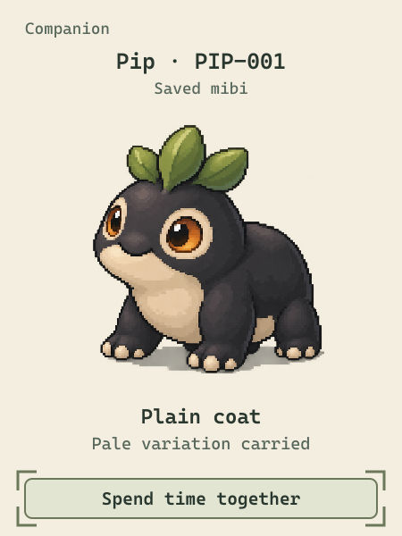

# Style guide

One look for every screen. Pictures lead; rules stay short. Per screen: [Companion screens](companion-screens.md) · [Station screens](station-screens.md).

**What the devices are for.** The **Station** is the home lab: a genome-editing machine that keeps small lives going. The player reads, shapes and grows life there, and lives with it. The **Companion** is the field device the player carries out to explore, gather and walk with their mibis. Both are the same maker's gear. Every screen on either shows something the player acts on or watches change; nothing is there for decoration. What each screen and element must communicate is in [What every screen communicates](#what-every-screen-communicates). This guide is binding: a builder or artist who needs something it doesn't cover parks the ticket, and never invents it.

## Miniature Lives on each device

Creatures are sculpted, rounded and tactile, lit from the top left, with expressive eyes, clear markings and saturated, playful colour. The **Companion** draws them in HiBit: detailed pixel art that keeps that volume at 450×600. The **Station** draws the same creature at full resolution with clean light and shading, keeping the same trait boundaries. The same individual survives both, and four-gray and paper.

<table><tr><td valign="top"> <em>Companion, 450×600 at 1×. Accepted appearance reference (creature only; layout and type not accepted).</em></td>
<td valign="top"> <em>Station, 1024×600. Accepted appearance reference (creature only; layout and type not accepted).</em></td></tr></table>

## The Companion

<table><tr><td valign="top"> <em>companion-map-hands: the north star for the map. Approved concept, generated; a reference, not a master.</em></td>
<td valign="top"> <em>companion-storm: the north star for a place. Approved concept, generated. The tree is not shelter.</em></td></tr></table>

- **Palette:** the Companion's 8-bit indexed colour, up to 256 entries in per-biome sets, built on the kit's ramps (cool and warm neutrals, grass, teal, blue, violet, red, orange, yellow, pink, white; values in [ui-kit §2](../proposals/ui-kit.md#2-the-kit)). Nothing off palette.
- **Light:** one light, from the top left. Shade in three or four steps of one ramp. Shadows lean cool, highlights warm.
- **Outline:** 1 px in the darkest step of the part's own ramp, never black; one step lighter on the lit side. Touching parts get a contact shade, not a line.
- **No alpha,** no anti-aliasing, no gradients. Blends are palette tables (dark, light, veil, fade) or the 4×4 Bayer dither. Nothing else.
- **Type:** Mibi 7×9, 2× minimum (14 px caps), 3× for titles. Never 1×.
- **Frame:** HUD 32 · view 532 · bottom line 36. 4 px unit, 6–8 px margins, groups 8 px apart.
- **Shown at 1:1** or a whole-number multiple of 450×600, never a fractional scale.
- **Figures only as prices and counts,** each beside its icon. Everything else is said in play language or shown as a mark.
- **Tokens:** HiBit, never flat blobs. Rounded volume, catch-lit eyes, markings readable at a glance. The pawn and every mibi read in sun, storm, fog and veil; storm and veil never darken them.
- **Weather:** unexplored land is a lavender-grey cloud bank with volume and a lit rim; a fog bank is pale and washed out, never lavender; rain is one clean diagonal sheet.
- Take mood, light and the scale of signs and pawn from the concepts. Their strings and HUD details are not specs.

## The Station

<table><tr><td valign="top"> <em>station-research-hands: the quality bar (clean light, real shading, a lit subject). Approved concept, generated; too simple in content.</em></td>
<td valign="top"> <em>companion-resident-home: the warmth the living window carries, drawn at Station resolution. Approved concept, generated.</em></td></tr></table>

- **1024×600, used to the full.** Native resolution everywhere. Never a scaled-up Companion screen or upscaled tokens.
- **Painted light on the painted layer:** one key light from the top left, soft cast shadows, correct form shading, painted gradients. No dither bands and no flat fills in a painting.
- **Device plates for modules, cards, the strip and the namer (fix 2):** Home's modules, Habitat's card and modules, the strip and its tile wells, the namer, the Probe's two modules and Compare's two pages are plates cut from the housing (`plate-device-*`, `plate-well-*`), placed 1:1 on the painted layer, never a fill. No plate picture, no plate.
- **Flat panels on the art layer:** the device's panels (bars, panels, panes, tabs and rings) are flat fills with one bevel of light and 1 px hairlines, never dithered and never painted. The layers are in [Station screens, Palette and layers](station-screens.md#palette-and-layers).
- **Field gear that keeps life going.** The Station is the Companion's sibling, made by the same maker; both dock into the Caddy. The screen is the Station's own face, never a picture of a room with a device in it.
- **A lab, a genome-editing machine.** The Station is a lab, never a desk. Its research screens are advanced research and crafting benches where you edit life: instruments of the lab, not a craftsman's workbench. Paper, slips, tags and notes appear only in the Library. Every other screen shows its information on the machine: its displays, lamps, readouts and moving parts. Anything that changes with the player's input or with time is on the device's own display, never paper, print or a tag. Paper is only for what never changes, and only in the Library.
- **Rugged, matte, handled.** Sage and sand housing, dark rubber, screws, engraved marks; powder-coat, rubber, moulded polymer, canvas, braided hose. Inside the frame, dark matte slate panels and cream type; orange for the action.
- **Cozy, tethered to its tech.** The equipment that keeps the life going is visible and works for it: feed lines, vents, misters, small gauges, grow lamps. Cozy, never clinical, never hidden.
- **The vivarium is the most alive thing on the screen,** Miniature Lives in warm daylight, and the eye goes there first.
- **Never:** glowing HUDs, holograms, neon, chrome, polished glass, gloss, brushed metal, alien technology, sterile labs, a cabinet or display case, a cottage with no equipment, anything childish.
- **One test:** beside the Companion concept and the kit test, it reads as the same maker's field gear, working to keep something alive.
- **HiBit is allowed:** a fine pixel grain on creatures and world; chrome and type crisp.
- **1× grain, measured.** Cut each 1024×600 capture into the top bar (y 0–40), the stage (y 40–562) and the bottom line (y 562–600). In each region take 2×2 blocks at each of the four grid phases, counting only blocks whose 4×4 surround holds more than one colour. **G2** is the share of those blocks that are one colour, at the best phase. G2 of 0.60 or more is 2× rendering and fails; 0.40 or less is 1× grain; between the two, the region is judged by eye at 1×. Anti-aliased type is never block-uniform, so the bottom line's G2 is at most 0.40.
- **Type:** a smooth face, Inter (OFL), anti-aliased, with tabular figures. The Companion keeps the bitmap face; the two devices share colour roles, not a typeface.
- **Carry more** than the concept: keep its quality, fill the screen with the device and its life.

## Creatures on both devices

<table><tr><td valign="top"> <em>HiBit, 280×300 at 1×. Accepted.</em></td>
<td valign="top"> <em>Richer treatment, 300×310 at 1×. Accepted.</em></td>
<td valign="top"> <em>Juvenile, adult, elder. Approved concept, generated; the elder reads calm, not sad.</em></td></tr></table>

- Subject area: 280×300 on the Companion, 300×310 or larger on the Station. In the field, tokens keep the same parts at tile size (48 px).
- Same anatomy, pose language and light on both devices; only inherited traits differ between individuals.
- Draw only what is known. Unknown parts stay frosted, never guessed. Art never changes genes.
- Age reads from proportion and bearing. Elders are calm and dignified: eyes open, leaves held up.

Every mibi wears its **standard look**: the cloud painting made at Grow over the Station's control passes and derived down to the Companion and the token, with the rig placeholder shown until its painting arrives. What is reviewed is the **treatment** (the painting prompt's house rendering to this guide), the species pieces, the control contract and the test sets, not each individual. A **portrait**, earned by research and spent at a sitting, adds the scene, the full moving set, the postmark and the card; no person sees a player's painting or portrait before the player, so the pipeline's validation checks stand in for review there. A mibi's Companion picture, token and idle and walk frames are derived from its own Station painting, never painted small or made by hand for the individual; only the species pieces, such as the generic token for a silhouette not yet painted, are made by hand, once per species.

## Type and colour roles

| Role | Companion | Station |
| --- | --- | --- |
| Name, display | 3× | 4× (28 px caps) |
| Title | 3× (21 px caps) | 3× |
| Body, HUD, bottom line | 2× (14 px caps), cream on ink | Inter 16 px body and readouts, 20 px titles, 28 px names. One exception: on Pods the pod's name label under the dish is 20 px medium |
| Context | mist (N5) | mist on chrome |
| Confirm's verb · Call · ticking counter | orange O3 · teal T3 · yellow Y2 flash | the same hues |
| Warning | red R1 on paper | red, with a shape |
| Focus | orange corner brackets | a warm cream ring; the focused thing lifts |

Materials keep one shape on both devices: Energy a yellow bolt, Data a blue diamond, Essence a green drop. Text on art gets a 1 px dark shadow. Live text is never baked into art. Colour never carries meaning alone.

## Motion vocabulary

- **Companion, stepped frames:** idle 2 frames at 2 Hz; walk 3 frames, 150 ms a step; flame and crackle 2 frames at 4 Hz; water 2 Hz; Call ring 3 frames over 300 ms; slides 110–170 ms; counters +1 per 90 ms with a 260 ms flash.
- **Station, smooth and eased:** the living window moves all the time (breathing, routines, plants, water). The device's controls move only when something happens: doors, rails and lamps in 200–400 ms. Reveals (a frost wipe, a shell clearing) take about two seconds.
- **Both:** the first frame is the still state; nothing means something only by blinking; presses during a motion are consumed.

## What every screen communicates

The rules a picture must follow, on the Station and the Companion: what each component is for, how many words it may carry, what each mark means, and what feedback must tell the player. The looks that serve them are in the sections above and in [Station screens](station-screens.md) and [Companion screens](companion-screens.md). A screen passes only if every element earns its place against its screen's purpose.

### Components: what each must say

| Component | It exists to say | It must always show | It must never |
| --- | --- | --- | --- |
| **Decision panel** | "You are choosing between these futures" | One window per option, each **its outcome as a picture**; the option's name; its cost beside it; one consequence line (a loss in the loss colour) | Appear where there is no real decision (spend, commit, irreversible, a path). Show two options that look alike |
| **Card** (a reveal, a report) | "This is what just happened, or just arrived" | The thing itself as a picture (the mibi's part, the crate's contents); at most one plain line | Carry a list of sentences. Use jargon without a picture ("unflappable" alone) |
| **Display screen** (the genome screen, the bench's readouts) | "This is the machine's live reading of this mibi" | Live state that changes with the player's input or with time | Show anything that never changes (that belongs in the Library) |
| **Plate / pane** | "These things belong together" | Its contents inside its margins | Hold floating text, or exist with nothing to hold |
| **Tile** (a gene, a pod, a mibi) | "This one thing, and its state" | The thing as a picture; its state as a mark from section 6 | Carry words, beyond a name tag where the screen allows one |
| **Badge** (a place, a find, a species) | "Where / which" | A recognisable picture of the place or thing | Stand for an action |
| **Progress** (the ring) | "How far along, and how long" | The fill at the screen's scale; cuts where something will be revealed; the Incubator's minute count beside it | Use digits, except the Incubator's "ready in about n min" |
| **Genome marks** | "What this gene is doing, and what kind it is" (section 6) | One meaning per mark, the same everywhere | Draw data the frames don't have (the genome engineer verifies) |
| **Buttons and key hints** | "What this key does here" | ✓ with the verb, ← with where it leads, R with "look closer" where a detail exists | Show a ✓ cap when ✓ does nothing |

### The words budget

The most words each element may carry. Fewer is always allowed; a word that a picture already says is a word too many.

#### Station

| Element | Words, at most | Notes |
| --- | --- | --- |
| Top bar | the screen's title (1–2 words) | Supplies are numbers beside their icons |
| Bottom line, action | the verb (up to 4 words) + price icons | "Grow it", "Open the bay", "Look at the new pods" |
| Bottom line, context | 6 words | The one fact the screen can't draw ("Coat stays a surprise") |
| Bottom line, notice | 5 words | What needs you, from the return signals |
| Decision panel window | option name (3 words) + one consequence line (8 words) | No other words in a window |
| Reveal card | "Revealed" + "{Trait}: {plain words}" (8 words in all) | The trait's plain words: what the animal looks like or does, never the look's bare name for a doing |
| Ribbon (an event) | 5 words | "The Companion is home" |
| Genome screen | the chapter names only (one word each) | Letters and rules only in the R detail |
| Tiles, badges, marks, the bay, crates, progress | **0** | The picture is the meaning |
| Name tags | the name | |
| The Library | its own book pages, outside this budget | Paper lives only in the Library |

#### Companion

| Element | Words, at most | Notes |
| --- | --- | --- |
| HUD | 0, except numbers beside icons | |
| Bottom line, action | 3 words + cost | Smaller screen: shorter verbs ("Dig", "Call", "End trip") |
| Bottom line, context | 5 words | |
| Message box | 2 short lines | One note, which stays until the next action |
| Cards (expedition kind, partner) | a name (2 words) + one line (6 words) | |

Numbers appear only as prices, supplies and counts beside their icon, and as the Incubator's minute count. Never as progress, chances, rarity or percentages.

### Marks: one meaning each, on both devices

1. **No meaning rides on a tiny glyph or an unexplained colour.** A mark that carries meaning is drawn at the legible size the art director sets, and has a distinct shape. If a player needs a legend to read it, it fails.
2. **One mark, one meaning, everywhere.** The register below is binding on the Station and the Companion. A new mark, or a new meaning for an old one, comes back to the game designer first.
3. **Draw only what is known.** Unknown is frost, never a guess. A mark never shows data the game doesn't hold, or promises an effect that isn't designed.

| Meaning | The mark | Where |
| --- | --- | --- |
| Changed by you | Lit, with the notch | Genome, drums or tiles |
| Still a surprise (unread, unknown) | Frost | Genome, founder, pods, chapters |
| Something new here (where, never what) | The four-point glint | Pods, chapters (per chapter), the map |
| A piece of your wish | The four-point glint, lit in the wish's yellow | Genome (when the founder shows it), drum faces, forecasts |
| New to your field guide | The cream triangle | Genome, reveals |
| Clash (won't build) | Red rim, on each trait in the set | Genome, drums |
| Only breeding changes it | Joined rings, with the line toward the Cross | Genome, chapter pages |
| It changes where it goes | Step marks with the place badge | Genome, vivarium up close |
| Asleep behind a switch | Dark behind the gate bar | Genome |
| Sealed, opens with a find | The find's picture (crystal, pearl, shard) | Genome, chapter pages |
| Needs you | Amber lamp: pulsing = something new to see; steady = ready to act | Home's modules, Idle tags |
| Fills with time | The ring | Incubator, Home, Idle, the portrait crate |
| Energy / Data / Essence | Bolt / diamond / drop (cell, cartridge, vial as objects) | Everywhere |

### Feedback

- **A press that acts** shows its result where the eye is, in the same beat. A turned gene changes the founder; a read clears its frost; a spend ticks its counter.
- **A refusal is never silent.** The thing that can't act answers with its own reason mark (the line to the Cross, the steps and badge, the lock), once. There is no plate and no sound unless the motion vocabulary give one.
- **A spend is never silent.** No key spends without the price having been on screen first. A large or irreversible spend goes through a panel.
- **A jump is announced:** the panel's choice names the destination, or the arrival line names it after.
- **Reveals are events.** A read, a clearing, a hatch and an arrival each play as a short moment, skippable with any key, never eating presses afterwards.
- **The dock and the undock** play across the three devices in step: a short show, then one real choice ([Dock and arrival](station-screens.md#dock-and-arrival)).

### Using this guide

- Every visual or screen ticket cites the sections it follows.
- A reviewer judges against those sections and the ticket's acceptance tests, among the neighbouring screens.
- Anything not covered is parked: looks to the art director, what something must communicate to the game designer. Nobody fills a gap with their own invention.

## What every screen and piece meets

The rules every screen, master and painting meets before it is shown. The looks they hold to are the sections above, [Station screens](station-screens.md), [Station layouts](station-layouts.md) and [Companion screens](companion-screens.md); this section adds what those do not say.

### Judged against its concept

- A screen is judged beside its accepted concept candidate, at device size and 1× (1024×600 or 450×600), on a true-size screen. It reads as that concept with the live text on it.
- It meets its own entry in [Station screens](station-screens.md) or [Companion screens](companion-screens.md): what it reads first, within a second, and every line of its "Pass when" list.

### Masters

- Every master starts from the screen's accepted concept candidate.
- Station masters are painted; Companion masters are hand-pixelled on the 48 ramps and generated pixels never ship, except a mibi's own pictures (Mibi paintings, below).
- Accepted assets are placed, never regenerated or redrawn: Pip, and the genome stamp from the stamp module.
- A master comes as its layered source and its 1× exports, each with its hash.
- A master holds no text and no figures. Each text slot fits the screen's strings as [Station layouts](station-layouts.md) or [Companion screens](companion-screens.md) and the string table give them, at their longest, at the guide's sizes (Station: Inter 16, 20 and 28 px; Companion: Mibi 7×9 at 2× and 3×) without clipping.
- A master gives one slice per state the screen draws. A state is its own slice; the build never recolours or tints art.

### Placed, never drawn

- Art is made by artists and placed by the build, 1:1, at whole pixels. Engineers do not draw: no code-drawn screen, sprite, scene or effect is art.
- The face composes only palette geometry: rectangles, 1 px hairlines and bevels, the focus ring, and the composed line pictures of [lvgl-switch.md §2.2](../proposals/lvgl-switch.md) (exact palette colours, no anti-aliasing, no opacity).
- A placeholder stands only where no master exists yet. It is registered in the asset manifest at its exact size, with `status: placeholder` and the master it waits for.
- A slot with neither a master nor a placeholder is registered with `status: empty` at its exact size and draws nothing. The layout does not move when the slot fills.

### Mibi paintings

How a mibi's painting is made is in the [art pipeline](../proposals/art-pipeline.md) and [the Grow service](../../prototypes/workbench/grow/README.md). Every painting meets these:

- One house rendering for every species: the painting prompt's recipe (light, shading, value-only contour, the house eye, framing, ground). Species notes say only what differs. No species reference image is sent.
- A naturalist's study of a small living animal, never a vinyl collectible.
- Inside the cute envelope, rules E1 to E9 ([workbench](../../prototypes/workbench/README.md)). No part is added, moved or recoloured from the controls.
- The controls come from the genome, in three-quarter and side views. The painting is the same individual as its controls and shows only what is known.
- Validation checks the silhouette, every part, the slot colours and the markings inside their fields. A painting that fails gets one named retry; after that the rig placeholder stands.
- The small sizes are derived from the Station painting, never painted small: the 280×300 Companion resident, the 48 px token, and the idle and walk frames.
- A painting is never regenerated silently. The painter's id is part of its cache key, and nothing hidden is carried in the manifest or the controls.
- Each species' pieces (faces and materials, with the generic token for a silhouette not yet met) are painted once per species, never per mibi.

### Figures in documents

- Every figure has a caption that says what it is: concept, generated, master, placeholder, wireframe or diagram.

## The Loika, type, grain and tile size

1. **The Loika** is Pip as in the approved art: charcoal, cream belly, orange eyes, three-leaf crest. The lilac long-eared token is retired.
2. **Station type** is a smooth face, Inter, anti-aliased.
3. **Pixel indication on the Station:** a fine grain on creatures and world; chrome and type crisp.
4. **Companion tile size:** 48 px, about 9 across and 11 down; the camera keeps the pawn in the middle third.
