# Style guide

> **Provisional.** This is the current implementation reference for the screens as built. It follows the prototypes as they iterate, and any newer direction for the screens overrides it. The general look and feel it serves is the [art direction](../art-direction.md).

**The reference builders and artists follow for how the Station and the Companion look.** A builder or artist with a visual ticket finds the look here and invents nothing. If something they need is not here, they stop and park the ticket to the art director with the exact gap ([§11](#11-how-to-use-it)).

**Who wrote it.**
- The art director wrote the visuals: palette, materials, light, components, type, icons and layout.
- The game designer wrote what each screen and element must communicate: what the devices are for (§1), the purpose sentences (§8) and §10 (components, the words budget, the marks register, feedback).
- The creative director signs it as the UI and art gate, and the game designer signs the game design gate.

**This file, then:**
- [Station screens](station-screens.md) and [Companion screens](companion-screens.md) give each screen's intent, look and do and don't.
- [Appendix: Station layouts](station-layouts.md) gives the pixel tables. It serves this guide: where the appendix and this guide disagree on a look, this guide wins and the appendix is fixed.

Every rule below has a plate in [`plates/`](plates/): the do on the left and the don't on the right, at 1×, made by [`plates/make-plates.py`](plates/make-plates.py). The plate's caption says what each side is: a capture, a signed slice, an approved concept or a diagram.

---

## 1. The look in one page

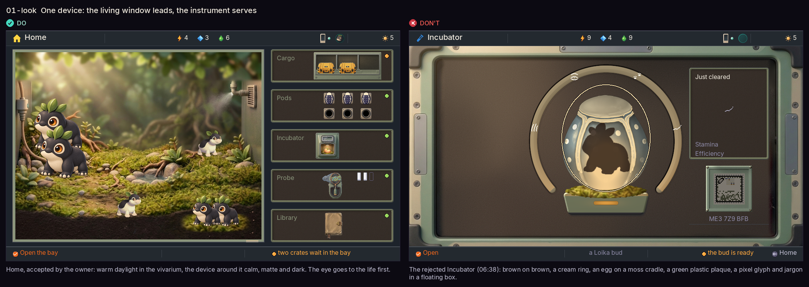

**What the devices are for.** The **Station** is the home lab: a genome-editing machine that keeps small lives going. The player reads, shapes and grows life there, and lives with it. The **Companion** is the field device the player carries out to explore, gather and walk with their mibis. Both are the same maker's gear. Every screen on either shows something the player acts on or watches change; nothing is there for decoration. What each screen and element must communicate is in [What every screen communicates](#10-what-every-screen-communicates). This guide is binding: a builder or artist who needs something it doesn't cover parks the ticket, and never invents it. *(game designer)*

Both devices are rugged, matte field gear: sage powder-coat, dark rubber and screws. Neither is a toy, a hologram or a cabinet.

**How they relate to Miniature Lives.**
- Miniature Lives is the look of the life itself: sculpted, rounded, tactile creatures, lit from the top left, with expressive eyes and saturated, playful colour ([art direction](../art-direction.md)).
- The devices exist to show that life. On the Station the device is quiet: dark matte slate displays, a few light words and light only where it does work. The life is the brightest, warmest and most detailed thing on every screen.
- The Companion draws the same creatures in HiBit pixels. The Station draws them painted at full resolution.

**The three sentences every screen obeys.**
1. **The life leads.** The creature, pod or place is the subject: big, lit and grounded. The device frames it and never competes with it.
2. **The machine shows what changes.** Anything that changes with input or time, or that the player acts on, is on the machine's own display, lamps or moving parts. Paper, tags and labels may appear anywhere if they never change while on screen; they are never an interactive part of the device.
3. **Pictures before words.** An outcome, a state or a meaning is a picture or a sculpted mark. Words name things; they never explain them.

**Why the rejected Incubator, Cargo report and Return panel failed** (plate 01, right). They broke all three sentences:
- brown on brown and cream panels instead of the display's slate;
- an egg on a moss cushion instead of an instrument working on the player's pod;
- tiny glyphs, colour bars and jargon instead of pictures.

None of them read as Miniature Lives.

## 2. Palette

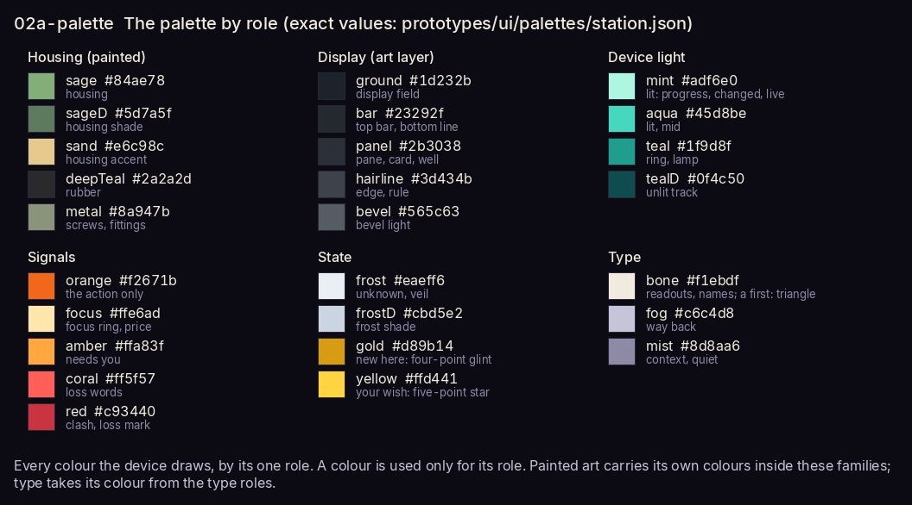

The exact values are in `prototypes/ui/palettes/station.json` (62 colours: the Companion's 48, then the instrument's 14). Each colour has one role, given below; a colour is never used outside its role.

| Layer | Role | Colour | Value |
| --- | --- | --- | --- |
| **Housing** (painted) | the device's body and frame | `sage` | #84ae78 |
| | housing shade | `sageD` | #5d7a5f |
| | housing accent: engraved marks, worn edges | `sand` | #e6c98c |
| | rubber: bumpers, bezel, seals | `deepTeal` | #2a2a2d |
| | screws and fittings | `metal` | #8a947b |
| **Display** (art layer) | the display field: the stage's ground behind every instrument | `ground` | #1d232b |
| | the top bar and the bottom line | `bar` | #23292f |
| | a pane, a card, a panel | `panel` | #2b3038 |
| | an edge, a rule | `hairline` | #3d434b |
| | the bevel's light, top and left | `bevel` | #565c63 |
| **Device light** | lit: progress, changed, live readouts, the link lamp | `mint` | #adf6e0 |
| | lit, mid step | `aqua` | #45d8be |
| | rings and lamps at rest | `teal` | #1f9d8f |
| | an unlit track | `tealD` | #0f4c50 |
| **Action** | the ✓ cap and Confirm's verb, nothing else | `orange` | #f2671b |
| **Signals** | the focus ring, prices | `focus` | #ffe6ad |
| | needs you: the notice and its lamp | `amber` | #ffa83f |
| | loss words ("Gone for good.") | `coral` | #ff5f57 |
| | a clash or loss mark, always with its cross | `red` | #c93440 |
| **State** | unknown: frost, the veil | `frost`, `frostD`, `frostS` | #eaeff6, #cbd5e2, #a9b5c8 |
| | new here: the four-point glint | `gold` (lit centre `yellow`) | #d89b14, #ffd441 |
| | a piece of your wish: the five-point star | `yellow` (edge `gold`) | #ffd441, #d89b14 |
| | a first (new to your field guide): the triangle | `bone` | #f1ebdf |
| **Type** | readouts and names | `bone` | #f1ebdf |
| | the way back; the quiet line on a pane | `fog` | #c6c4d8 |
| | context; the quiet line on the field | `mist` | #8d8aa6 |

**Contrast, measured.**

| Pair | Ratio |
| --- | --- |
| `bone` on `panel` | 11.2 : 1 |
| `bone` on `ground` | 13.3 : 1 |
| `mint` on `ground` | 12.8 : 1 |
| `mist` on `ground` | 4.8 : 1 |
| `mist` on `panel` | 4.0 : 1 |
| `coral` on `panel` | 4.4 : 1 |
| `orange` on `bar` | 4.7 : 1 |
| `red` on `panel` | 2.6 : 1 |

Body type needs 4.5 : 1 or more, so:
- `mist` sits only on `ground` or `bar`; on a `panel` the quiet line is `fog`;
- `red` is never type;
- loss words are `coral` on `ground`.

**Painted art.** Painted art (the vivarium, creatures, pods, scenes, the housing) carries its own full colour. Its device parts stay in the housing family (sage, sand, rubber), and its life is the saturated Miniature Lives colour.

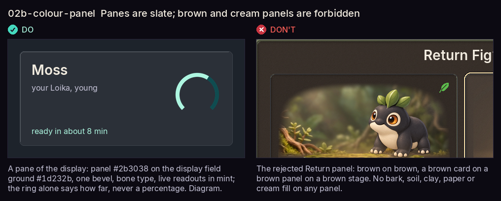 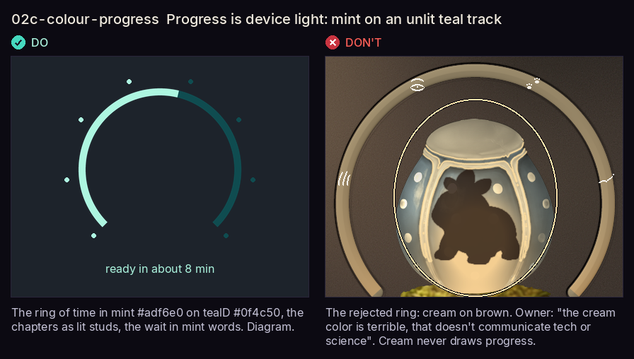

**Forbidden on the Station** (the Library's book keeps its warm paper and boards):
- **Brown on brown.** No `bark`, `soil`, `clay`, wood or leather as a panel, card, stage wall or field. The display field is `ground`, and the painted stage behind an instrument is the display's slate, never a brown wall.
- **Cream panels.** No `paper`, `cream` or `sand` fill on a panel, card, plate, slip or bar. Cream never draws progress.
- **Orange for anything but the action.** No orange decoration, bars or frames.
- **Unexplained colour.** No colour bars, pips or chips whose meaning needs a legend.
- **Off-palette art-layer colours.** No pure black (#000000), no neon, no gradient fills on panes, no evening-room greens or warm lamp pools on the art layer.

**The display is dark matte slate, and the life and the lit parts carry the colour.** No other display ground is used on the Station.

## 3. Materials and light

**The light.**
- **One key light from the top left**, as the vector (−0.55, −0.62, 0.56), warm daylight. Shadows lean cool; highlights are broad and soft.
- **Everything sits on something** (plate 03b): every object rests in a recess, on a floor or in a cradle, with a contact shadow where it touches. Nothing floats on an empty field.

| Material | What it is | How it is rendered | Plate |
| --- | --- | --- | --- |
| **Housing** | matte powder-coated sage polymer with sand engravings, dark rubber bumpers and bezel, recessed screws | painted, with soft broad highlights, a slight worn edge and no reflections. The housing frames the screen once: instrument screens have no inner riveted bezel, and their subject sits in a recess cut into the slate face, lit from the top left, with its contact shadow | 03a |
| **Display** | the matte slate screen of the machine: the stage field, panes, cards and the bars | flat on the art layer: one fill, a 1 px `hairline` edge and a 1 px `bevel` of light top and left. No texture, no dither, no gradient | 02b |
| **Panes and wells (no plate pictures)** | every section of the display | the one flat slate pane (§4 Pane) and the `ground` well (§4 Tile), drawn on the art layer. Painted plates are retired as pictures: `plate-device-*`, `plate-well-*`, the cargo report plate, `label-plate-cream` and the stamp case plaque. The stamp is drawn on the display | 02b, 03a (don't) |
| **Glass** | only where something lives or grows behind it: the vivarium window, the candling chamber | clear and matte-edged in a rubber bezel. You look into it, not at it. No gloss streaks and no reflections | 03d |
| **Light sources** | lamps, the candling light, the device's lit marks | cast light: a pool on what they light, no wider than it, at most 55 % over the field. No glow, bloom or halo on type, panes or edges | 03c |

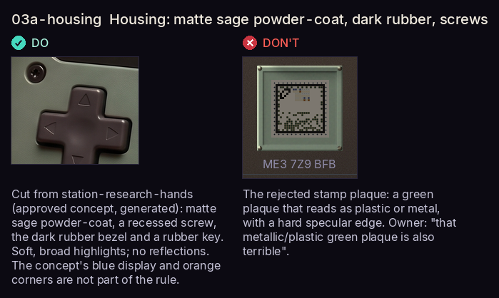 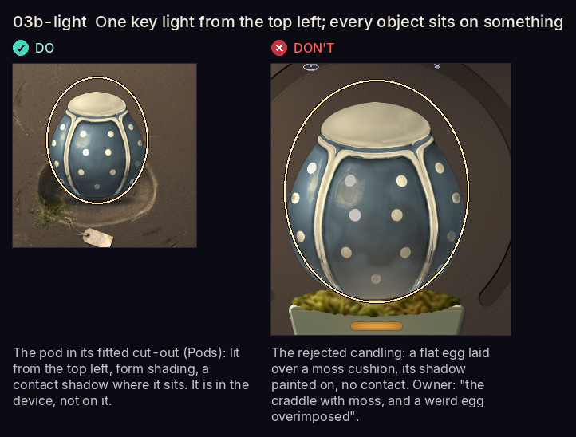

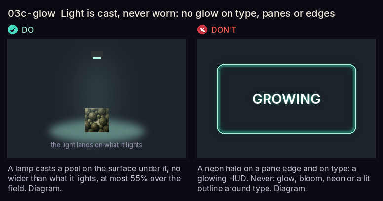 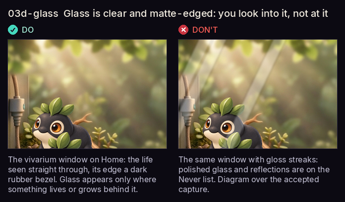

**Never:** glowing HUDs, holograms, neon, chrome, polished glass, gloss, brushed metal, alien technology, sterile labs, a cabinet or display case, a cottage with no equipment, equipment with no visible job (gauges that read nothing, pipes that feed nothing), anything childish.

## 4. Components

Every component is a part of the machine, named as a thing. A generic box fails. All sizes are 1× screen pixels on the 8 px grid ([§7](#7-layout)).

| Component | What it is | Size and margins | States | Plate |
| --- | --- | --- | --- | --- |
| **Top bar** | the device's status strip | 1024 × 40, `bar`; the room's mark 24 and the title 20 px at the left; Energy, Data and Essence centred; the Companion's glyph, lamp and faces; the world turn | counters tick with a 240 ms flash | 04b |
| **Bottom line** | the keys' legend | 1024 × 38, `bar`; ✓ cap + verb + price, the context, the notice, then ← cap + where it goes, right-aligned to x 1008 | the ✓ cap orange, dimmed (`mist`, the price figure `amber`), or absent when ✓ does nothing | 04b |
| **Key caps** | the device keys drawn as their legend | 16 × 16 discs: ✓ `orange`, ← `stone`; dimmed ✓ is its own slice | rest, dimmed | 04b |
| **Pane** | a section of the display | flat `panel`, radius 8, 1 px `hairline`, 1 px `bevel` top and left; 16 px inner margin; 8 px between related things, 16 between groups | rest; focused (the ring) | 02b |
| **Decision panel** | the machine asking you to choose between futures | panel 840 × 440 at (92, 80), radius 12, `panel`, over the stage veiled toward `ground`; title 20 px medium, the question, at most 4 words; option cards 776, 380 or 248 wide × 288, 16 apart | the card focused (the ring), dimmed (cannot pay), loss | 04a |
| **Option card** | one future | a well in `ground`, radius 8. The outcome scene painted in the window (w − 32 × 160 today; P1's larger windows once P1 is chosen); under it the verb at 20 px (at most 3 words), the costs or gains as icons with figures, one line at 16 px (at most 8 words), a loss in `coral` with the cross | as the panel | 04a |
| **Tile** | one thing you can pick (a mibi, a pod, a place) | well 64 × 64, radius 8, `ground` with the bevel; the thing painted inside at 48 | rest; focused (ring, lift 2 px); dimmed (veiled 60 %, still focusable); the corner marks at its top right: new here, your wish, a first (§6) | 04c |
| **Pod** | the player's pod, everywhere it appears | its species' own shell, painted once per species from the one pod renderer, the same picture on Pods, Create, the Incubator, Cargo and the panels; only its place's dust or moss varies. Never a generic egg | sealed, identified, candled (lit from below), cracking | 03b (don't) |
| **Badge** | a place, a species or a find | painted, 32 × 32 at least (48, 64 and 96 where the screen gives room), with its one word under it at 16 px | known; unknown (frost) | 04d |
| **Progress** | the machine's own measure of time or growth | a ring or track in `mint` on a `tealD` track, 8 to 10 px thick; the chapters as lit studs. No digits and no percentage: the ring alone says how far. The one minute count is the Incubator's, in its bottom line's context ("ready in about 8 min"), nowhere else | growing (k of n); ready (full, its lamp lit) | 02c |
| **Genome marks** | the genes | sizes only: the genome screen's tiers, 48, 40, 32 or 24 px, and no other; 48 is the largest. On a sparse species (S01: 4 rows, 1–2 genes) the spare room goes to the founder and to the rows' part crops, not to bigger genes. What each mark means is the register in [§10, Marks](#marks-one-meaning-each-on-both-devices), the one list; each state is its own silhouette that reads in four-gray. Provisional until the genome concept is chosen (T-20261016-166) | every register state | 04e |
| **Stamp** | the genome code | the label 120 × 120 drawn on the display, with its text id beside it at 16 px tabular in `bone`. Never a plaque or a white card, and never the brightest thing | — | 03a (don't) |
| **Lamps** | small status lights | 8 × 8 (the link: `mint` docked, `stone` away) and 12 × 12 (`amber`: needs you) | lit, unlit | — |
| **Focus ring** | where you are | `focus`, 2 px, 4 px out from the thing, radius = its radius + 4; the thing lifts 2 px | — | 04c |
| **Message plate** | the machine's short reply | a pane, at most 640 wide, centred on x 512, bottom at y 550; 16 px, at most 6 words; shown 4 s | — | — |
| **Materials** | Energy, Data, Essence | a yellow bolt, a blue diamond, a green drop: 16 px icons in the top bar and in prices, each with its figure. As physical things in Cargo: battery cells, cartridges and vials (48 × 64, 72 × 96) | — | 06a |
| **Corner marks** | new here; a piece of your wish; a first | exactly three, 12 to 16 px, at the top right of a host of 24 px or more, each its own shape: the four-point glint in `gold` (new here, 14 px), the five-point star in `yellow` (your wish, 16 px), the triangle in `bone` (a first, 12 px). They never carry meaning without their host | — | 04c, 06b |

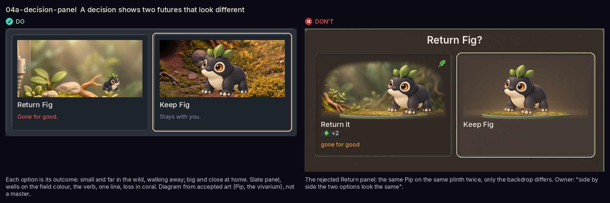

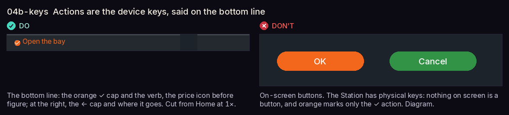 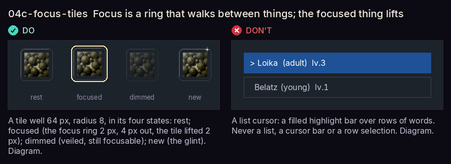

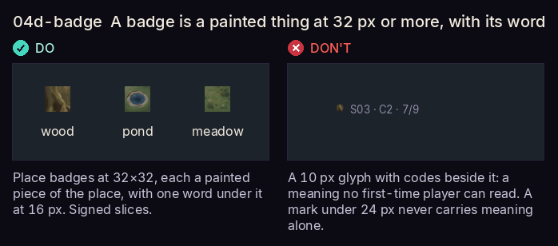 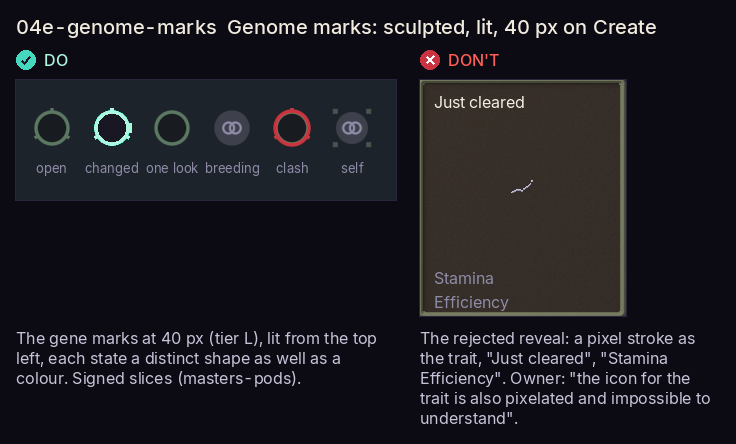

**Never:**
- on-screen buttons, since the keys are physical;
- list cursors or highlighted rows;
- floating text over art;
- a panel with a coloured border over another panel;
- a component without a name in the world.

## 5. Type and the words budget

**The faces.** The Station uses Inter (OFL), anti-aliased, with tabular figures. The Companion uses Mibi 7×9 at 2× or 3×, never 1× (plate 11b). The two devices share colour roles, not a typeface.

| Role | Station | Companion |
| --- | --- | --- |
| Name (a mibi, a pod, a species) | 28 px semibold, `bone` | 3× |
| Title (the screen, a heading, a panel's question, an option's verb) | 20 px medium, `bone` (verb on the bottom line `orange`) | 3× (21 px caps) |
| Readout, label, line | 16 px regular, `bone` | 2× (14 px caps), cream on ink |
| Quiet line | 16 px, `fog` on a pane, `mist` on the field | N5 mist |
| Exception | Pods: the pod's name under the dish, 20 px medium | — |

- **Placement.** Type sits on a pane, a bar or the field, inside a 16 px margin, never floating over a painting. Text that does sit on art gets a 1 px dark shadow. Live text is never baked into art.
- **Case.** Sentence case for sentences; chapter names exactly as the frames write them ("Coat", "Legs & tail"); the build never recases them. No capitals for emphasis.
- **Never:** 13 px or smaller, cream on cream, centred paragraphs, more than one weight in a line.

**The words budget** is the game designer's table in [§10, The words budget](#the-words-budget); type serves it. Where the appendix's older limits differ, §10 wins.

A picture or a mark the screen already uses beats a word. Stand-in text at the longest case is the design.

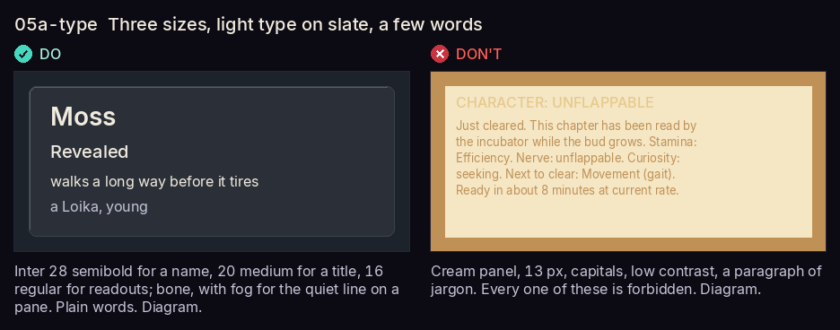 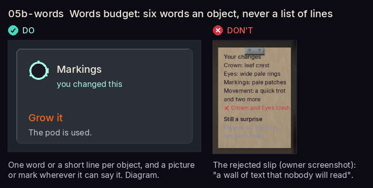

## 6. Icons and marks

- **Drawing style:** painted or sculpted like the life, lit from the top left, never a pixel glyph on the Station. A mark is a thing you recognise: the place itself, the mibi's face, the battery cell, the part of the body.
- **Minimum legible size:** a mark that carries meaning on its own is **24 px or more** on the Station (32 px for a badge). Under 24 px a mark only accompanies a word or a figure (the 16 px material icons beside their figures; the three corner marks, 12 to 16 px, on their host).
- **One meaning per mark** is the game designer's register in [§10, Marks](#marks-one-meaning-each-on-both-devices); this section sets how each is drawn.
- **No meaning rides on a tiny glyph or an unexplained colour.** Every state has a shape as well as a colour, and reads in four-gray (plate 06b). A mark that needs a legend fails.

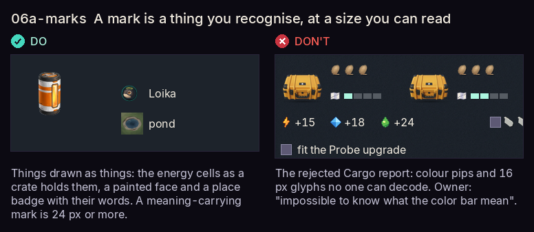 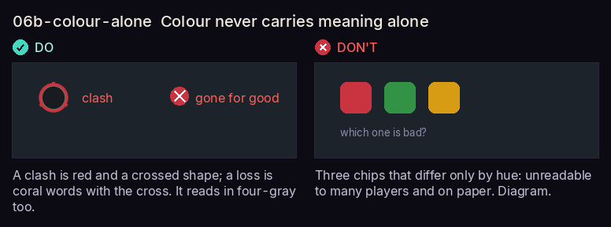

## 7. Layout

**The Station at 1024 × 600.**

| Region | Rule |
| --- | --- |
| Frame | top bar 0–40; stage 40–562 (522 px); bottom line 562–600 (38 px) |
| Grid | every region's x, y, w and h a multiple of 8; hairlines are the only exception |
| Margins | 16 px from the screen's left and right edges; stage content from y 48 to y 552 |
| Gaps | 8 px between related things, 16 between groups; no region touches another |
| Density | one subject per screen, taking the largest region (a third of the stage or more); supporting panes in one column or one row beside it; nothing in a region that has no job |

| Family | Density |
| --- | --- |
| Vivarium screens | the living window takes about two thirds |
| Instrument screens (Pods, Create, the Incubator, the Probe bench, Cargo) | the subject, a column of panes and nothing else |
| Panels | the panel over the veiled screen |
| Library | the open book |

**The Companion at 450 × 600.**
- Frame: HUD 32, view 532, bottom line 36.
- Spacing: 4 px unit, 6 to 8 px margins, groups 8 px apart; tiles 48 px.
- Scale: shown only at 1:1 or a whole multiple.

**Equivalents across the devices.**

| Station | Companion |
| --- | --- |
| the top bar | the HUD |
| the bottom line | the bottom line |
| the stage | the view |
| a pane | the message box |
| the decision panel | the menu's confirm |

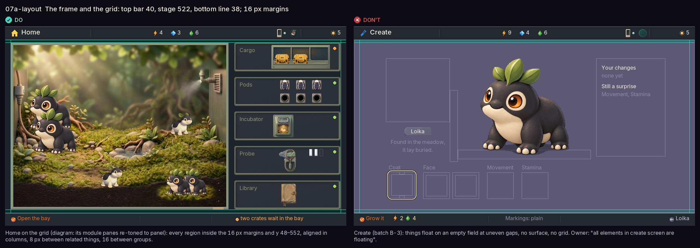

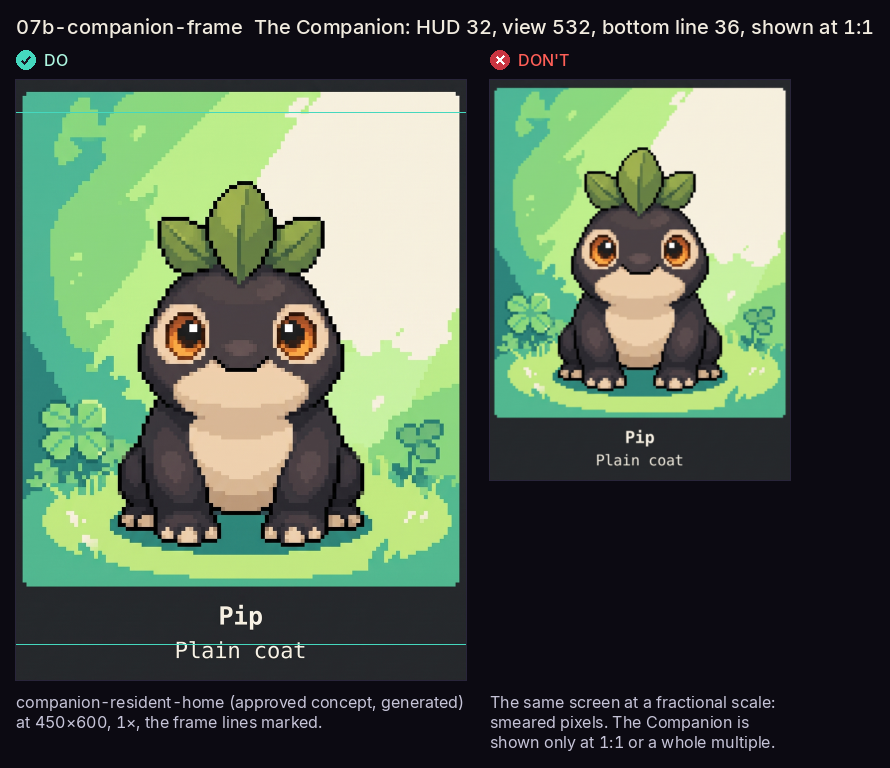

## 8. Screen families

**How to read the table.**
- **The purpose sentence and Communicates** are the game designer's (from `specs/purpose-briefs-b20261017-1.md` and the screens' purpose lines).
- **The direction** is the visual one, from the creative director's Station experience review (work-queue `specs/station-experience-review.md`); the order of redesign is there too.

**The Station.**

| Family | Purpose (one sentence) | Reads first | Direction | Plates |
| --- | --- | --- | --- | --- |
| **Home, Vivarium, Idle, a mibi up close** | The collection alive, kept by the device | the residents, then what needs you | Kept as accepted: the warm painted vivarium leads. The only change is their panes, which take the one slate pane (§4 Pane), so they lose only their brown | 01 |
| **Pods** (the sample case) | The pods you brought home, and what you know of each | the pod, lit in its fitted cut-out | The instrument family pass: the brown stage becomes the slate face, the inner riveted bezel goes, each pod sits in a recess with its contact shadow, the side panes are the slate pane. The pod's tag returns as the collector's label: only where it was found, written once; species, identification and knowledge are on the display pane. No floating labels, no line under 16 px | 03b, 10a |
| **Create** (the gene bench) | Shape your mibi's genes before it grows, and see what you changed | the founder, big and lit, then the changed marks | The genome is G2's rack with the body answering in light. The founder stands big and lit in a scanning recess of the slate face; beside it one column of rows is the machine's readout: each row headed by a crop of this founder's own part (or a doing's behaviour picture) and its one word, each gene a picture of the look it makes in a lit socket. Focusing a row or gene lights that part on the founder in `mint` scan light; a turn changes the founder in the same beat. The genes are the controls; the drum tray goes. No leader lines, no lilac field | 04e, 07a |
| **Incubator** (candling) | "The life you designed on Create is being grown here, and each time you look it is further along and you know more about it" | the candled pod, the founder forming inside | The candling chamber: the player's own pod (its species shell) held upright in a clamp, in a recess of the slate face, behind clear matte-edged glass. The machine's lamp shines up through the shell in device light, not cream; the known parts show in colour through the shell and the unknown stay frost; the light stays within the chamber. The `mint` ring with chapter studs, and "ready in about n min" in the bottom line. A cleared chapter lights its stud and shows the founder's own part large in the side pane (or a behaviour moment for a doing), with plain words. G2's genome compact in the side column; the stamp on the display. No moss, cushion, plinth, egg, glow or plaque | 02c, 03b, 03c, 03d |
| **Cargo** (the receiving bay) | "What your trip brought home arrives here: you open each crate and see what came back and where each thing goes" | the open crate and its contents | C2, crate by crate: the bay is the machine's slate face, floor and door. Each crate with its place badge (32 px or more) opens in turn by itself, skippable; ✓ takes everything at once. Its contents lie in front as things (pods as their shells, cells, cartridges, vials, finds). The materials fly into the top bar's counters, which tick; there are no store tanks. The pods go out through the Pods hatch; with no free well they wait sealed on the bay floor. No colour bars, rack, materials row, goal line, reach, world rows or cream ribbon plate | 06a |
| **Decision panels** | "At a real decision, the panel shows what each choice will do, as pictures that differ at a glance, and its cost" | two different outcome scenes | P1, two windows: the slate panel over the veiled screen; the title the question, at most 4 words at 20 px; each window its outcome painted full-bleed (the game designer's §6.1 scenes), the two differing in distance, size, direction, setting and light; under each the verb, the cost icons and one line of at most 8 words, a loss in `coral` with its cross. Two windows is the norm; a third only where the rules give three futures. This pane is the device's pane | 04a |
| **Probe bench** (the service dock) | Mend and upgrade the Probe the Companion carries | the Probe, upright in its dock | The instrument family pass (as Pods): slate face, no inner bezel, the Probe upright in its vertical cradle in a recess; Mend and Upgrade are slate panes. No loose tools, no gauges that read nothing | 03a |
| **Dock arrival** | The Companion is home, and its crates come through | the arrival | The bay's own light comes on (lamp to `mint`), and the crates slide in. Device light only, no fanfare graphics | 09a |
| **Cross and Wish** (the splicer) | Two parents and the child their genes forecast | the two parents and the bud | Create's rules: the subjects sculpted and lit, the genome on the display | 04e |
| **Library** (the field journal) | The species you have met, as a book | the open page | A worn botanical volume, warm paper and cloth. Its paper never changes while it is on screen | 10a |

**The Companion.**

| Family | Purpose | Direction |
| --- | --- | --- |
| **Map, Reach, Place, Start map** | Plan and walk the trip | HiBit at 48 px tiles, on per-biome palettes. Unexplored land is a lavender-grey cloud bank with a lit rim; fog is pale; rain is one diagonal sheet; the pawn and mibis always read. North stars: `companion-map-hands`, `companion-storm` |
| **Menu, Message box, Cargo, End expedition, Link states** | Say what happened and what to choose | the Companion frame; Mibi type at 2×; figures only as prices and counts beside their icon |
| **Companion mode, Care, the carried set** | Be with your mibi | the resident in HiBit at 280 × 300, catch-lit eyes, no flat blobs (plate 11a) |

What each Companion screen reads first is in its entry in [Companion screens](companion-screens.md). The per-screen detail is in [Station screens](station-screens.md) and [Companion screens](companion-screens.md). Each screen's entry starts with its intent, look and do and don't, then its rules.

## 9. Motion and feedback

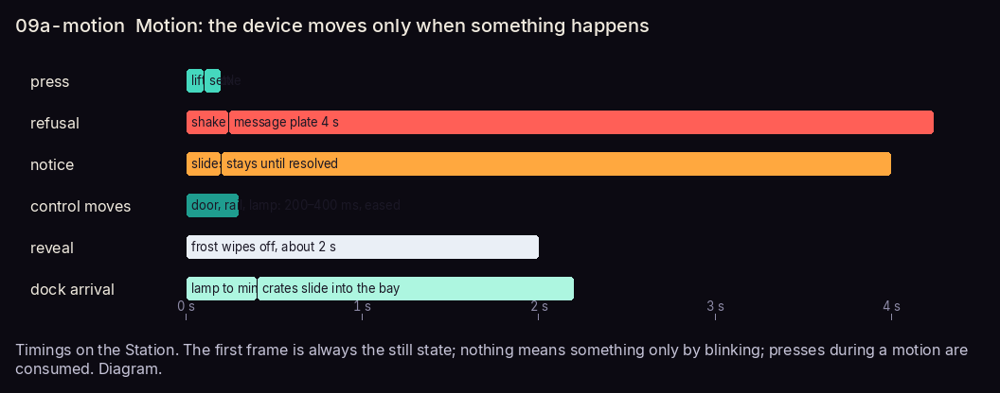

**The Station: smooth and eased.**
- The living window moves all the time (breathing, routines, plants, water). The device moves only when something happens.

| Event | What moves |
| --- | --- |
| **Press** | the focused thing lifts 2 px in 100 ms and settles |
| **Refusal** | two kinds. A turn or move that cannot act: the thing shakes 3 px twice in 240 ms and shows its own reason mark once, with no plate. A ✓ that cannot go ahead: the message plate, at most 6 words, for 4 s. Nothing is spent |
| **Notice** | its lamp lights `amber`, and the notice slides in from the right in 200 ms and stays until resolved |
| **Controls** | doors, rails and lamps move in 200 to 400 ms, eased |
| **Reveals** | a frost wipe or a shell clearing takes about 2 s; a first takes longer and gets the triangle |
| **Spending and gaining** | the counter ticks with a 240 ms flash |
| **Dock** | the link lamp turns `stone` to `mint`, the glyph fills and lifts 2 px for 200 ms, and the crates slide into the bay. Undocking reverses it |
| **Screen change** | the title and its mark cross-fade in 200 ms; the stage cuts. This is every room change from Home and every ← |
| **Pod carry** (a hand-off: Cargo → Pods → Create → the Incubator) | the player's own pod is carried across instead of cut: it lifts 2 px out of its place (120 ms), travels on a short shallow arc to where it sits on the next screen while the title cross-fades and the next stage fades in under it (480 ms, ease in-out), then lands with its contact shadow and a 2 px settle (120 ms). About 720 ms in all. Nothing else moves; any key lands it at once |
| **Hatch to the vivarium** | the young mibi steps out of the opened shell and walks into the vivarium on its own walk cycle (about 1.2 s), while the stage fades from the chamber to the vivarium under it; any key lands it at once |

**The Companion: stepped frames.**

| Motion | Frames |
| --- | --- |
| idle | 2 frames at 2 Hz |
| walk | 3 frames, 150 ms a step |
| flame | 2 frames at 4 Hz |
| water | 2 Hz |
| Call ring | 3 frames over 300 ms |
| slides | 110 to 170 ms |
| counters | +1 per 90 ms, with a 260 ms flash |

**Both devices.**
- The first frame is the still state.
- Nothing means something only by blinking.
- Presses during a motion are consumed.

## 10. What every screen communicates *(game designer)*

The rules a picture must follow, on the Station and the Companion: what each component is for, how many words it may carry, what each mark means, and what feedback must tell the player. The looks that serve them are in the sections above and in [Station screens](station-screens.md) and [Companion screens](companion-screens.md). A screen passes only if every element earns its place against its screen's purpose.

### Components: what each must say

*Plates: [04a](plates/04a-decision-panel.png) panel outcomes, [04c](plates/04c-focus-tiles.png) tiles, [04d](plates/04d-badge.png) badges, [02c](plates/02c-colour-progress.png) progress, [04b](plates/04b-keys.png) key hints.*

| Component | It exists to say | It must always show | It must never |
| --- | --- | --- | --- |
| **Decision panel** | "You are choosing between these futures" | One window per option, each **its outcome as a picture**; the option's name; its cost beside it; one consequence line (a loss in the loss colour) | Appear where there is no real decision (spend, commit, irreversible, a path). Show two options that look alike |
| **Card** (a reveal, a report) | "This is what just happened, or just arrived" | The thing itself as a picture (the mibi's part, the crate's contents); at most one plain line | Carry a list of sentences. Use jargon without a picture ("unflappable" alone) |
| **Display screen** (the genome screen, the bench's readouts) | "This is the machine's live reading of this mibi" | Live state that changes with the player's input or with time | Show anything that never changes (that belongs in the Library) |
| **Plate / pane** | "These things belong together" | Its contents inside its margins | Hold floating text, or exist with nothing to hold |
| **Tile** (a gene, a pod, a mibi) | "This one thing, and its state" | The thing as a picture; its state as a mark from section 6 | Carry words, beyond a name tag where the screen allows one |
| **Badge** (a place, a find, a species) | "Where / which" | A recognisable picture of the place or thing | Stand for an action |
| **Progress** (the ring) | "How far along, and how long" | The fill at the screen's scale; cuts where something will be revealed; the Incubator's minute count beside it | Use digits, except the Incubator's "ready in about n min" |
| **Genome marks** | "What this gene is doing, and what kind it is" (section 6) | One meaning per mark, the same everywhere | Draw data the frames don't have (the genome engineer verifies) |
| **Buttons and key hints** | "What this key does here" | ✓ with the verb, ← with where it leads, R with "look closer" where a detail exists | Show a ✓ cap when ✓ does nothing |

### The words budget

*Plate: [05b](plates/05b-words.png) the words budget; [05a](plates/05a-type.png) plain words, not jargon.*

The most words each element may carry. Fewer is always allowed; a word that a picture already says is a word too many.

#### Station

| Element | Words, at most | Notes |
| --- | --- | --- |
| Top bar | the screen's title (1–2 words) | Supplies are numbers beside their icons |
| Bottom line, action | the verb (up to 4 words) + price icons | "Grow it", "Open the bay", "Look at the new pods" |
| Bottom line, context | 6 words | The one fact the screen can't draw ("Coat stays a surprise") |
| Bottom line, notice | 5 words | What needs you, from the return signals |
| Decision panel window | option name (3 words) + one consequence line (8 words) | No other words in a window |
| Reveal card | "Revealed" + "{Trait}: {plain words}" (8 words in all) | The trait's plain words: what the animal looks like or does, never the look's bare name for a doing |
| Ribbon (an event) | 5 words | "The Companion is home" |
| Genome screen | the chapter names only (one word each) | Letters and rules only in the R detail |
| Tiles, badges, marks, the bay, crates, progress | **0** | The picture is the meaning |
| Name tags | the name | |
| The Library | its own book pages, outside this budget | Its pages are static paper |

#### Companion

| Element | Words, at most | Notes |
| --- | --- | --- |
| HUD | 0, except numbers beside icons | |
| Bottom line, action | 3 words + cost | Smaller screen: shorter verbs ("Dig", "Call", "End trip") |
| Bottom line, context | 5 words | |
| Message box | 2 short lines | One note, which stays until the next action |
| Cards (expedition kind, partner) | a name (2 words) + one line (6 words) | |

Numbers appear only as prices, supplies and counts beside their icon, and as the Incubator's minute count. Never as progress, chances, rarity or percentages.

### Marks: one meaning each, on both devices

*Plates: [04e](plates/04e-genome-marks.png) the genome marks, [06a](plates/06a-marks.png) marks you recognise, [06b](plates/06b-colour-alone.png) never colour alone.*

1. **No meaning rides on a tiny glyph or an unexplained colour.** A mark that carries meaning is drawn at the legible size the art director sets, and has a distinct shape. If a player needs a legend to read it, it fails.
2. **One mark, one meaning, everywhere.** The register below is binding on the Station and the Companion. A new mark, or a new meaning for an old one, comes back to the game designer first.
3. **Draw only what is known.** Unknown is frost, never a guess. A mark never shows data the game doesn't hold, or promises an effect that isn't designed.

| Meaning | The mark | Where |
| --- | --- | --- |
| Changed by you | Lit, with the notch | Genome, drums or tiles |
| Still a surprise (unread, unknown) | Frost | Genome, founder, pods, chapters |
| Something new here (where, never what) | The four-point glint, in `gold` | Pods, chapters (per chapter), the map |
| A piece of your wish | The five-point star, in the wish's yellow (its own silhouette, so it never relies on colour) | Genome (when the founder shows it), drum faces, forecasts |
| New to your field guide | The triangle, in `bone` | Genome, reveals |
| Clash (won't build) | Red rim, on each trait in the set | Genome, drums |
| Only breeding changes it | Joined rings, with the line toward the Cross | Genome, chapter pages |
| It changes where it goes | Step marks with the place badge | Genome, vivarium up close |
| Asleep behind a switch | Dark behind the gate bar | Genome |
| Sealed, opens with a find | The find's picture (crystal, pearl, shard) | Genome, chapter pages |
| Needs you | Amber lamp: pulsing = something new to see; steady = ready to act | Home's modules, Idle tags |
| Fills with time | The ring | Incubator, Home, Idle, the portrait crate |
| Energy / Data / Essence | Bolt / diamond / drop (cell, cartridge, vial as objects) | Everywhere |

### Feedback

*Plate: [09a](plates/09a-motion.png) the timings.*

- **A press that acts** shows its result where the eye is, in the same beat. A turned gene changes the founder; a read clears its frost; a spend ticks its counter.
- **A refusal is never silent.** The thing that can't act answers with its own reason mark (the line to the Cross, the steps and badge, the lock), once. A ✓ that cannot go ahead gets the message plate, at most 6 words; any other refusal gets its reason mark and the shake, with no plate (§9).
- **A spend is never silent.** No key spends without the price having been on screen first. A large or irreversible spend goes through a panel.
- **A jump is announced:** the panel's choice names the destination, or the arrival line names it after.
- **Reveals are events.** A read, a clearing, a hatch and an arrival each play as a short moment, skippable with any key, never eating presses afterwards.
- **The dock and the undock** play across the three devices in step: a short show, then one real choice ([Dock and arrival](station-screens.md#dock-and-arrival)).

## 11. How to use it

1. **Every visual ticket cites the sections it follows** (for example "§4 Tile, §6, §8 Pods"), and its proof is judged against them and their plates.
2. **Not covered means stop.** A missing look (colour, material, component, size, icon, motion) is parked to the art director; a missing meaning (what something must communicate, a words budget, a mark's meaning) to the game designer, each with the exact gap. Nobody fills a gap with their own invention.
3. **Changes are made here first.** A new component or rule is added to this guide, with its plate, before any art or build uses it. The guide and its plates change together.
4. **The gates judge against this guide** and each screen's acceptance lines, among the neighbouring screens in the device sheet, at 1×.

## 12. Plates

| Plate | Rule |
| --- | --- |
| [01-look](plates/01-look.png) | the life leads; the instrument serves |
| [02a-palette](plates/02a-palette.png) | the palette by role |
| [02b-colour-panel](plates/02b-colour-panel.png) | slate panes; no brown, no cream |
| [02c-colour-progress](plates/02c-colour-progress.png) | progress in `mint` on `tealD` |
| [03a-housing](plates/03a-housing.png) | matte sage housing; no plastic plaque |
| [03b-light](plates/03b-light.png) | top-left light; grounded |
| [03c-glow](plates/03c-glow.png) | cast light, never a glow |
| [03d-glass](plates/03d-glass.png) | clear, matte-edged glass |
| [04a-decision-panel](plates/04a-decision-panel.png) | two futures that look different |
| [04b-keys](plates/04b-keys.png) | keys on the bottom line; no on-screen buttons |
| [04c-focus-tiles](plates/04c-focus-tiles.png) | the ring and the tile states |
| [04d-badge](plates/04d-badge.png) | badges 32 px or more, with their word |
| [04e-genome-marks](plates/04e-genome-marks.png) | sculpted genome marks |
| [05a-type](plates/05a-type.png) | three sizes, light on slate |
| [05b-words](plates/05b-words.png) | the words budget |
| [06a-marks](plates/06a-marks.png) | recognisable marks at legible size |
| [06b-colour-alone](plates/06b-colour-alone.png) | colour never alone |
| [07a-layout](plates/07a-layout.png) | the frame and the grid |
| [07b-companion-frame](plates/07b-companion-frame.png) | the Companion's frame, at 1:1 |
| [09a-motion](plates/09a-motion.png) | motion timings |
| [10a-paper](plates/10a-paper.png) | paper is static, never status |
| [11a-companion-hibit](plates/11a-companion-hibit.png) | HiBit creatures |
| [11b-companion-type](plates/11b-companion-type.png) | Mibi type at 2× |

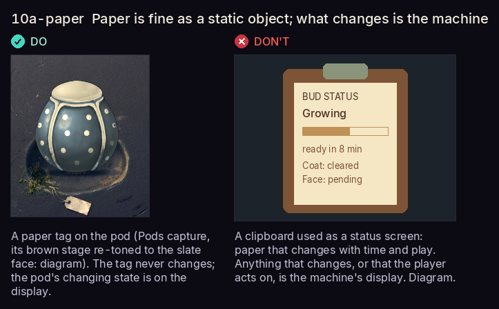 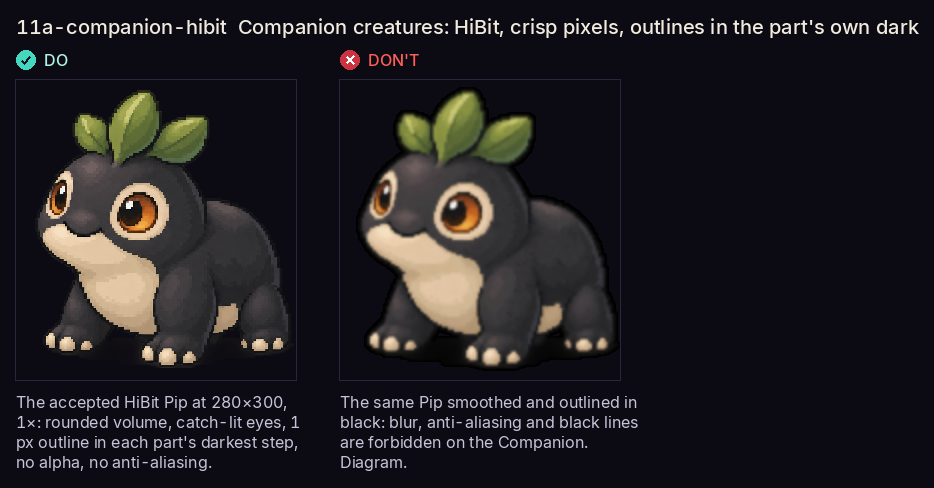 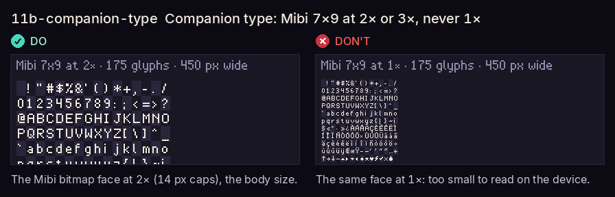

## 13. Companion drawing rules

<table><tr><td valign="top">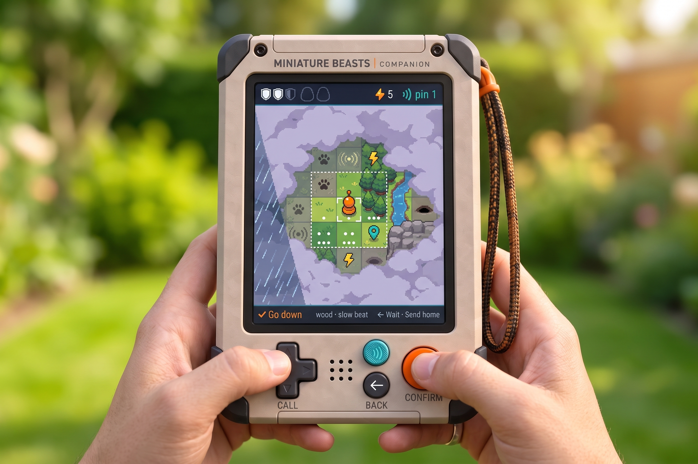 <em>companion-map-hands: the north star for the map. Approved concept, generated; a reference, not a master.</em></td>
<td valign="top">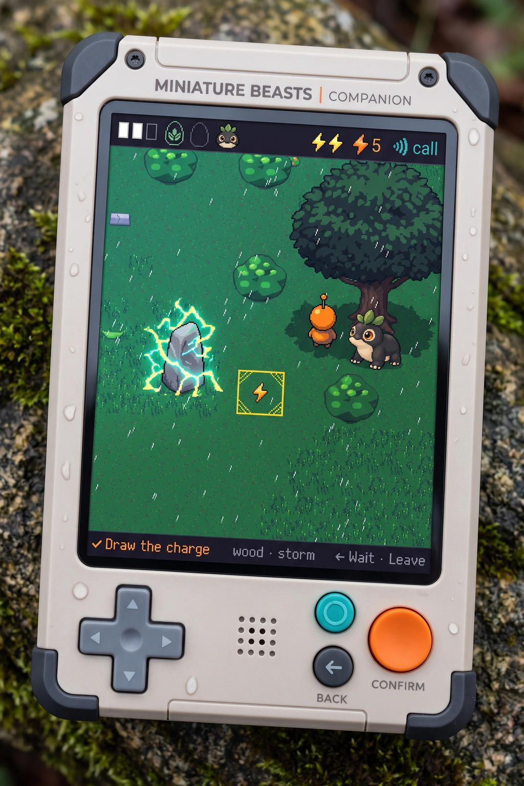 <em>companion-storm: the north star for a place. Approved concept, generated. The tree is not shelter.</em></td></tr></table>

- **Palette:** the Companion's 8-bit indexed colour, up to 256 entries in per-biome sets, built on the kit's ramps (cool and warm neutrals, grass, teal, blue, violet, red, orange, yellow, pink, white; values in [ui-kit §2](../proposals/ui-kit.md#2-the-kit)). Nothing off palette.
- **Light:** one light, from the top left. Shade in three or four steps of one ramp. Shadows lean cool, highlights warm.
- **Outline:** 1 px in the darkest step of the part's own ramp, never black; one step lighter on the lit side. Touching parts get a contact shade, not a line.
- **No alpha,** no anti-aliasing, no gradients. Blends are palette tables (dark, light, veil, fade) or the 4×4 Bayer dither. Nothing else.
- **Type:** Mibi 7×9, 2× minimum (14 px caps), 3× for titles. Never 1×.
- **Frame:** HUD 32 · view 532 · bottom line 36. 4 px unit, 6–8 px margins, groups 8 px apart.
- **Shown at 1:1** or a whole-number multiple of 450×600, never a fractional scale.
- **Figures only as prices and counts,** each beside its icon. Everything else is said in play language or shown as a mark.
- **Tokens:** HiBit, never flat blobs. Rounded volume, catch-lit eyes, markings readable at a glance. The pawn and every mibi read in sun, storm, fog and veil; storm and veil never darken them.
- **Weather:** unexplored land is a lavender-grey cloud bank with volume and a lit rim; a fog bank is pale and washed out, never lavender; rain is one clean diagonal sheet.
- Take mood, light and the scale of signs and pawn from the concepts. Their strings and HUD details are not specs.

## 14. Station drawing rules

<table><tr><td valign="top"> <em>station-research-hands: the quality bar (clean light, real shading, a lit subject). Approved concept, generated; too simple in content. The display is slate (§2); the concept's blue and orange are not the rule.</em></td>
<td valign="top"> <em>companion-resident-home: the warmth the living window carries, drawn at Station resolution. Approved concept, generated.</em></td></tr></table>

- **1024×600, used to the full.** Native resolution everywhere. Never a scaled-up Companion screen or upscaled tokens.
- **Painted light on the painted layer:** one key light from the top left, soft cast shadows, correct form shading, painted gradients. No dither bands and no flat fills in a painting.
- **One pane, no plate pictures:** Home's modules, the mibi's card and modules, the strip and its tile wells, the namer, the Probe bench's Mend and Upgrade, Compare's pages and every decision panel are the one flat slate pane (§4 Pane), with `ground` wells (§4 Tile). The painted plates (`plate-device-*`, `plate-well-*`, the cargo report plate, `label-plate-cream`, the stamp case plaque) are retired as pictures. The stamp is drawn on the display (§4 Stamp).
- **Flat panels on the art layer:** the device's panels (bars, panels, panes, tabs and rings) are flat fills with one bevel of light and 1 px hairlines, never dithered and never painted. The layers are in [Station screens, Palette and layers](station-screens.md#palette-and-layers).
- **Field gear that keeps life going.** The Station is the Companion's sibling, made by the same maker; both dock into the Caddy. The screen is the Station's own face, never a picture of a room with a device in it.
- **A lab, a genome-editing machine.** The Station is a lab, never a desk. Its research screens are advanced research and crafting benches where you edit life: instruments of the lab, not a craftsman's workbench. Information shows on the machine: its displays, lamps, readouts and moving parts. Anything that changes with the player's input or with time, or that the player acts on, is on the device's own display, never paper, print or a tag. Paper, tags and labels may appear anywhere if they never change while on screen; a clipboard never becomes a status screen (plate 10a). On Pods, the pod's tag is the collector's label tied to it, and carries only what is fixed from pickup: where it was found, as the place's mark or name, written once. The species, whether it is identified and what is known stay on the display pane. A tag never carries a state, a count or a mark that moves.
- **Rugged, matte, handled.** Sage and sand housing, dark rubber, screws, engraved marks; powder-coat, rubber, moulded polymer, canvas, braided hose. Inside the frame, dark matte slate panels and `bone` type; orange for the action only (§2).
- **Cozy, tethered to its tech.** The equipment that keeps the life going is visible and works for it: feed lines, vents, misters, small gauges, grow lamps. Cozy, never clinical, never hidden.
- **The vivarium is the most alive thing on the screen,** Miniature Lives in warm daylight, and the eye goes there first.
- **Never:** glowing HUDs, holograms, neon, chrome, polished glass, gloss, brushed metal, alien technology, sterile labs, a cabinet or display case, a cottage with no equipment, anything childish.
- **One test:** beside the Companion concept and the kit test, it reads as the same maker's field gear, working to keep something alive.
- **HiBit is allowed:** a fine pixel grain on creatures and world; chrome and type crisp.
- **1× grain, measured.** Cut each 1024×600 capture into the top bar (y 0–40), the stage (y 40–562) and the bottom line (y 562–600). In each region take 2×2 blocks at each of the four grid phases, counting only blocks whose 4×4 surround holds more than one colour. **G2** is the share of those blocks that are one colour, at the best phase. G2 of 0.60 or more is 2× rendering and fails; 0.40 or less is 1× grain; between the two, the region is judged by eye at 1×. Anti-aliased type is never block-uniform, so the bottom line's G2 is at most 0.40.
- **Type:** a smooth face, Inter (OFL), anti-aliased, with tabular figures. The Companion keeps the bitmap face; the two devices share colour roles, not a typeface.
- **Carry more** than the concept: keep its quality, fill the screen with the device and its life.

## 15. Creatures on both devices

<table><tr><td valign="top">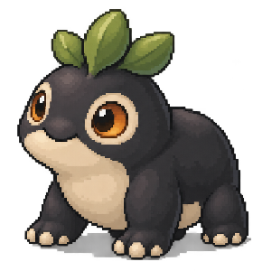 <em>HiBit, 280×300 at 1×. Accepted.</em></td>
<td valign="top">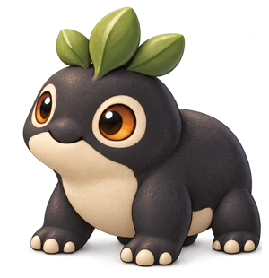 <em>Richer treatment, 300×310 at 1×. Accepted.</em></td>
<td valign="top"> <em>Juvenile, adult, elder. Approved concept, generated; the elder reads calm, not sad.</em></td></tr></table>

- Subject area: 280×300 on the Companion, 300×310 or larger on the Station. In the field, tokens keep the same parts at tile size (48 px).
- Same anatomy, pose language and light on both devices; only inherited traits differ between individuals.
- Draw only what is known. Unknown parts stay frosted, never guessed. Art never changes genes.
- Age reads from proportion and bearing. Elders are calm and dignified: eyes open, leaves held up.

Every mibi wears its **standard look**: the cloud painting made at Grow over the Station's control passes and derived down to the Companion and the token, with the rig placeholder shown until its painting arrives. What is reviewed is the **treatment** (the painting prompt's house rendering to this guide), the species pieces, the control contract and the test sets, not each individual. A **portrait**, earned by research and spent at a sitting, adds the scene, the full moving set, the postmark and the card; no person sees a player's painting or portrait before the player, so the pipeline's validation checks stand in for review there. A mibi's Companion picture, token and idle and walk frames are derived from its own Station painting, never painted small or made by hand for the individual; only the species pieces, such as the generic token for a silhouette not yet painted, are made by hand, once per species.

## 16. What every screen and piece meets

The rules every screen, master and painting meets before it is shown. The looks they hold to are the sections above, [Station screens](station-screens.md), [Station layouts](station-layouts.md) and [Companion screens](companion-screens.md); this section adds what those do not say.

### Judged against its concept

- A screen is judged beside its accepted concept candidate, at device size and 1× (1024×600 or 450×600), on a true-size screen. It reads as that concept with the live text on it.
- It meets its own entry in [Station screens](station-screens.md) or [Companion screens](companion-screens.md): what it reads first, within a second, and every line of its "Pass when" list.

### Masters

- Every master starts from the screen's accepted concept candidate.
- Station masters are painted; Companion masters are hand-pixelled on the 48 ramps and generated pixels never ship, except a mibi's own pictures (Mibi paintings, below).
- Accepted assets are placed, never regenerated or redrawn: Pip, and the genome stamp from the stamp module.
- A master comes as its layered source and its 1× exports, each with its hash.
- A master holds no text and no figures. Each text slot fits the screen's strings as [Station layouts](station-layouts.md) or [Companion screens](companion-screens.md) and the string table give them, at their longest, at the guide's sizes (Station: Inter 16, 20 and 28 px; Companion: Mibi 7×9 at 2× and 3×) without clipping.
- A master gives one slice per state the screen draws. A state is its own slice; the build never recolours or tints art.

### Placed, never drawn

- Art is made by artists and placed by the build, 1:1, at whole pixels. Engineers do not draw: no code-drawn screen, sprite, scene or effect is art.
- The face composes only palette geometry: rectangles, 1 px hairlines and bevels, the focus ring, and the composed line pictures of [lvgl-switch.md §2.2](../proposals/lvgl-switch.md) (exact palette colours, no anti-aliasing, no opacity).
- A placeholder stands only where no master exists yet. It is registered in the asset manifest at its exact size, with `status: placeholder` and the master it waits for.
- A slot with neither a master nor a placeholder is registered with `status: empty` at its exact size and draws nothing. The layout does not move when the slot fills.

### Mibi paintings

How a mibi's painting is made is in the [art pipeline](../proposals/art-pipeline.md) and [the Grow service](../../prototypes/workbench/grow/README.md). Every painting meets these:

- One house rendering for every species: the painting prompt's recipe (light, shading, value-only contour, the house eye, framing, ground). Species notes say only what differs. No species reference image is sent.
- A naturalist's study of a small living animal, never a vinyl collectible.
- Inside the cute envelope, rules E1 to E9 ([workbench](../../prototypes/workbench/README.md)). No part is added, moved or recoloured from the controls.
- The controls come from the genome, in three-quarter and side views. The painting is the same individual as its controls and shows only what is known.
- Validation checks the silhouette, every part, the slot colours and the markings inside their fields. A painting that fails gets one named retry; after that the rig placeholder stands.
- The small sizes are derived from the Station painting, never painted small: the 280×300 Companion resident, the 48 px token, and the idle and walk frames.
- A painting is never regenerated silently. The painter's id is part of its cache key, and nothing hidden is carried in the manifest or the controls.
- Each species' pieces (faces and materials, with the generic token for a silhouette not yet met) are painted once per species, never per mibi.

### Figures in documents

- Every figure has a caption that says what it is: concept, generated, master, placeholder, wireframe or diagram.

## 17. The Loika, type, grain and tile size

1. **The Loika** is Pip as in the approved art: charcoal, cream belly, orange eyes, three-leaf crest. The lilac long-eared token is retired.
2. **Station type** is a smooth face, Inter, anti-aliased.
3. **Pixel indication on the Station:** a fine grain on creatures and world; chrome and type crisp.
4. **Companion tile size:** 48 px, about 9 across and 11 down; the camera keeps the pawn in the middle third.
