# Station screens

1024×600 landscape, judged at 1×. The binding look is the [style guide](README.md): palette §2, materials and light §3, components §4, type and words §5, marks §6, layout §7, families §8, motion §9. Each screen below starts with its intent, its look and its do and don't; the rules under them follow, and where they disagree the block at the top wins. The Station is field gear that keeps small lives going: one device, one look, the vivarium at its heart. It is never a scaled-up Companion.

## The frame

- **Top bar, 40 px.** Where you are, what you hold, who is out, when: the room's mark and the screen's title at the left; Energy, Data and Essence centred, ticking when they change; the Companion's glyph and lamp with the face of the mibi out with it, then the world turn as a sun mark, at the right. Marks, not words, but for the title. The zones, rules and states are in [Station layouts, The frame](station-layouts.md#the-frame).
- **Stage, 522 px.** The instrument and its one living window.
- **Bottom line, 38 px.** The one action (the ✓ cap and the verb in orange, then the price) | the context (mist, the only part that shrinks) | the notice (amber, with its lamp) | the way back (the ← cap and where it leads, at the right edge). Read-only focus draws no ✓ cap. Every word is a slot filled to its zone's rule.
- **Focus.** The focus ring (`focus`, 2 px, 4 px out) walks between drawn things; the focused thing lifts 2 px. Never a list cursor ([style guide §4](README.md#4-components)).

## Keys and navigation

One navigation model for the whole Station: Home is the hub, every screen has one parent, and each key means one thing everywhere. The map is [nav-map.png](station-layouts/nav-map.png); the parents, the back words, the room keys and Home's pad order are in `prototypes/ui/specs/station/frame.json` (`navigation`).

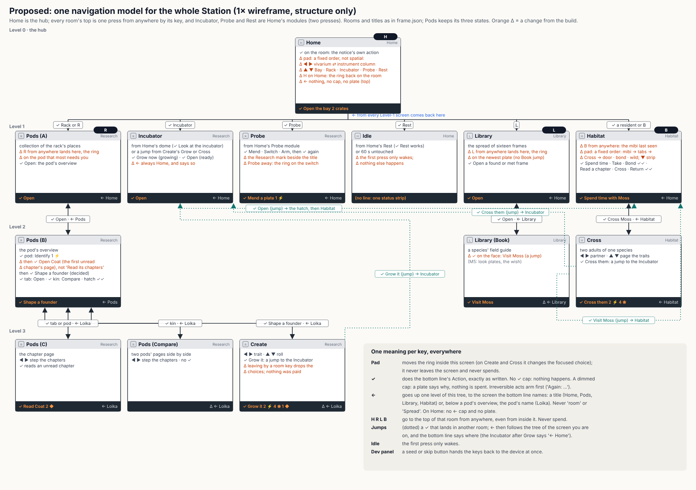

*The navigation map, 1× wireframe.*

| Key | Means, on every screen |
| --- | --- |
| **Pad** (◀ ▲ ▶ ▼) | Moves the ring inside this screen; on Create and Cross it changes the focused choice. It never leaves the screen and never spends |
| **✓** | Does the bottom line's action, exactly as written. No ✓ cap: nothing happens. A dimmed cap: a message plate says why, and nothing is spent. An act that cannot be undone arms first, and the line reads "Again: …" |
| **←** | Goes up one level, to the screen's parent in the tree, and the bottom line names it: a title (Home, Pods, Library, Vivarium) or, below a pod's overview, the pod's name ("Loika"). On Home there is no ← cap, and ← does nothing (no plate) |
| **Home, Research, Library, Vivarium** | Open the top of their room from anywhere, even from inside that room: Home with the ring on the room, Pods on its collection with the ring on the pod that most needs the player, the Library on its spread, the Vivarium on the mibi last seen. They never spend |

- **The tree.** Home is the top. Under Home: Pods (the collection), the Incubator, the Probe bench, Idle, the Library and the Vivarium. Under the collection: a pod's overview. Under the overview: its chapter page, Compare and Create. Under the Library: the Book. Under the vivarium, up close: Cross. The Incubator and the Probe bench are Home's modules (reached from Home's instrument column, ← Home) and keep the Research room's mark.
- **Stack navigation.** A ✓ that lands in another part of the tree is a jump: Grow it (Create) and Cross them (Cross) to the Incubator, Open (the Incubator) to the vivarium, up close, Visit (the Book) to the vivarium, up close. After a jump, ← goes to the parent of the screen you are on, never back along the way you came: the Incubator after Grow reads "← Home", the vivarium, up close, after a Book's Visit reads "← Home".
- **Home's pad.** A fixed order, not the nearest thing: ◀ ▶ cross between the vivarium's residents and the instrument column; ▲ ▼ walk the column, Bay, Rack, Incubator, Probe, Rest. The Home key on Home puts the ring back on the room, where ✓ does what needs you.
- **Idle.** The first press only wakes the screen; nothing else happens.
- **Leaving Create or Cross** by a room key drops the unpaid choices; coming back starts fresh.

## Species and mibi

The player always knows which level a screen is about. The Library, the Book and its guide are about the **species**, filled in by every pod and mibi the player has read. Pods, the vivarium up close and Cross show one individual, a **mibi** (a **pod** before it hatches), with its own stamp. On screen the species is "every", "a typical" or its name alone; the individual is "this" or "your". Never on screen: specimen, type, individual, critter, creature. Each level has a door to the other: the figure on Pods and the species word on the vivarium up close open the species' guide (`✓ Open the guide`, a jump); a name in the guide's "Carried by" opens that mibi in the vivarium, up close (`✓ Visit Fig`, a jump). The table and the numbers are in [Station layouts, The two levels](station-layouts.md#the-two-levels-species-and-mibi).

## The device and the life

| | The device | The vivarium |
| --- | --- | --- |
| Feels | rugged, handled, calm; working for the life | warm, soft, alive |
| Light | the same warm daylight from the top left, caught softly; nothing glows for show | the warm key light from the top left, by the time of day |
| Colour | sage and sand housing, dark rubber, dark matte slate panels, `bone` type, orange for the action only, small lamps in device light (`mint`, `amber`). Never brown panels or cream fills ([§2](README.md#2-palette)) | greens, warm earth, water, the creatures' own colours |
| Materials | powder-coat, rubber, moulded polymer, canvas, braided hose; paper only in the Library | plants, soil, stone, water, fur and leaf |
| Moves | the life-support works quietly (a mister, a lamp, a feed line); controls move when something happens | all the time |
| Words | a few per section | none |

Wireframes give layout only. The device above sets the materials of every screen. Read their windows as the chapter rail and pages ([research loop](../proposals/research-loop.md)), and their whorl as the stamp, the genome code.

## Palette and layers

The Station draws in three layers. The **art layer** is the device's panels (bars, panels, panes, hairlines, bevels, tabs, pips, lamps and the focus ring), the pixel art the build draws (material icons, the glint, the leaf timer, Shield plates), placeholders and the vivarium's frame; it uses only the Station palette's 62 colours (the Companion's 48 as the shared core, then the device's colours: dark matte slate panels, the sage and sand housing, dark rubber, the frost veil, the leaf timer's sage and the focus cream; roles and swatches in [ui-kit §2](../proposals/ui-kit.md#2-the-kit), numbers in `prototypes/ui/palettes/station.json`), is crisp and flat with one bevel of light, never dithered, and is checked at 0 off palette. The **painted layer** is every painted master and mibi painting: the vivarium's inside, the specimens, the tome and the device's painted objects; it is full colour with straight alpha, carries the painted light and the fine grain on creatures and world, and is off palette by design. The **type layer** is Inter, anti-aliased; each string takes its colour from a palette role (`bone` readouts, `mist` context, `amber` what needs you, `orange` Confirm's verb, `red` a clash), and its smoothed edges are off palette by design. The genome stamp is placed in its own colours from the stamp module, the same on screen, on paper and on the scan page. The art layer holds no wood, felt, evening-room greens or warm lamp pools; its only warm colours are signals: the focus ring's cream, the amber lamp and Confirm's orange.

## One device, one look

One device. Every section is a part of it, in the same materials and light. Home shows the vivarium in the central panel with the sections at the right; left alone, the vivarium fills the screen. A section takes the whole screen and goes from the whole down to one item; coming closer changes only how near you are. ← brings the vivarium back.

| Section | What it is on the device |
| --- | --- |
| **Vivarium** (Home, idle, one mibi up close) | The living world the device keeps; up close, a mibi at home, never a specimen on display |
| **Pods** | The sample case: pods in fitted, worn cut-outs, their names on the machine's display (paper is the Library's) |
| **Research** (Create, Cross and Wish, Probe bench) | The lab's advanced research and crafting benches, where you edit life: the gene bench (Create), the splicer (Cross and Wish), the Probe's service dock; what is under study in the device's light, its state on the machine's own displays and lamps |
| **Incubator** | The bridge between research and the vivarium: the player's own pod candled by an instrument of the machine, the founder showing through its shell in the device's light. No moss nest, no egg |
| **Library** | The field journal the device keeps: a worn botanical expedition volume |
| **Arrivals** | The Companion's cargo coming through from the Caddy into the bay |

The concept rounds named below (Home A-r3-a1, Pods PV-D-r3-a4) stand for layout and content only; their look is replaced by the Station concept board. Create is the gene bench and the Incubator is candling; their earlier rounds (CR-C2, IN-D-r1-a3, IN-C1) are retired as references.

<table><tr><td valign="top">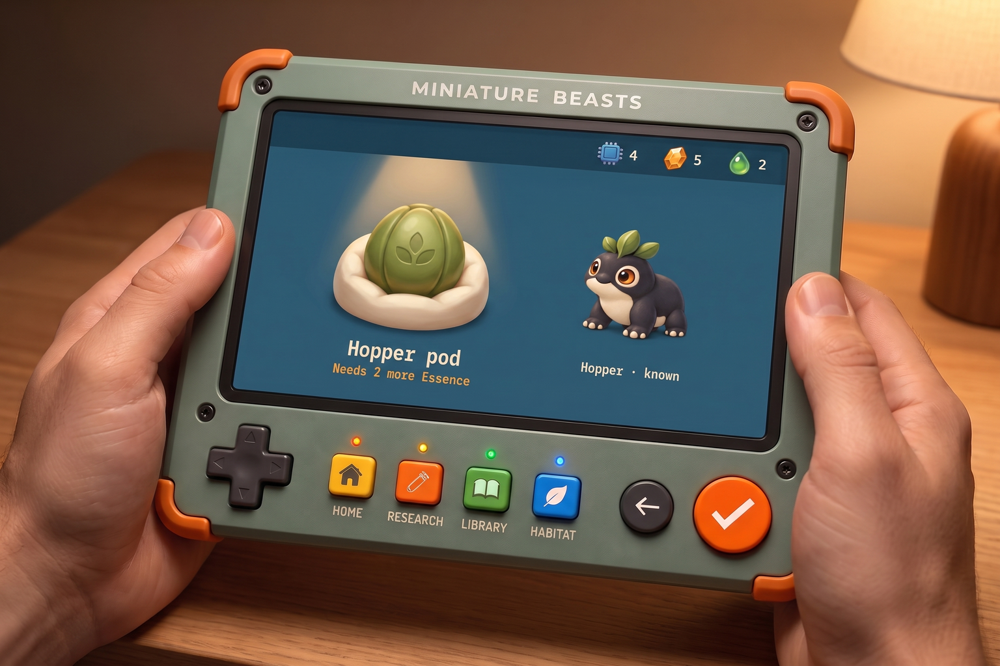 <em>station-research-hands: the quality bar. Concept, generated. Keep the light and shading; carry far more.</em></td>
<td valign="top">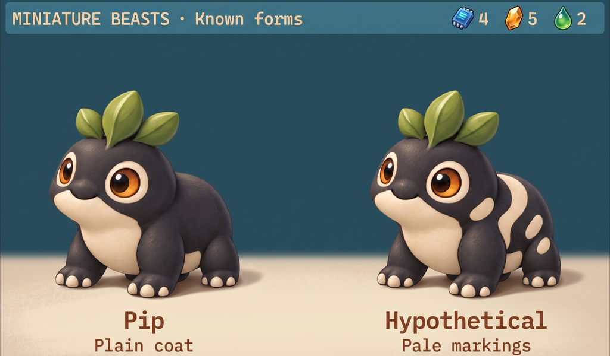 <em>station-known-forms: rich creatures at Station size. Concept, generated.</em></td></tr></table>

---

## Home

> **Intent.** The always-on view of the collection alive, kept by the device.
>
> **Look.** Accepted as built: the warm painted vivarium takes the left two thirds; the modules are slate panes holding their painted objects, in one column.
>
> **Do:** the vivarium the warmest, most detailed thing; module objects painted and lit, at their tile size or larger (01, 04c). **Don't:** a module that holds words instead of its object; a bright or warm module competing with the vivarium; any brown or cream module ground (02b).

**Vibe.** The device at rest: the vivarium in the central panel, the sections at the right.

**Purpose.** The always-on view: the collection alive, the equipment's state. **Reads first:** the residents, then whatever needs you (the bottom line's right part).

- **Living window.** The vivarium, the left two thirds (about 640×500): a lit glass habitat with plants, stones, water and a burrow. Residents in the rich treatment keep their species' routines. The with-you bed shows the one to three mibis with you, or a small Companion mark while they are away.
- **Instrument.** The right third, a column of five modules, each with a status lamp and one engraved word (Cargo, Pods, Incubator, Probe, Library): the bay where the crates arrive, the pod rack, the Incubator with its bud and leaves, the Probe and its Shield plates, and the Library's field journal.
- **Composition.** The vivarium's glass sits in a thin bezel; the modules align to one column with 16 px gaps. Nothing overlaps the vivarium.
- **Lively / quiet.** Lively: residents, plants, water, the bud's glow. Quiet: the modules; one lamp pulses slowly when its module needs you.
- **Light.** Inside the vivarium, the same light as Idle: the warm key light from the top left, by the time of day; even cool light on the chrome.
- **Palette.** Deep blue-teal chrome; the vivarium's greens and warm earth; amber only on the lamp that needs you.
- **Type.** Inter: the title 20 px medium; the module words and the name plate 16 px.
- **Chrome.** `✓ Look at Bean` | "an adult Untuva" (the name is on the plate under the resident) | "a new pod waits"; no ← on Home.
- **Motion.** Residents move smoothly at the panel's rate; module doors and lamps move only on events.

**Pass when**
- [ ] It reads as an instrument holding something alive, not a room.
- [ ] The vivarium is the only warm light on screen.
- [ ] Residents are the matched rich treatment, never upscaled tokens.
- [ ] Each module reads by its shape before its words.
- [ ] What needs you is found in one glance.
- [ ] No wood, felt, shelves or lamp-lit bench.

<table><tr><td valign="top">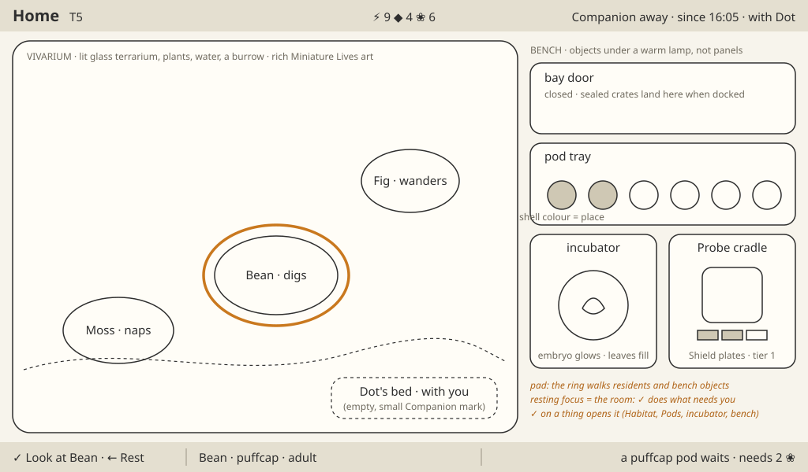 <em>Home wireframe. Layout only.</em></td>
<td valign="top">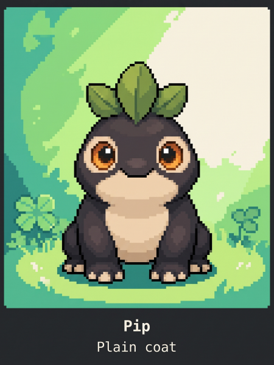 <em>companion-resident-home: the warmth of the vivarium, at Station resolution. Concept, generated.</em></td></tr></table>

---

## Dock and arrival

> **Intent.** The Companion is home and its crates come through: the devices talk to each other.
>
> **Look.** The bay's own light comes on: the link lamp to `mint`, the glyph fills, the crates slide into the bay in 200–400 ms eased steps.
>
> **Do:** device light and moving parts only; the first frame is the still state (09a). **Don't:** fanfare graphics, glows or blinking-only meaning (03c, 09a).

**Vibe.** Arrivals: the Companion home on the Caddy, its crates coming through into the bay.

**Purpose.** What the trip brought home arrives: each crate is one trip, and opening it shows what came out and where each thing goes (materials to the top bar's counters, pods to the rack). Docking shows the arrival and accepts nothing; opening the bay is the player's choice. **Reads first:** the crates, then their contents flowing to the store and the rack.

- **Instrument.** The sample bay leads: once cargo has come through, its door shows one sealed crate per consignment. `✓ Open the bay · 2 crates`. Then, per crate: the seal breaks and its contents lie out in front of it as things (pods, battery cells, cartridges, vials, finds); the materials fly into the top bar's counters, which tick (there are no store tanks); the pods go out through the Pods hatch, which shows its free wells, and a pod with no free well waits on the bay floor, still sealed, until one frees; the Probe dock shows the free mend; a ribbon names the crate ("First crate home"); the world turn jumps. The Cargo redesign (T-20261016-164) sets the bay's layout.
- **Living window.** The vivarium stays; residents turn toward the bay as crates open.
- **Composition.** Home's layout; the Bay module lifts 2 px, the chrome lift, and nothing is scaled; the ribbon sits inside the glass's top. There is no report card: reach goes to the Companion's map, news about the player's mibis to the Station's return signals, and news about the world to the Companion's map.
- **Lively / quiet.** Lively: the crate, the pods' travel, the residents' reaction. Quiet: the other modules.
- **Light.** A warm beam inside the bay as the seal breaks; the vivarium unchanged.
- **Palette.** The crates as painted (the container references); counters flash on change. Orange stays for the action only.
- **Type.** Inter: the ribbon 20 px medium; nothing else is written in the bay but `+n` beside a pile.
- **Chrome.** Presses during the arrival are consumed; focus stays on the room; then `✓ Look at the new pods`.
- **Motion.** About 3 s per crate: seal 300 ms, each pod's travel 600 ms.

**The portrait crate** ([the portrait](../proposals/the-portrait.md) §1). A finished portrait comes to the bay like cargo: while it is painted, a flat crate silhouette waits behind the bay door with its lamp slowly filling (no clock, no digits; "waiting for the cloud" when offline); landed, the bay lamp turns amber, `✓ Open the bay`, with "a sealed crate" in the context line. The seal breaks, the flat crate slides out, its lid lifts and the portrait stands on the stage in its gilt frame, ribbon "Fig's portrait"; then `✓ Look at Fig` opens the vivarium, up close, where Fig is drawn fresh in its painted set. The welcome sitting ("a sitting, to begin") arrives in the slot, not at the bay.

**Pass when**
- [ ] Cargo arriving alone shows crates and accepts nothing.
- [ ] Each crate's arrival reads as one event.
- [ ] The free mend shows on the Probe dock.
- [ ] Nothing of the field is drawn; the Station shows only what it owns.
- [ ] A still frame tells the same story.

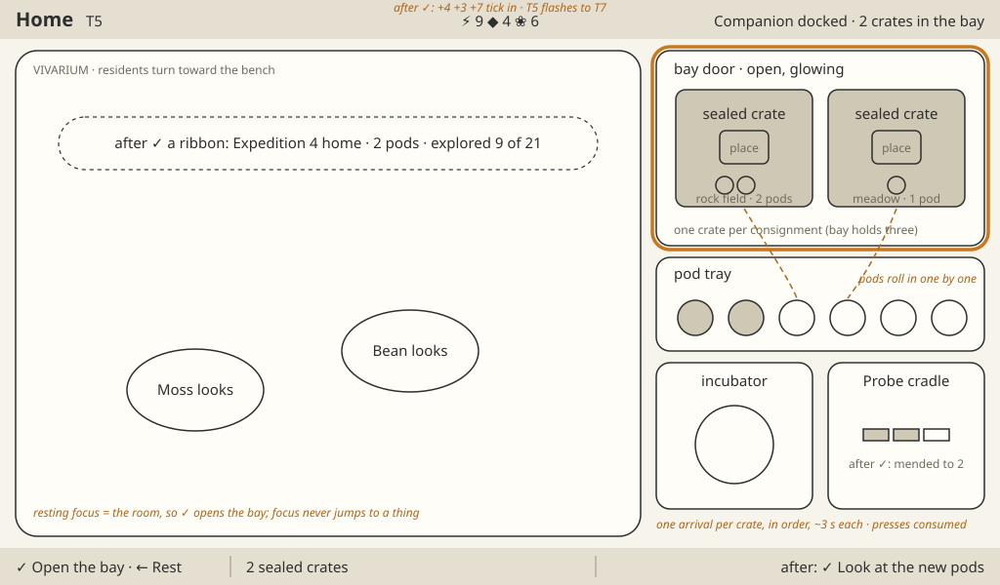

*Dock and arrival wireframe. Layout only.*

The measured layout, states and timeline are [Station layouts, Cargo](station-layouts.md#cargo). The ribbon has no digits and says the crate only: "First crate home". How far the land is explored is the Companion's map's, not the Station's. Where the appendix's Cargo tables still draw a report card, a pod rack or reach pips, they are superseded by the Cargo redesign (T-20261016-164).

---

## Pods

> **Intent.** The pods you brought home, and what you know of each.
>
> **Look.** The sample case: pods in fitted cut-outs set into the slate instrument face, lit from the top left with contact shadows; the rail and rings in device light; the name and state on a display pane.
>
> **Do:** the pod lit and grounded in its cut-out (03b); the name on the display (10a); progress in `mint` (02c). **Don't:** a paper tag on the pod (10a); a brown painted wall behind the case (02b); glyphs under 24 px carrying meaning (04d).

**Vibe.** Pods: the sample case.

**Purpose.** Identify a pod, read its chapters, compare, return. **Reads first:** the pod and its name.

- **Living window.** The specimen stage: the pod in the warm daylight. It is the warmest thing there: a soft inner glow, then, once identified, the seal on its cap broken and the species glyph lit.
- **Instrument.** Three states ([Station layouts, Pods](station-layouts.md#pods-collection-pod-overview-chapter-page)). The collection: every rack place, each pod with its name, place picture and progress ring. The overview: the chapter rail hanging from the top bar, each tab with an emblem, one word and its pips; the figure; where the pod came from; its kin; the return hatch with a leaf mark; the stamp on its 120 px label in a small, dim case at the right. The chapter page: every trait of the open chapter as a picture, with no pane.
- **Progress ring.** Around each pod in the collection: one arc per chapter, filled when that chapter is read, the band closed when every chapter is read; a star on the band is a glint. No digits.
- **Chapter states.** Unread (a dotted outline round an empty picture, the trait's name under it); glint (a four-point star); shows and hides (a close, warm drawing of each trait on this pod's mibi, the misty seed glyph after its name holding the hidden look); only (a small base glyph after the name); asleep (the asleep mark); breed to change (two joined rings); sealed (the page shut, with a picture of the find that opens it).
- **The stamp.** The genome code is the stamp, on its 120 px label at the edge of the overview, never the spotlight.
- **Composition.** The collection a 3 × 2 grid of places. The overview: the pod on its dish in the left third, the figure beside it, where it came from and its kin at the right, the rail centred across the top. The chapter page: the pod at the left, the page to its right.
- **Lively / quiet.** Lively: the pod's glow, glints, the page turn. Quiet: the rail, the rings, the bench.
- **Light.** The warm daylight from above onto the pod's dish; a read page lit warm from inside; the rail and the rings in the device's panels.
- **Palette.** Pods from one renderer: the species' colour pair and shell pattern, the place's dust or moss; frost, the veil over what is unread; seeds pearl with a ghost inside; the collection ring read `bone`, unread `bevel`.
- **Type.** Inter: the pod's name 20 px medium on its plate; the origin 16 px ("Found on the rock field, as a Tuikis felt safe."; the pattern is in [Station layouts](station-layouts.md), Words on Pods); the page heading 20 px medium; one word per chapter and one word per trait, 16 px.
- **Chrome.** `✓ Identify   ◆ 1`, `✓ Read Coat   ◆ 3`, `✓ Shape a founder`, `✓ Compare`, `✓ Return to the wild   ❀ +1`, `✓ Open the guide` on the figure; the way back `← Home`, `← Pods` or the pod's name.
- **This pod, the species.** On the overview, "this pod" under the pod's marks and "the species" under the figure, once identified. The ring starts on the pod with `✓ Shape a founder`; the figure is a side trip one ▶ away, and ✓ on it opens the species' guide: a jump to the Book's guide spread, where ← reads Library.
- **Motion.** The seal breaks and the glyph lights in about 2 s; a read wipes the page's frost in 2 s and the tab's pips fill; the page turns in 200 ms; glints 2 Hz.

**Concept.** The genome stamp sits on its 120 px label, a small label and never the spotlight. The progress ring sits around the pod and carries chapters only; "identified" shows on the pod's seal. The device's matte slate panels are the bench, and Create and Incubator follow it. Reference: `art/concept-station/pods-v2/`, candidate PV-D-r3-a4.

**Chapter rail.** Every screen with a chapter rail shows as many chapters as the species has, in ring order; there is no fixed count. The four-tab rails in the concept plates are legacy concept art.

**Pass when**
- [ ] Unread chapters show nothing; draw only what is known.
- [ ] The seven chapter states are told apart without colour.
- [ ] The progress ring reads at a glance in the collection, with no digits.
- [ ] The stamp is a small label, never the spotlight.
- [ ] No letters, ratios, loci or progress digits anywhere.
- [ ] The pod is the warmest, brightest thing on screen.
- [ ] Pods of one species match; no shell shows an individual's genes.

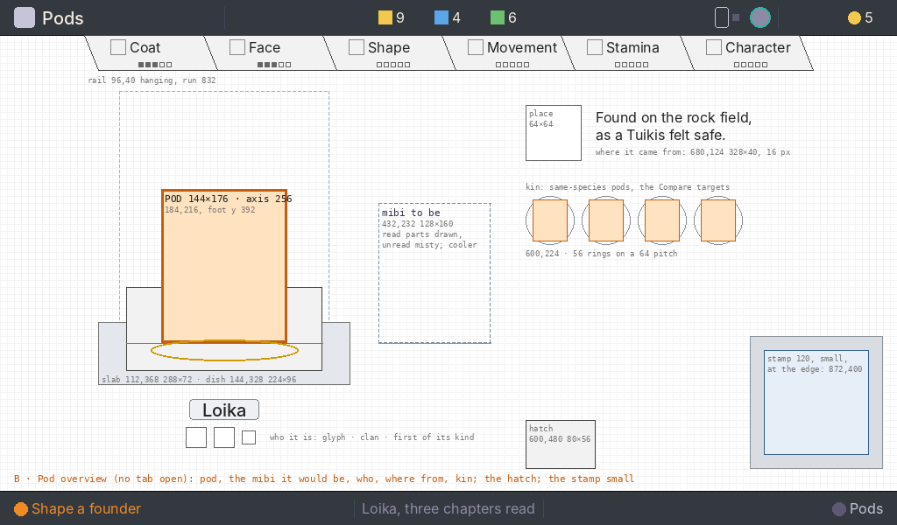

*Pods, the pod overview, 1× wireframe; measured in [Station layouts, Pods](station-layouts.md#pods-collection-pod-overview-chapter-page).*

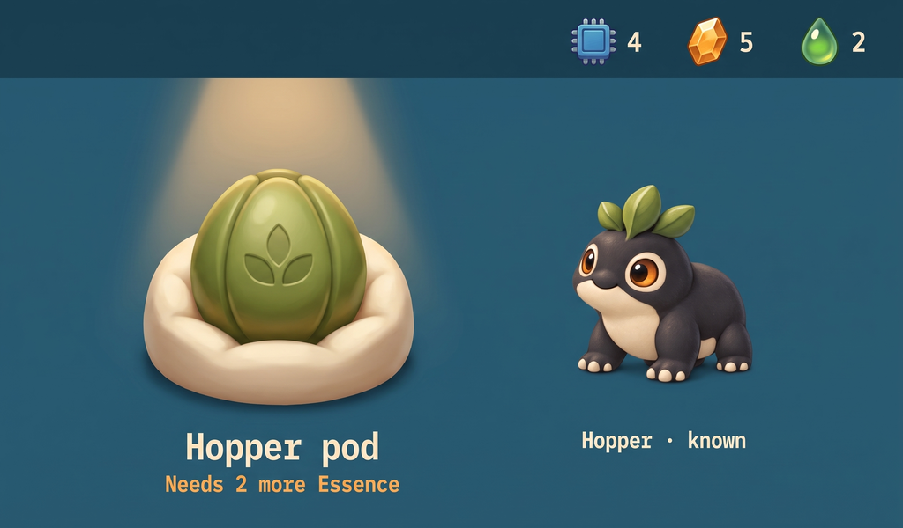

*station-research-pod: the pod in its cradle under a beam. Concept, generated. Its icons and type are not specs.*

---

## Create (the review)

> **Intent.** Shape your mibi's genes before it grows, and see what you changed.
>
> **Look.** The gene bench, G2 with the body answering in light: the founder big, sculpted and lit in a scanning recess of the slate face; one column of rows beside it, each headed by the founder's own part and its word, each gene a picture of its look; focusing a row or gene lights that part on the founder in `mint`. The genes are the controls, so the drum tray below is superseded ([style guide §8](README.md#8-screen-families)).
>
> **Do:** every object sitting in or on the bench (03b, 07a); genome marks sculpted at their tier, each state a shape (04e); a few words (05b). **Don't:** floating parts on an empty field (07a); a cream notch or cream slip (02b, 05b); a brown or lilac field; paper of any kind (10a).

**Vibe.** Research: the gene bench, an advanced research and crafting bench where you edit life.

**Purpose.** Shape a founder by turning its genes, see its cost, and grow it. **Reads first:** the founder on its dish.

- **Living window.** The founder stands at the centre on a growth dish, a dish in a shallow cut-out in the bench, with a contact shadow under its feet, at 300×310 or larger, rich treatment. Wherever a chapter is unread, that part stays misty: a cool frost over the body, never a guess.
- **Instrument.** One bench fills the stage inside the device's frame, and everything sits on it or in it; nothing floats.
  - The player's own pod, opened, in the fitted well it had on Pods, with its name plate and its place badge.
  - A short braided gene line from the pod's well into the gene bank: a tray along the front of the bench holding one drum per trait, grouped under engraved chapter words, every trait of the species at once.
  - A drum's faces are this pod's own looks (as the pod is, only the first copy, only the second copy), so it never offers a look the pod lacks. A changed drum wears a small notch lit `mint`.
  - A doings trait is a pinned drum: two joined rings, no turn marks, "breed to change".
  - An unread chapter's drums are capped under the frost.
  - Clashing drums are marked, and so are their chips on the display; Grow is withheld.
  - The machine's display, let into the bench's housing at the right: one picture chip per trait with the drums' own marks (the changed notch, a frost for still a surprise, a red link for a clash), at most three words. No paper.
  - There is no chapter rail and no tabs, no dome or chamber, and no stamp case on this screen.
- **Composition.** The bench is the whole stage; the founder centred on its dish; the pod at the left, the display at the right, the bank along the front. The measured layout is UI/UX's.
- **Lively / quiet.** Lively: the founder (breathing, a blink) and the redraw of its part when a drum turns. Quiet: the bench, the bank, the display.
- **Light.** Warm key light on the founder from the top left; the rest in the device's light. Everything casts a soft shadow onto the bench.
- **Palette.** The founder's own colours; the frost veil; the drums in the housing's sage; the price icons in their hues.
- **Type.** Inter 16 px: at most three words on the display; the total in the bottom line.
- **Chrome.** `✓ Grow it   ⚡ 2 ❀ 4 ◆ 1`, the icon before the figure | what stays a surprise | the notice | `← Loika` (Create's parent is the pod's overview).
- **Motion.** ◀ ▶ walks the drums; ▲ ▼ turns the focused drum one face: its window rolls to the next look in 200 ms, the part that trait covers redraws on the founder and nothing else on the body moves, the display's chip changes and the price changes. On Grow the drums lock, the stamp appears on the display and the code appears, the pod's shell closes, and the pod is carried out toward the Incubator.

**Concept.** The gene bench. A drum's picture is the flank close-up of the part it changes, not a whole founder. The chapters still to read are named in the bottom line's context ("Coat stays a surprise", "two surprises to come") and shown as frosted chips on the display.

**The founder's look** ([art pipeline](../proposals/art-pipeline.md) §1.1). The rig's render is the **placeholder**, not the game's art. A unique painted render is the **portrait**, a prize a mibi may earn, paid with **a sitting** earned by research; Create never shows one. The founder on Create is drawn in the placeholder (the stylised rig pass: flat slots, outline, no face, no material; [the placeholder brief](../proposals/plain-renderer.md)), since nothing is painted before Grow; the drums' pictures are placeholder close-ups. Grow starts the standard painting. The pass line "same trait boundaries as the Companion's HiBit drawing" holds for the placeholder as it does for the painting.

**Pass when**
- [ ] Founder, changes, surprises and cost are all visible at once.
- [ ] Every object sits on the bench with contact and shadow; nothing floats.
- [ ] In three seconds a stranger says "you change the creature by turning those".
- [ ] The founder's misty parts match the unread chapters exactly.
- [ ] A turn changes only what that trait covers (the founder's part, the drum, the display's chip and the price), and never offers a look the pod lacks.
- [ ] The code appears only at Grow.
- [ ] Same trait boundaries as the Companion's HiBit drawing.

<table><tr><td valign="top">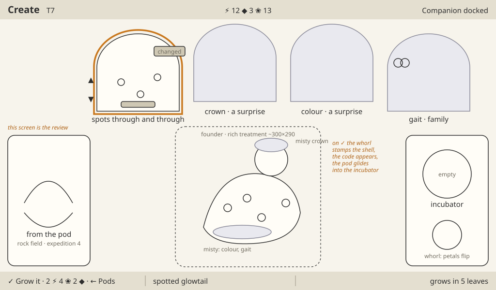 <em>Create wireframe, before the gene bench. Superseded; the bench's layout comes with its layout spec.</em></td>
<td valign="top">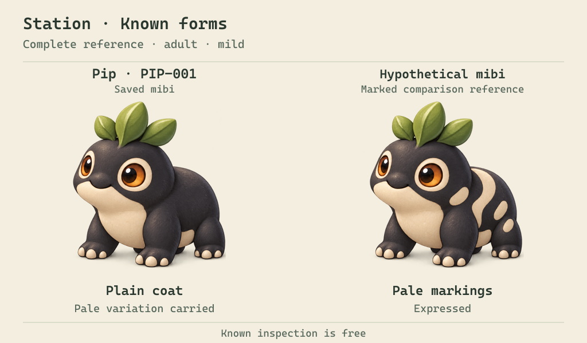 <em>Two individuals differing only in markings, at Station size. Appearance reference (creature only).</em></td></tr></table>

---

## Incubator

> **Intent.** "The life you designed on Create is being grown here, and each time you look it is further along and you know more about it" (game designer).
>
> **Look.** Candling done well: an instrument of the machine candles the player's own pod, its light through the shell showing the founder forming; the ring of time in `mint` on `tealD`; the reveal shows the founder's own part large; the stamp on the display with its text id. The chamber: the pod clamped upright in a recess of the slate face behind matte glass, the lamp shining up through the shell, known parts in colour and unknown in frost, no moss or plinth ([style guide §8](README.md#8-screen-families)).
>
> **Do:** device light doing the work, cast onto what it lights (03c); the pod grounded in the instrument (03b); progress in `mint` (02c); the reveal as a picture with a short plain line (05a). **Don't:** an egg on a moss cradle, a flat painted shadow (03b); a cream ring (02c); a green plastic plaque (03a); a pixel glyph and jargon in a floating box (04e, 05a); a brown room (02b).

**Vibe.** The bridge between research and the vivarium: candling. The player's own pod, lit from below, with the founder they made showing through it.

**Purpose.** Meet the mibi you made, and see more of it each time you look. **Reads first:** the pod and the shape inside it, then the ring of time.

- **Living window.** The pod is the one the player collected and grew: its species' shell from the one pod renderer, with the dust or moss of the place it was found, the same picture as on Pods and Cargo. It stands in the candling instrument, lit from below by the device's light as an egg is candled (the instrument's form: T-20261016-168). No moss nest.
  - As it grows, the shell lets more light through and the founder's shape shows inside it as a soft shadow, showing only what is known: the body from Create, and each chapter's look as it clears. This replaces the generic glowing bean.
  - Ready: light breaks through the shell's seams, the shadow is the whole founder, and nothing steps out until the player opens it.
  - A crossed bud has no collected pod: it is a pod of its species' shell laid at home, with the vivarium's own moss on it, and its shadow shows only the species' outline.
- **Instrument.** Every object has a job; there is no machinery without one.
  - The candling light under the pod: the one device, whose light is the point of the screen.
  - One ring of time around the pod, at the stage's scale, filling continuously, cut where each chapter will clear, closed at ready.
  - The same display as on Create, set into the machine at the left: the pod's name and place badge, its changed chips, and its frosted chips clearing as their chapters clear. At most three words; no paper.
  - At the right: the reveal (the newest cleared part, shown as the founder's own part, large, with a short plain line; never "Just cleared" or a trait adjective), and the stamp on its label with its code under it as live text.
  - On a founder's bud the unread chapters clear one by one, except a sealed chapter that is still shut. Each clearing reaches the shadow, the card, the display's chip and the stamp.
  - No chapter tabs and no leaves.
- **Composition.** The pod centred and large inside its ring; the display at the left; the card and the stamp at the right. The measured layout is UI/UX's.
- **Lively / quiet.** Lively: the light through the shell and the ring's fill; a clearing pulses its cut once. Quiet: everything else.
- **Light.** The device's light from below, through the shell and a little onto the instrument; the key light from the top left for form. The pod is the brightest thing.
- **Palette.** The pod's own shell colours; the housing's sage and sand; the device's dark matte slate behind; the ring `mint` on `tealD`. No brown, no cream.
- **Type.** Inter 16 px. The one time count on the Station is here: the bottom line's context "ready in about n min", one rounded count, here only. No other digits for time, on this screen or any other.
- **Chrome.** Growing: `✓ Grow now   ❀ 7` | "ready in about n min"; ready: `✓ Open`; empty: `✓ Choose a pod`; `← Home`.
- **Motion.** The ring fills with time. Open: the shell opens along its seams, the juvenile steps out, and the ribbon reads "Fig, a young Loika".

**Concept.** Candling. The pod the player collected travels from Pods through Create into the cradle; what the player made is what they see forming. The stamp stands alone on the Station; the code string may also show, as a shareable "look at my mibi" string.

**Instant grow.** While growing, the chrome offers `✓ Grow now` and its price, ❀ 1 for every 2 minutes left, rounded up (at most 19; the first bud 3). The first bud ever grows in five minutes, others twenty plus one per shaped trait; all timers sit under the developer-tools toggle for testing. The bud has two states, growing and ready; with no bud the Incubator opens empty, an invitation to grow one. A portrait arrives as a crate in the sample bay (Dock and arrival, [the portrait](../proposals/the-portrait.md)), and the sitting that pays for it is chosen in the vivarium, up close (the Sitting, below).

**The standard painting** ([art pipeline](../proposals/art-pipeline.md) §1.1). Grow starts the mibi's standard painting; the chamber keeps its two states, and the painting is not a third. **At Open,** the juvenile steps out in its standard painting if it has landed (a connected kit, within the bud's minutes), else in the **placeholder**: the stylised rig pass, flat and outlined, no face, no material, with a small cool "waiting" lamp on the cradle and the status "its painting is on its way" (offline: "waiting for the cloud"). **The painting lands** at the next fresh draw of that mibi (a screen change, waking, coming home), never while it is on screen, and the lamp goes out; no ribbon, no crate, no spinner. The same placeholder and lamp show on Home's vivarium and in the vivarium, up close, for any resident still waiting. The juvenile that steps out is the founder from Create in either look.

**Pass when**
- [ ] The pod is the player's own: its species' shell and its place's dust or moss.
- [ ] The shape inside the shell shows only what is known.
- [ ] Time reads at a glance as the ring; the only digits for time are "ready in about n min" in the context line.
- [ ] The pod and its light are the only warm, living thing.
- [ ] Every object has a job a player can read.
- [ ] Ready reads from across a table.
- [ ] The juvenile that steps out is the founder from Create.
- [ ] A still frame shows progress.

<table><tr><td valign="top">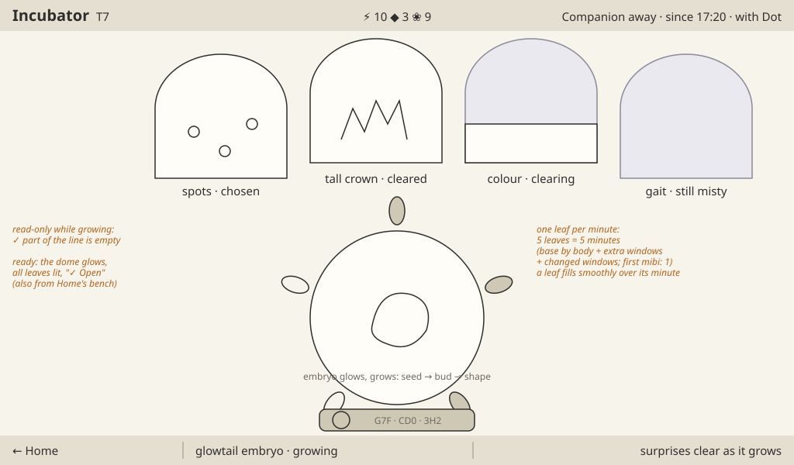 <em>Incubator wireframe, before candling. Superseded; the new layout comes with its layout spec.</em></td>
<td valign="top">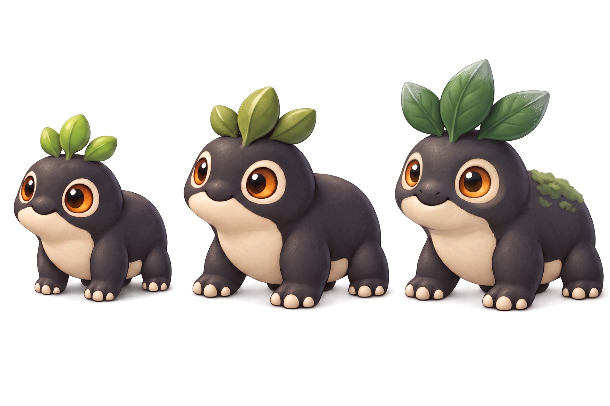 <em>The juvenile that steps out reads young by proportion. Concept, generated.</em></td></tr></table>

---

## Library

> **Intent.** The species you have met, as a book.
>
> **Look.** The one place for paper: a worn botanical volume, warm paper and cloth, lit from the top left.
>
> **Do:** paper that never changes while it is on screen. **Don't:** paper that changes with input; the book's warm paper used anywhere else on the Station (10a).

**Vibe.** Library: a botanical tome. Two screens: the **Spread** and the **Book**. The Library is one object, an old botanical-expedition volume, and both screens are its pages.

The collection screen is the **tome's spread of plates**: reference `art/concept-station/library-spread/`, SP-P-r4-a1. An unmet species shows no cue at all of what it may be: no silhouettes and no shapes in the mist. The collection reads as a collection, with a dedicated place per species, and nothing on it steals the spotlight from the specimens. Lineage matters: the stamp carries it, and the Book shows a family tree (display in `design/proposals/family-tree.md`).

**Never childish** ([art direction](../art-direction.md)). The look is cute by charm and craft, as Pip is; not cartoon simplification, sticker faces, toy-like rendering, nursery colours or storybook ornament. The spread is the example: a real naturalist's expedition volume in ink and watercolour, restrained ornament, plates at Pip's craft, a real pencil study, aged natural colours and the device's own type on the chrome; lanterns, scrollwork and ribbons read storybook, plates read as stickers, a cute cat and serif type on the chrome fail it. Every Library brief, critique and master checks against this line.

### Spread

**Purpose.** The whole collection at a glance, as pages of the book that opens from it. **Reads first:** the found plates among the sixteen frames.

- **Living window.** None; the spread is quiet. The plates' own warmth is the only warmth, inside the found frames.
- **The tome.** An old botanical-expedition volume: aged, foxed laid paper with worn boards and a deckle; a single ink rule; restrained life in the margins, a cloth marker, a leaf and seeds, a dried flower, a wordless pencil scribble, a survey sketch, none covering a frame. No scrollwork, lanterns or ribbons. The device's own sans (Inter) on the chrome; a serif leak is a fail.
- **Frames.** Sixteen ruled frames to the spread, eight a page in two rows of four, one place per species, all seen at once; the collection grows by a page turn, never by scrolling. Each frame has a blank caption rule under it.
- **Found.** A tipped-in framed plate in the book's own plate style (the Book's mounted portrait at small size), painted at Pip's level of craft; never a flat card or a sticker. Once a mibi of the species is portrayed, its portrait takes the plate, with a gilt corner on the mat (with several portrayed, the Book offers `✓ Make Fig the face`). Loika's plate is the placed Pip.
- **Met, not researched.** An anatomical pencil study, a real naturalist's pencil with its construction lines, the name in pencil grey.
- **Unmet.** An empty ruled frame with a blank caption rule and no cue: no silhouette, no shape, no colour.
- **Clan.** An inked rule in the clan's colour over the frame of each met species; none at the page edge, none on unmet frames.
- **Focus.** A thin rounded rectangle around the frame, in `rust`, the ring on paper.
- **Composition.** The open spread fills the stage; frames 96×112 with their caption rules; the margins' life between and around them.
- **Palette.** Aged cream and sepia; graphite; the plates' own natural colours; the clan colours only on the inked rules.
- **Type.** Inter: the title 20 px medium; names 16 px in the device type, placed on the caption rules (the met name in pencil grey); nothing under unmet frames. No digits.
- **Chrome.** `✓ Open` on a found or met plate; read-only on an empty frame. No ledge, no synopsis objects: the spread itself is the record.
- **Motion.** The plate lifts off the page and becomes the Book's mounted plate in 300 ms; a page turn past sixteen.

### Book

**Purpose.** Each species' field guide: its frame, the looks found so far, lineage and wishes. **Reads first:** the species' portrait and name.

- **Living window.** The species portrait: one resident of that species in rich treatment, doing its habit (dig, glow, puff), mounted on the page as a framed plate.
- **Instrument.** Two spreads. The face spread: the species' places as stamps; the frame once, as a pressed plate; the stamp at 120 px on a plain plate (the type specimen's, with no mibi name, until a portrait); the family tree panel under the stamp; the pinned wish; a page-turn corner to the guide (`book-corner-turn-24x24`, only when the species has a guide). The guide spread, the fold-out: every chapter as a column, every look found and still to find (Guide, below).
- **The clarity line.** Under the habit line: "A typical Belatz, not one of yours."; with a portrait, "Fig, your Belatz, sat for this."
- **Composition.** Portrait at the left (304×312); the places and the frame plate beside it; stamp, tree and wish at the right edge.
- **Lively / quiet.** Lively: the portrait. Quiet: the guide, the tree.
- **Light.** Warm on the portrait; cool, even light on the archive.
- **Palette.** The tome's cream, the species' hues on plates.
- **Type.** Inter: the species name 28 px on a paper label, with one 16 px habit line under it; no paragraphs.
- **Chrome.** `✓ Visit Fig` on a mibi (on the face spread only when the face is a living mibi's portrait: the type face has no ✓ cap), `✓ Add to the wish` on a look, `✓ Find a pair` on a wish, `← Library`. `✓ Visit Fig` is a jump: in the vivarium, up close, ← reads Home.
- **Motion.** The page turns to the guide in 300 ms; the portrait lives.

**Concept** (`art/concept-station/library-book/`, BK-D-r2-a1). The portrait is mounted as a framed plate, not painted straight onto the page; the family tree panel sits under the stamp, about 180×160 px; the name sits on a paper label with the habit line under it. The label's copy and the names follow the house words and this guide's type: consistent case and the typeface.

**The face and the portrait** ([the portrait](../proposals/the-portrait.md) §1, §7). The book's living window is the species' **face** (a resident in the standard look, doing its habit) until a mibi of the species has sat for its portrait; then **the portrait replaces the face**: that mibi in its chosen pose and place, alive in the window, the habit line under it. A portrayed mibi returned to the wild keeps its portrait here, marked "released". After the welcome portrait, the gilt frame is drawn faintly over the species' last empty look plate to show where the next sitting comes from.

**Pass when**
- [ ] The spread shows every released species' frame at once, sixteen to the spread, no scrolling; more species turn a page.
- [ ] The specimens are the spotlight: framed plates in the book's style and a real pencil study, never flat cards or stickers; the tome's life stays in the margins.
- [ ] Unmet frames give no cue at all; the met study shows only what the field saw.
- [ ] Nothing childish: no storybook ornament, no sticker plates, no cute animals, no serif on the chrome.
- [ ] Knowledge, never material: nothing implies a look, or a wish, can be taken from here.
- [ ] The family tree reads parents, siblings and children without text.
- [ ] Two mibis are told apart by stamp at 40 px.
- [ ] No digits, no ledge, no furniture; never a text page or a school lesson.

<table><tr><td valign="top">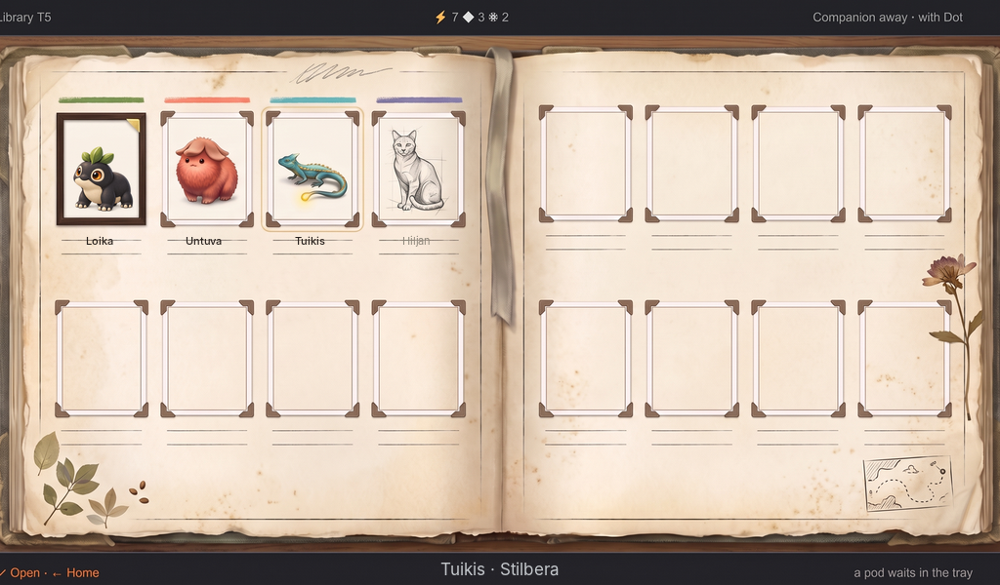 <em>The Spread, SP-P-r4-a1 with Pip and the names placed. Concept art, generated and placed; the direction, not a master.</em></td>
<td valign="top">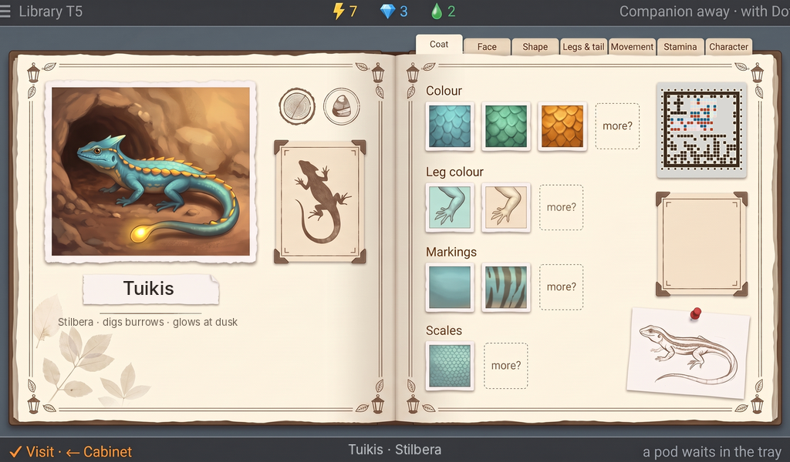 <em>The Book, BK-D-r2-a1 with the real stamp and the name placed. Concept art, not a master.</em></td></tr></table>

---

### Guide

The field guide is the Book's fold-out second spread, turned with ◀ ▶; ← reads Library. Measured in [Station layouts, Book: the guide spread](station-layouts.md#book-the-guide-spread); the numbers are in `prototypes/ui/specs/station/library.json`.

**Purpose.** The species whole: what is found, what is left, and who carries a look. **Reads first:** the face and the name, then the chapter panels.

- **The species, said.** The face (`guide-face-<SNN>-128x112`, the type painted for the guide), the name, and under it "Every look a Belatz can carry, found across your Belatz."
- **Columns are chapters.** One panel per chapter, shared by every species and tinted by it: one pixel in eight of the species' pod pigment on paper, with a 2 px band of it across the top. Up to seven chapters 128 wide on a 136 pitch; eight 112 wide on a 120 pitch; never a scroll.
- **Progress on every trait.** One pip per look, filled found, dotted unseen, in groups of five. No digits.
- **Sealed.** A shut panel with its notch and no traits.
- **One detail band.** The open trait's looks as plates and one dashed "more?", each plate keylined in `bark`, "Carried by" with your mibis' names on two lines at most.
- **Wish.** A mark on a pinned trait and its plate; the pinned wish itself stays on the face spread.
- **Palette.** The tome's paper; colour only in the tints, the plates and the face.
- **Chrome.** `✓ Add to the wish` or `✓ Take it off the wish` on a plate; `✓ Visit Fig` on a name (a jump: in the vivarium, up close, ← reads Home); read-only on a cell; `← Library`.
- **Focus.** On the tome's paper the ring is `rust`, the same geometry (frame.json `focus.ring.onPaper`), on the Library, the face spread and the guide.
- **Motion.** The page turns in 300 ms.

**Pass when**
- [ ] It says it is the species, in one line under the name.
- [ ] Eight chapters fit with no scroll, every word whole.
- [ ] Ten looks read as two groups of five at 1×.
- [ ] Nothing is new state: every field comes from `fieldGuide`, the wish rules and `chapterLooks`.
- [ ] No digits, no connectors, nothing childish.

## The vivarium, up close

> **Intent.** One mibi at home, never a specimen on display.
>
> **Look.** The warm painted vivarium leads; the card is slate panes beside it, with painted faces and badges.
>
> **Do:** the mibi the brightest thing; the card's marks 24 px or more, each with a word (06a). **Don't:** a specimen plinth; words where a picture says it; brown panes (02b).

**Vibe.** Vivarium: cozy, warm, the pet happy at home.

**Purpose.** One mibi up close: name it, greet it, take it with you, cross, have it sit for its portrait, or return it to the wild. **Reads first:** the mibi, then its name.

- **Living window.** The mibi at 304×312 in the vivarium's light, its standard painting or its placeholder with the waiting lamp, doing its species moment on Greet. Its name on a plate under its feet, 20 px.
- **Instrument.** A card at the right: "your Loika, adult" (the species word, with `mark-guide-16`, is the door to the guide), where it came from and what it remembers, its code, the stamp on its 120 label (the stamp is the genome code), and one plate a chapter. Under it four modules, one engraved word each: Companion, Portrait, Cross, Wild. The strip of bays along the foot, thumbnails only.
- **Composition.** The window at the left (16 to 576), the card and modules in a 416 px column at the right, the strip 64 px along the foot.
- **Lively / quiet.** Lively: the mibi. Quiet: card, modules, strip.
- **Light.** Warm key light from the top left in the window; cool on the card.
- **Palette.** The vivarium's greens and earth; card chrome; the heart a small enamel heart in the house light. Nothing on the vivarium up close is amber.
- **Type.** Inter: the name 20 px medium on its plate; the card's lines 16 px.
- **Chrome.** The four zones, the price icon first, no dots: `✓ Greet Fig`; `✓ Rename Fig`; `✓ Take Fig with you` | "goes at the next dock", or `✓ Bring Fig home` | "home at the next dock"; `✓ Cross Fig`; `✓ Portray Fig` | "one sitting each, ever"; `✓ Return Fig   ❀ +2` | "goes back to the wild", then `✓ Again: return Fig` | "never taken back"; `← Vivarium`.
- **Motion.** Walking the strip dithers the mibi shown in 200 ms; the species moment plays about 2 s.

The measured layout, the focus graph and the states (rest, the meet, out) are [Station layouts, the Vivarium](station-layouts.md#the-vivarium-the-whole-and-one-mibi-up-close).

**Pass when**
- [ ] The mibi is the same individual as on the Companion.
- [ ] Stage reads from proportion and bearing; elders calm and dignified.
- [ ] No meters or needs.
- [ ] The Companion module shows which mibis are with you.
- [ ] Greet rewards nothing and shows nothing like a reward.

---

## Sitting

> **Intent.** Spend a sitting for a portrait.
>
> **Look.** The mibi posed in its place, painted; the machine's panes in slate.
>
> **Do:** the outcome shown as a picture (04a). **Don't:** a cream card or paragraph (05a, 05b).

A sitting is spent in a ceremony on the Station: the player chooses the one mibi, a pose from its habits and a place it has been. It takes real time, longer than a bud, and the portrait arrives as a crate at the dock. The words are sitting, portrait, portrait card and `✓ Portray`. One sitting a mibi, ever; a sitting earned while one is held is not given, and the Station warns ahead. Its rules are in `prototypes/station/src/sitting.mjs`.

In the vivarium, up close, the Portrait module offers `✓ Portray Fig` while a sitting is held and the mibi can sit ([Station layouts, the vivarium up close](station-layouts.md#the-vivarium-the-whole-and-one-mibi-up-close)).

The sitting is its own screen under the vivarium, up close, opened from the Portrait module, with three steps: the pose, the place, then look and confirm. Its layout is [Station layouts, Sitting](station-layouts.md#sitting).

---

## Cross and Wish

> **Intent.** Two parents and the child their genes forecast.
>
> **Look.** The splicer bench, with Create's rules: the subjects sculpted and lit and the genome on the display.
>
> **Do:** the parents grounded and lit (03b); sculpted genome marks (04e). **Don't:** floating parts (07a); colour-only marks (06b).

**Vibe.** Research: the lab's splicer.

**Purpose.** Pick two adults of one species, see what their child could be, cross them; see how close a pairing gets to a wish. **Reads first:** the two parents, then the forecast.

- **Living window.** The two parents left and right as 48×48 portraits at the heads of their columns. Between them the child to be, misty, never a promise, with the kinship word on its pill.
- **Instrument: the splice.**
  - **Overview.** Each parent is a column of chapter modules, and each locus leaves it as two wires, its two copies. A gate per locus splices them: a switch passes one copy of two, a blend mixes them. The wires run inward to the child: four seeds for a switch, and for a blend a track with both parents' values and the stretch where the child can land.
  - **Chapter view.** One chapter's traits, each copy's look printed on its wire. ▲ ▼ walk from the overview through the chapters.
  - **Kinship and the wish.** Kinship is `amber`: a narrowed range, and seeds where a hidden look can surface. A pinned trait's glint is lit when a child can reach it.
  - **What is not shown.** Only what the player has read, and an indication of everything missing: an unread chapter draws frost and "read Rook's Shape", and never a hidden copy.
- **Composition.** The parents' heads sit at the outer edges, the child's head between them, and the splice under them, flowing inward. The chapter view hangs the shared chapter rail.
- **Lively / quiet.** Lively: the parents. Quiet: the splice.
- **Light.** Warm key light on the parents from the top left; the splice in the device's own light on the tray.
- **Palette.** The parents' own colours in their portraits and pictures. Wires by kind: switch `lilac`, blend `aqua`, settled `bevel`, unread `frostS`, sealed `hairline`. Kinship in `amber`, and the wish in `yellow`, its one accent.
- **Type.** The parents' names in 20 px medium; trait names, words and the looks on the wires in 16 px; no digits but the price.
- **Chrome.** `✓ Cross them   ⚡ 2 ❀ 4` | the pair and the species | the notice | `← Vivarium`. The notice names the first missing read ("read Rook's Shape"). An ineligible pair draws no ✓ cap, and its reason takes the notice.
- **Motion.** A partner swaps in 300 ms and the wires re-route with it. A chapter opens or closes in 200 ms. On Cross, the gates take one copy each, and the child's pod glides into the incubation chamber in 600 ms.

**Pass when**
- [ ] No odds as numbers, no percentages, no promise of a result.
- [ ] Each forecast reads as four seeds without colour.
- [ ] Only adults of one species can be paired; a refusal comes before any spend.
- [ ] Each switch gate visibly passes one copy from each parent, and each blend gate mixes the two.
- [ ] Nothing of an unread or sealed chapter is drawn but frost, the words to read it, or its find.
- [ ] A wish reads as knowledge, never material.

Wireframes: [09a-cross-overview.png](station-layouts/09a-cross-overview.png) and [09b-cross-chapter.png](station-layouts/09b-cross-chapter.png); measurements in [station-layouts.md, Cross: the splice](station-layouts.md#cross-the-splice), and numbers in `prototypes/ui/specs/station/cross.json`.

---

## Probe bench

> **Intent.** Mend and upgrade the Probe the Companion carries.
>
> **Look.** The Probe upright, as held, in a vertical service cradle; Mend and Upgrade as slate panes.
>
> **Do:** the Probe grounded and lit (03b); the tier shown by its parts and reach, as pictures (04a). **Don't:** loose tools, or gauges that read nothing; a brown wall (02b).

**Vibe.** Research: the Probe in its service dock, being mended.

**Purpose.** Keep the Probe ready: mend its Shield plates, set whether the dock mends every plate, fit the upgrade. **Reads first:** the Probe, then its plates.

- **Instrument.** The Probe large in its cradle, its Shield plates standing under it (the tier's count). At the right, the Mend module (a switch and a picture of what it means: the dock, then the plates it leaves whole) and the Upgrade module (the socket and part, what it adds as pictures, lit only when affordable). The one screen whose subject is a machine.
- **Composition.** The cradle and the column form one group centred on the screen: the Probe on the axis x 296, the two modules at the right.
- **Lively / quiet.** Quiet until a press.
- **Light.** The device's warm daylight from the top left, as on Create and the Incubator; the Probe the brightest object.
- **Palette.** Dark matte slate and dark rubber; plates white when whole, outlined when gone; lamps on (`sprout`) or off. Nothing on the bench is amber.
- **Type.** Inter 16 px: the modules' engraved words.
- **Chrome.** The four zones, the price icon first, no dots: `✓ Mend a plate   ⚡ 1` | "one plate to mend"; `✓ Switch on` | "the dock mends two, free"; `✓ Fit the upgrade   ⚡ 12 ◆ 4`, then `✓ Again: fit the upgrade`; `← Home`.
- **Motion.** A plate seats in 300 ms; the switch's knob slides in 200 ms; the upgrade fits in 900 ms.

The measured layout is [Station layouts, Probe bench](station-layouts.md#probe-bench).

**Pass when**
- [ ] Shield state reads from the plates alone.
- [ ] The armed state is visible before the second press.
- [ ] The Probe is the same device the Companion draws.
- [ ] Away, the cradle shows the Probe is out, not missing.

---

## Decision panels

> **Intent.** At a real decision, the panel shows what each choice will do, as pictures that differ at a glance, and its cost.
>
> **Look.** The slate panel over the veiled screen ([style guide §4](README.md#4-components)); each option window is its outcome painted as a different scene (distance, size, direction, setting, light), with the verb, its cost and one line.
>
> **Do:** two futures that look different with the words covered (04a). **Don't:** the same picture twice with a different backdrop; brown or cream panels (04a, 02b).

**Purpose.** At a real decision, see each choice's future and its cost, and choose. **Reads first:** the outcome pictures, side by side.

- **Only at a real decision:** a spend, a commitment, an irreversible act or a fork in the path. Grow it, Cross them, Return to the wild, Fit the upgrade, a large Grow now, Spend a sitting, the Hatch and its name, Read it now on Create. Nowhere else.
- **Each option is its outcome, drawn.** Covering the words, a first-time player can still tell the options apart, because the pictures show different futures: for Return to the wild, the mibi walking out into its home place against the mibi asleep in its bay.
- **Under each picture:** the option's name, its cost in the materials' shapes, and one consequence line, a loss in the loss colour ([words budget](README.md#the-words-budget)).
- **The choice names where it leads.** No jump lands the player somewhere unannounced.
- **It replaces arming:** an irreversible act is chosen in a panel, never with "✓ again".

---

## Idle

> **Intent.** The vivarium alone, the device asleep.
>
> **Look.** Accepted: the painted vivarium fills the screen, by the time of day.
>
> **Do:** the life moving; the device still (09a). **Don't:** any overlay that glows or blinks (03c).

**Vibe.** Vivarium: the pets at ease, nothing asking for you.

**Purpose.** A living view the Station can show permanently, always on: the vivarium, something worth looking at all day; never a screen off or a sleep. **Reads first:** the residents.

- **Living window.** The vivarium at 1024×568, above the strip, its light following the time of day, residents keeping their routines.
- **Instrument.** Reduced to one line on a thin cool strip at the foot, one sentence of six words or fewer ("a bud is growing", "Dot is out with the Companion"), and nothing else.
- **Composition.** The vivarium edge to edge; the strip 32 px.
- **Lively / quiet.** Lively: everything in the vivarium. Quiet: the strip.
- **Light.** Day to dusk to night in the vivarium, always the warm key light from the top left; at night warm and low (the glow-moss and the residents' own glows), the moon only a cool rim; mean L* 30 or more at night, mean red at least mean blue in every light; Home's glass shows the same light.
- **Palette.** The vivarium's; the strip in chrome.
- **Type.** Inter 16 px regular, the line in `mist`.
- **Chrome.** None. The first press only wakes; nothing else happens, and waking never rewards.
- **Motion.** Continuous and slow; nothing blinks for attention.

**Pass when**
- [ ] Beautiful at a distance, all day.
- [ ] Nothing decays and nothing nags.
- [ ] Residents are the rich treatment at full size.
- [ ] The status line is the only text.
- [ ] Night is calm, never gloomy.

The measured layout is [Station layouts, Idle](station-layouts.md#idle): the vivarium 1024×568, the strip 32 px, one sentence of six words or fewer, a state of the frame.

*companion-resident-home: the warmth idle carries, at Station resolution. Concept, generated.*
