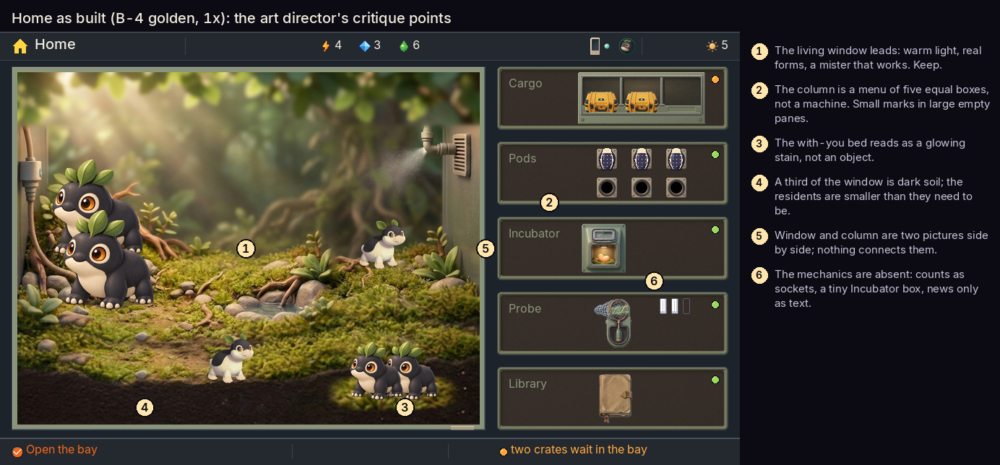

# Home, challenged: the art director's critique (T-20261016-186)

Written independently, before reading any other critique. Judged at 1× on Home's goldens (B-4: docked, away, a bud ready, the goal line) beside the Vivarium and Pods in the device sheet.

*home-critique-points.png: Home as built (capture), numbered against the points below.*

## The lens

Home is the screen the player sees most and the art direction's target picture, so it will be copied. I judge it by the three layers (the life, the instrument, the signal) and by what each motivation finds there:
- **the feel:** a small life to care for and watch;
- **the mechanics:** how inheritance works and how to steer it;
- **the person moving between them.**

## What it does well

1. **The living window leads (1).** It takes two thirds of the screen in warm daylight, with real sculpted forms and soft shadows. The mister visibly works for the life. It is the most alive thing on the screen and the eye goes there first. This is the feel, and it is right.
2. **One action, said once.** The bottom line names the one thing to do. Home never asks twice.
3. **The light changes with the day.** The dawn, day, dusk and night versions give a reason to look again, quietly.

## What is missing

4. **The instrument is a menu, not a machine (2).** Five equal boxes, each with a small mark in a large empty pane. Every module weighs the same whether it needs you or not, so the column reads as a list of links. It is the weakest part of the screen, and the part most likely to be copied.
5. **The mechanics are absent (6).** The rack is sockets, the Incubator is a 40 px box, the Probe is a dial, and the news ("three new pods in the rack") is only text. Nothing on Home lets the curious see why anything is the way it is: who descends from whom, what a pod might hold, what just changed in a line. The mechanics motivation finds nothing to pull on.
6. **The life tells no news.** A resident that grew up, a new arrival or a mibi carrying a first looks the same as every other. The feel motivation gets a pretty scene but no story about this animal today.
7. **Window and column don't connect (5).** They are two pictures side by side. Nothing physical runs from the machine into the life: the mister comes from the window's own wall, not the instrument. This is the "one machine" principle failing on the screen that is supposed to model it.

## What can improve

8. **The window frames poorly (4).** About a third of it is dark soil, and the residents are smaller than they could be. The with-you bed is a glowing patch with no object (3): light worn, not cast.
9. **The column has no depth.** Its marks sit on the pane rather than in wells, with no contact shadow, so the instrument is flat beside a painted life.

## Proposals, ranked

1. **Make the column a machine that answers state.** A module that needs you comes forward: it grows, and its subject is shown at a readable size (the candled pod when the bud is ready, the crates when they arrive). Quiet modules shrink to a lamp and a mark in a well. The column stops being a list and starts being the instrument working for the life. This serves both motivations: the feel sees what is happening, and the mechanics sees where to go.
2. **Let the life carry its own news.** In the window: a grown mibi visibly larger, a new arrival near the bay, a first marked with its triangle on the animal. The window becomes the story, and the notice line confirms what the picture already shows.
3. **One press from the life to the mechanism.** Focusing a resident lifts a small kin mark: its two parents' faces, and what it carries that is new. ✓ goes to the depth. The feel isn't interrupted, and the mechanics has a thread to pull.
4. **Join the window to the machine.** Feed lines, the mister and the bay's chute run from the column into the vivarium, so the hand-offs (the pod carry, the hatch walk-in) travel along something the player has already seen.
5. **Reframe the window.** Lift the ground line, bring the residents forward and larger, and redraw the with-you bed as an object: a nest by the Companion's dock, lit by the day, not by a glow.
6. **Guard the template.** Until proposals 1 and 4 are drawn, no other screen copies Home's column. The art direction's target picture should show the column as a machine, not as five boxes in slate.

## For the person moving between motivations

Home should let one glance answer "how are they?" (the window) and one press answer "why?" (the column and the kin mark), and do it without changing the screen's mood. Today it answers the first beautifully and the second not at all.
