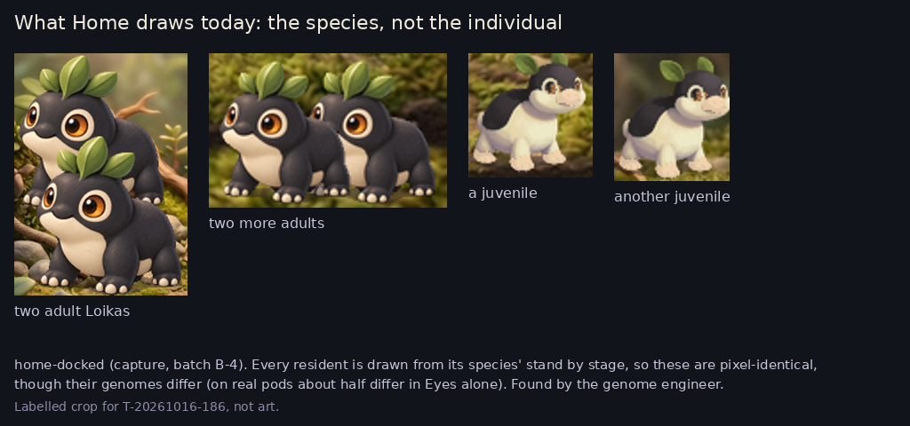

# Home, challenged: the summary

Four independent critiques (the game designer, the art director, UI/UX, the genome engineer), judged with the two motivations in mind. The full synthesis is `results/T-20261016-186.md`.

**In one line:** Home gives the feel everything and the mechanics nothing, and the bridge between them, the individual mibi, isn't drawn.

*The four adults and two juveniles on Home are pixel-identical, although their genomes differ. Everything a player does in Create and breeding becomes invisible exactly where the family lives. A Home-only player would conclude that crossing is pointless.*

**What it does well (keep):**
- the living window leads;
- one action, said once;
- the light changes through the day;
- it is calm.

**What's missing:**
- Nothing on Home is for the mechanics motivation: no question, no thread, no "what you're working toward".
- There is no way from a resident down to its genes.
- The module column is five equal boxes, and the Library never changes.

**Proposals, ranked:**
1. **Draw each mibi as itself**: crest, patches, eye rings and coat from its own genome.
2. **One press from a resident to its depth**: focus shows its chapter marks and kin, and ✓ goes down.
3. **The Library becomes your pursuit**: the wish's pieces lit, the field guide filling. One line names your next step.
4. **The column answers state in place**: what needs you comes forward, the rest goes quiet. Each picture is the screen it opens.
5. **The life carries its news**: names on events, a first's mark on the animal, a face for the trip.
6. **Small fixes**: the unexplained "☀ 5", room nouns, one message per line slot.

**The one disagreement to steer:** the art director wants the column's boxes to grow and shrink with what needs you. The game designer wants them fixed and learnt once. My call is fixed places, with the waiting one lit and brought forward inside its box.

Nothing is built until you steer.
