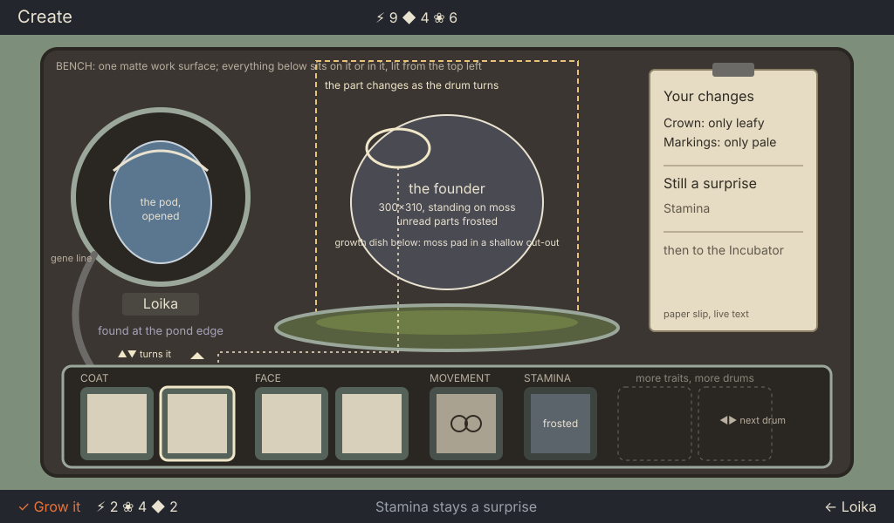

# Create: the gene bench (concept)

> **The Station is a lab** (owner, 2026-10-17 04:07; `specs/station-lab-sweep.md`). Paper, slips, tags and notes are only in the Library. The slip below is replaced by the machine's display (`specs/slip-visual-intent.md`, UI/UX T-20261016-126). Wherever this file says "slip", read "the display": picture chips with the drums' marks, at most 3 words.

Ticket T-20261015-02. Game designer, 2026-10-16. A concept, not a layout spec: the rects in the wireframe are rough, and UI/UX sets the real ones.

The owner's sentence: "all elements in create screen are floating. this page doesn't communicate a creation environment where you tweak genes". This concept answers both halves. The screen becomes **one bench** that everything sits on or in, and the genes become **drums on that bench that the player turns**, each turn changing the creature standing in front of them.

*create-concept/create-bench.svg: wireframe, 1×, layout and content only.*

## What the player does here

The player came from a pod's overview with `✓ Shape a founder`. They are deciding what their new mibi will look like, within what this pod carries, and then committing to it.

1. **◀ ▶** walks the ring along the drums of the gene bank, left to right in chapter order.
2. **▲ ▼** turns the focused drum one face. A drum has one face per look this pod can give that trait (as the pod is, only the first copy, only the second copy): up to three, as the rules say. A trait with one look is a drum with one face and no turn marks.
3. **✓ Grow it** commits, with the full price in the bottom line. **←** goes back to the pod, dropping the unpaid turns.

Nothing else is on this screen to do. No tabs, no chapter rail: the bank shows every trait of the species at once, grouped by chapter, so the player never pages to find a gene.

## What they see change

When a drum turns:

- **The drum.** Its window rolls to the next look's picture (the flank close-up of that part) in 200 ms, like a tumbler, and a small cream notch on its rim marks it changed.
- **The founder.** The part that trait covers redraws on the creature standing on the dish, and nothing else on the body moves. A dotted link is only in the wireframe; on screen the focused drum and the part it drives are tied by the ring's lift and a brief soft light on that part.
- **The slip.** A line is added to or removed from "Your changes" on the paper slip ("Crown: only leafy").
- **The price.** Data in the bottom line ticks up or down by one.

A clash marks the clashing drums in red, with a shape, names them on the slip, and withdraws Grow, as the rules say. Nothing is spent.

## Where the creature stands

The founder stands at the centre on a **growth dish**: a shallow cut-out in the bench holding a moss pad, with a contact shadow under its feet. It is the largest and warmest thing on the bench, 300×310 as the style guide asks, lit from the top left like the residents in the vivarium, because this is a living preview of a real animal. Where a chapter is unread its parts wear the frost veil, never a guess.

## The genes as physical things

| Object | What it is | Why it exists |
| --- | --- | --- |
| **The bench** | One matte work surface filling the stage inside the bezel, the same housing and bench as the accepted Pods screen | Every object sits on it or in it: nothing floats |
| **The pod, opened** | The player's own pod, in the same fitted well it had on Pods, shell open, its name tag and where it was found under it | The source: every look on the drums comes from this pod |
| **The gene line** | A short braided line from the pod's well into the bank | Says the drums are fed by this pod, not by a menu |
| **The gene bank** | A low tray along the front edge of the bench, holding one drum per trait, grouped under engraved chapter words | The genome as a thing you can put your hand on, all at once |
| **A drum** | A moulded sage drum in a slot, with a picture window and turn marks when focused | A gene you tweak. Faces are the pod's own looks, so it can never offer a look the pod lacks |
| **A pinned drum** | A drum with two joined rings, no turn marks | A doing only breeding changes ("breed to change") |
| **A capped drum** | A drum under the frost veil | An unread chapter: it stays as the pod has it, a surprise |
| **The growth dish and the founder** | Moss in a shallow cut-out, the founder standing on it | What you are making, grounded |
| **The slip** | A paper slip clipped to the bench at the right: "Your changes", then "Still a surprise" | Changes and surprises in words, live text |

All four of the pass list's needs (founder, changes, surprises, cost) are visible at once: the dish, the drums and slip, the slip, the bottom line.

**Grow.** The drums lock, the genome stamp prints onto the slip and its code appears, the pod's shell closes, and the pod is carried out at the right toward the Incubator (the jump). The pod the player collected is the object that travels: it is what sits in the Incubator next ([the Incubator concept](incubator-concept.md)).

## What leaves the current screen

The chapter rail and its tabs, the floating chamber box, the arch at the right (the empty dome), the stamp case on its own plane, and the roll strip above the founder. The roll strip is replaced by the drums; the stamp moves onto the slip and appears only at Grow.

## Mood note for the art director

An advanced research and crafting bench in the lab, where you edit life (owner, 04:16): the gene bench is the lab's editing station, the device's own housing with the drums as its controls. Never a desk. Take the bench, bezel and worn fitted wells from the accepted Pods screen, and the light and life of the accepted vivarium for the founder and its moss. The drums are moulded field-gear polymer in the housing's sage, rounded and handled, with a slight wear on the edges a thumb would turn; their picture windows are recessed and lit from the top left. The changes and surprises show on the machine's display let into the housing (`specs/slip-visual-intent.md`), never on paper. The founder is the warmest, most alive thing; the bench is calm. Everything casts a soft shadow onto the bench. No pipes, vents, gauges, wall fixtures, arches or domes: nothing is on the bench that the player does not use.

## Needs

**From art (AD).** Sizes are the concept's rough ones; UI/UX confirms them.

| Id (proposed) | Size | What |
| --- | --- | --- |
| `create-bench` | 928×490 | The bench surface inside the bezel, one painted master, with the dish cut-out and the bank tray recessed into it |
| `create-dish` | about 400×64 | The growth dish's moss pad and rim, its own layer, so the founder's contact shadow sits on it |
| `create-pod-well` | 200×200 | The Pods well, reused as accepted |
| pod, opened | 116×140 | One open-shell state per species from the pod renderer, with the place's dust or moss |
| `create-gene-line` | about 60×140 | The braided line from the well into the tray |
| `create-drum` | 84×84 | Drum states: rest, focused (lifted), changed, pinned, capped (frosted), clash; the window 68×68 left empty for the picture |
| per-look close-ups | 68×68 | One per look per shapeable trait, per species: the flank close-up the drum shows |
| per-look layers (the open B item) | the founder's 300×310 | For every shapeable trait, one layer per look, so a turn changes only that part of the founder; this is what makes "tweak" visible. Until they exist, a turn changes only the drum and the slip, and the screen does not pass |
| ~~`create-slip`~~ | — | Withdrawn: the machine's display replaces it (T-20261016-126) |

**From UI/UX.** The layout spec on the bench (even margins, the bank's grid, chapter groups for up to 10 drums and how a deeper species pages its bank), the focus graph (◀ ▶ along drums, ▲ ▼ turns), the slip's strings and slots at their longest, and the Grow motion's timing.

**For the creative director's gate.** A capture passes against this concept when: every object sits on the bench with contact and shadow; a stranger, in three seconds, says "you change the creature by turning those"; turning a drum changes the founder's part, the drum, the slip and the price, and nothing else; and none of the removed objects is back.

## Open for the lead

- The style guide's Create entry (station-gate design/style-guide/station-screens.md) still names the chapter rail, the dome at the right and the stamp label; it changes with this concept.
