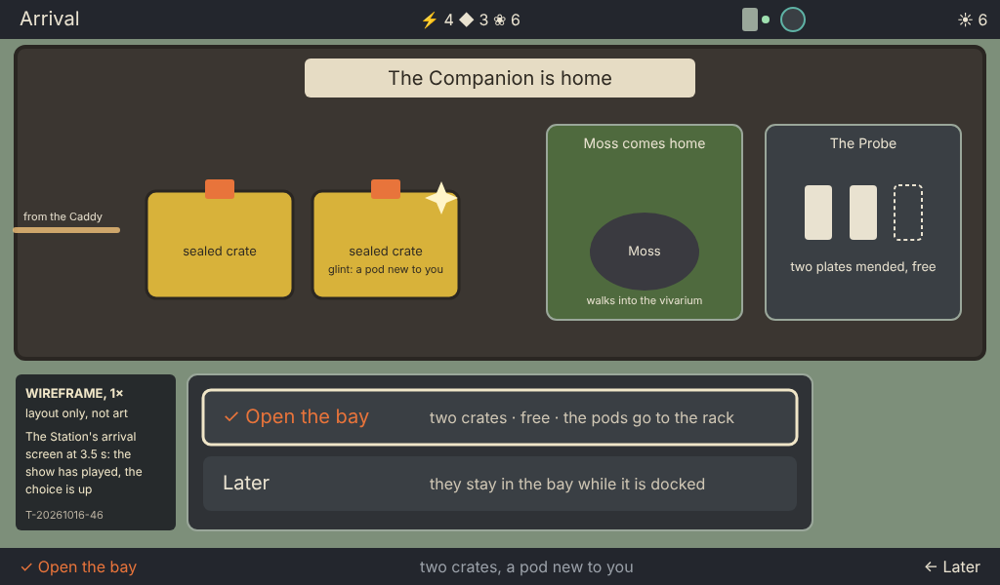

# Dock and undock: the moments the three devices talk

Ticket T-20261016-46. Game designer, 2026-10-16. Read at station-gate 54bde362: design/devices.md, design/interaction.md, design/architecture.md, design/proposals/technical-architecture.md, the Station's dock rules in `state.mjs` (the dock, `bayCrates`, opening the bay) and the "dock's cargo moment" in station-gate design/style-guide/station-layouts.md.

The owner, 13:23: "when you dock the companion, the station should pop up an arrival screen. that makes it feel like magic, that the companion, caddy and station talk between each other." / "also undocking should have some sort of effect in the station and caddy".

## The idea

The Companion docks onto the **Caddy**, and the Caddy tells the Station (the Caddy "charges both handhelds, lets them talk to each other"; design/proposals/homepage-spec.md). So a dock is one event seen from three places at once, and the magic is that **each device reacts to the same moment, in step**. One device lowers, the next lights, the third opens a door.

Three rules carry over from the rest of the design:

- **Docking never accepts cargo, moves a mibi against the player's choice, or awards anything** (design/devices.md, working rule). The arrival is a **show**, then **one real choice**: open the bay now, or later. It is not another press to accept (specs/station-decision-points.md).
- **The show is short and skippable.** About 3.5 s; any key jumps to the choice.
- **A lift never moves the Station's screen** (today's rule). The send-off plays in the frame and the living window, not as a takeover.

## 1. Dock, beat by beat

t = 0 is the moment the Caddy senses the Companion seated. "Crosses" is what passes between devices at that beat.

| t | Companion | Caddy | Station | Crosses |
| --- | --- | --- | --- | --- |
| 0 | Its screen dims to a "home" frame: the partner curls up, the HUD's bay marks show the sealed crates | Its cradle lamp lights; the e-paper starts one partial refresh | — | Presence: "a Companion is seated" (Caddy senses it) |
| 0.2 | — | — | Wakes if on Idle. The top bar's Companion glyph turns solid and its lamp mint, as today. **The arrival screen slides up over whatever is showing** (300 ms), unless the player is mid-decision (below) | The Companion's summary, read only: crate ids and count, which crate holds a pod of a species new to the player, the carried mibis and their care, the Probe's Shield, the world turn. Caddy → Station over Wi-Fi |
| 0.5–1.5 | Each crate mark on its HUD pulses once in turn | E-paper settles: "Companion home · 2 crates" with the crate icons | The ribbon "The Companion is home". The link light runs in from the bay's left edge ("from the Caddy") and the sealed crates slide into the bay, one per crate, in step with the Companion's pulses. A crate holding a new species glints (where, never what) | — |
| 1.5–2.5 | A mibi coming home walks off the Companion's screen edge | — | The mibi walks in on the right and into the vivarium panel; one staying with the Companion curls up on the with-you bed, as today | The carry set: who is home, who stays out (already requested Take and Bring) |
| 2.5–3.5 | The Shield plates refill | — | The Probe's plates refill: "two plates mended, free" (the dock's free mend, as today). The world turn's sun mark ticks if the world turned | The mend; the turn |
| 3.5 | Stays on its home frame, charging | — | **The choice**, in the decision panel's row form (T-45): **✓ Open the bay** (the crate count, "free", "the pods go to the rack") or **Later** ("they stay in the bay while it is docked") | — |

**After the choice.**

- **Open the bay** plays today's Cargo opening: per crate, the seal breaks, the pods travel to the rack, the counters tick, about 3 s each, and ✓ skips to the end. **In step:** as each seal breaks on the Station, the matching crate mark on the Companion's HUD clears. This is the confirmation the architecture already requires (the Companion clears a crate only after the Station confirms it), now made visible. When the last crate is open, the Caddy's e-paper updates once: "2 crates home · 1 new pod". Then the report card, whose ✓ goes to the new pods, as today.
- **Later** closes the arrival and returns the player to where they were. Home's Cargo module lamp is steady amber, and the line reads "two crates wait in the bay" (specs/station-return-signals.md).

### The cases

| Case | What changes from the script above |
| --- | --- |
| **A haul, no new pod** | No glint. The choice is the same |
| **A new pod** | The crate holding it glints from its slide-in. After the opening, the report's ✓ reads "Look at the new pod" (today's "See the new pod") |
| **An empty trip** (no crates: the Companion came home without ending an expedition, or carried nothing) | No crates and no choice. The ribbon "The Companion is home", who came home, and the mend, then the arrival closes by itself at 2.5 s and the player is back where they were. The Caddy shows "Companion home · charging" |
| **A broken Probe** (nothing came home; the pods dropped where it broke) | The ribbon says it straight: "The Companion is home. Nothing came back this time." The Probe panel shows the break mended free. Closes by itself |
| **A mibi coming home** (a Bring was asked) | Beat 1.5: it walks off the Companion and into the vivarium. The Companion's carried slot empties |
| **A mibi leaving** (a Take was asked) | Beat 1.5, reversed: it walks out of the vivarium's edge on the Station and appears on the Companion, curling up beside the partner. The Station's with-you bed fills |
| **The player is mid-decision** (a decision panel open, Create or Cross with an unpaid choice, the namer, the Sitting: today's list of screens that "stay where they are") | The arrival does not interrupt. A slim ribbon "The Companion is home" shows over the top bar for 2 s, and the arrival screen plays when the player leaves that screen |
| **Already docked, crates arrive later** (the Station was off) | The arrival plays at wake, the same way |

## 2. Undock, beat by beat

A send-off, never a takeover. t = 0 is the Caddy sensing the lift.

| t | Companion | Caddy | Station | Crosses |
| --- | --- | --- | --- | --- |
| 0 | Wakes to "Off we go": the partner stands up, the Shield plates and the carried mibis on the HUD | Cradle lamp off; one partial refresh: "Companion out · with Moss" | — | Absence: "the Companion lifted" |
| 0.2–1.5 | Ready to explore | E-paper settles. The Caddy keeps that line until the next dock, so a glance at the dock says who is out | **In the frame and the living window only:** the top bar's Companion glyph lifts to its outline and its lamp turns stone. On Home and Idle, the mibis on the with-you bed wake, stretch and walk out of the window's edge, and the bed empties to the Companion mark. The Cargo module's bay door shuts | Nothing more: the Station already holds everything it accepted |
| 1.5 | — | — | Nothing more moves. The screen the player is on is unchanged | — |

### Undock with something unfinished

| Unfinished | What happens, and what the player sees |
| --- | --- |
| **Crates not opened** | They leave with the Companion: the Station accepts only while docked (`openBay` needs the dock). At the lift, the Station's line says "the crates went out with the Companion"; the Companion's HUD still shows them sealed. They come back at the next dock and play the arrival again. Nothing is lost |
| **The lift lands mid-opening** | Crates already opened and confirmed stay accepted. If a confirmation did not reach the Companion before the lift, the Companion shows that crate "delivery unknown" and asks again at the next dock with the same request. The Station still has it exactly once, as the architecture already says. The Station plays the opening's last crate to its end; no crate is half-opened |
| **A Take or Bring asked but not yet done** | It is done at the next dock, as today ("goes at the next dock"). The send-off adds one line: "Moss goes at the next dock" |
| **A decision panel open, or Create or Cross unpaid** | Untouched. The send-off plays only in the frame |

## 3. The Station's arrival screen

*dock-moments/station-arrival.png: wireframe, 1×, layout only, with its label printed inside the image (source: station-arrival.svg).*

- **It is the bay.** It is drawn on Cargo's stage, with the bay as today. The owner's "pop-up" is the bay rising over the screen at the dock, so the arrival is not a new room; it is Cargo coming to the player.
- **It shows what came back and who came home:** the sealed crates (count, and a glint for a new species), the mibis coming home or leaving, and the Probe's mend. It never shows what is inside a crate. Opening is the payoff, and the player chooses it.
- **The hand-over.** The choice uses the decision panel's row form (T-45): two named rows, each with its cost and outcome. ✓ Open the bay leads into today's opening, then its report, then Pods. Later goes back to where the player was.
- **Skip.** Any key during the show jumps to the choice. During the opening, ✓ skips to the report (ceremony cut 4 in specs/station-decision-points.md).
- **Words.** The ribbon "The Companion is home" (20 px). The panels' headings are 16 px, the choice rows 20 and 16 px. Counts are spelled out; no digits but beside an icon.

## 4. What each device can do: today, and what needs new hardware or firmware

For the architect. "Reference hardware" is design/devices.md's.

| Device | Can do with the reference hardware (once firmware exists) | Needs new hardware or a decision |
| --- | --- | --- |
| **Station** (Pi 4, 1024×600) | The arrival screen and the send-off are screen work only. Its screen is always on, so it can show an arrival from Idle | **Knowing the dock happened.** Today it is the play page's Dock control. On devices, the Caddy must tell the Station over Wi-Fi (the Caddy service gains a "seated / lifted" event) and the Station must react within about 0.5 s. **Sound:** none in the reference hardware (it needs a speaker and amplifier) |
| **Caddy** (ESP32-S3, 5.79" four-gray e-paper, printer) | One partial refresh per beat (e-paper cannot animate; a partial refresh takes a fraction of a second and ghosts, a full one about two seconds). It shows a lasting line, which suits a dock: "Companion out · with Moss" stays readable for hours with no power | **Sensing a seated handheld** for each of the two cradles (a charging-coil status, a magnet and hall sensor, or a contact): new hardware. **A cradle lamp** per cradle: not in the reference hardware. **The relay** of the Companion's summary to the Station (BLE or Wi-Fi from the Companion, Wi-Fi to the Station): firmware, and the real transfer of crates is still undesigned (design/game.md, not designed yet) |
| **Companion** (ESP32-S3, 2.41" AMOLED, motion sensor) | The "home" and "Off we go" frames, the crate marks clearing in step, the mibi walking off the edge: screen work. The motion sensor can feel the lift a moment before the Caddy reports it | **Knowing it is docked by itself** (the charger's status line) depends on the board design. **Haptics** (a buzz on seating) and **sound**: neither is in the reference hardware |

**In the sandbox now.** All three can be shown on the play page today: the Dock control stands in for the Caddy's sensing, the Station frame plays the arrival, and the Companion frame plays its frames. The Caddy's e-paper lines can be drawn in its 792×272 four-gray view. This is how the owner can feel the moment before any hardware exists.

## 5. Needs

- **UI/UX.** The arrival screen's layout on Cargo's stage (the ribbon, the crates, who came home, the Probe, the choice rows). The interrupt rule: which screens defer the arrival, which matches today's "stay where they are" list. The send-off's motion in the frame and on the with-you bed. The new strings at their longest: "The Companion is home", "Nothing came back this time", "the crates went out with the Companion", "Moss goes at the next dock", and the Caddy's two lines.
- **Art (AD).** The link light into the bay. The sealed crates' slide-in, using today's crates. The with-you bed's sleepers waking and walking out (Home and Idle). The Companion's "home" and "Off we go" frames in HiBit. The Caddy's four-gray crate and Companion icons.
- **Build.** A seated and lifted event on the play page's Dock control, driving all three frames at once. The Station's arrival state on Cargo with the choice. The Companion's crate marks clearing on each confirmation. The Caddy's view lines. Later, for the architect: the Caddy service's seated and lifted events, and the presence sensing.
