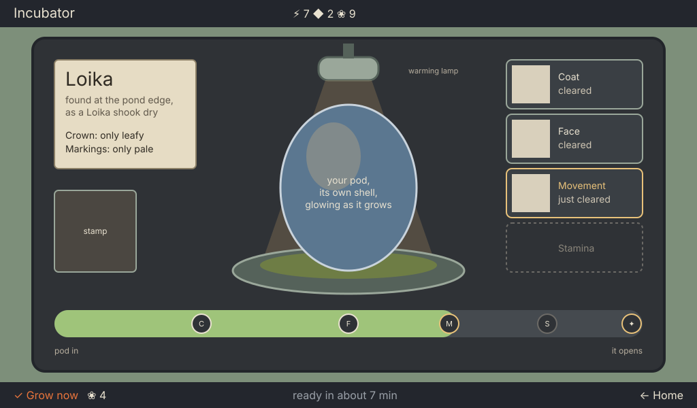
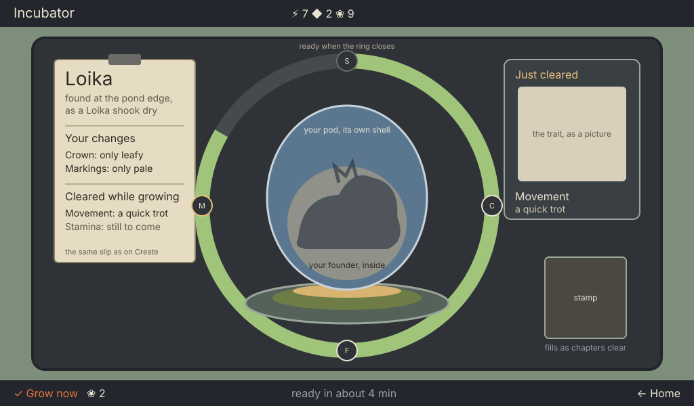
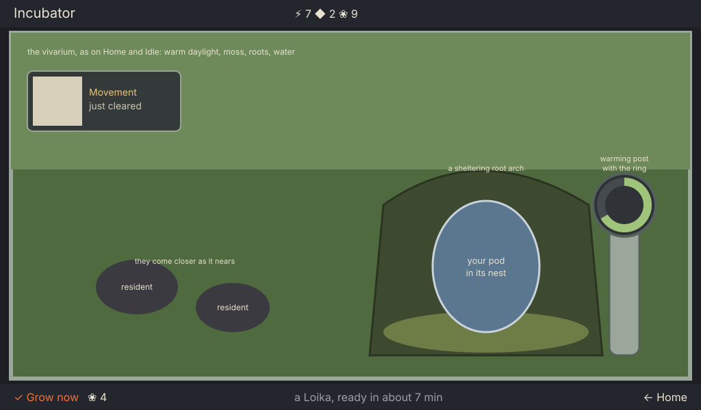

# Incubator: watching your own pod become your mibi (concept)

> **The Station is a lab** (owner, 2026-10-17 04:07; `specs/station-lab-sweep.md`). Paper, slips, tags and notes are only in the Library. The slip below is replaced by the machine's display (`specs/slip-visual-intent.md`, UI/UX T-20261016-126). Wherever this file says "slip", read "the display": picture chips with the drums' marks, at most 3 words.

Ticket T-20261016-25. Game designer, 2026-10-16. A concept for the owner to choose from, not a layout spec: the wireframes' rects are rough, and UI/UX sets the real ones. It follows the Create concept ([create-concept.md](create-concept.md)): the two screens are one flow, and the pod the player collected is the object that travels from one to the other.

The owner's verdict was "you're basically decorating a screen and placing an egg in it". The current screen has no purpose of its own: the player has nothing to look at that changes, nothing to come back for, and every object around the egg is decoration. This concept starts from what the player wants here and keeps only what serves it.

## 1. Purpose

**Why the player is here.** They have just shaped a founder and paid for it. What they want now is to **meet that mibi**. The Incubator is the wait between the decision and the meeting, and the rules already put something worth seeing into that wait: a founder's unread chapters **clear one by one** while it grows (station-gate design/research-and-breeding.md, "The bud"). Each clearing is free knowledge about the animal they made. The screen is about two things: **how close the meeting is**, and **what they have learned about their mibi so far**.

**What they do.**

| Key | What it does |
| --- | --- |
| **✓** | Growing: `✓ Grow now ❀ n`, the price falling as it grows. Ready: `✓ Open`, the hatch, then the jump to the vivarium, up close. Empty: `✓ Choose a pod`, a jump to Pods' collection |
| **◀ ▶** | Moves the ring between the pod and the "just cleared" card. On the card there is no ✓ cap; the context line says the trait in words |
| **←** | Home |
| Room keys | As everywhere. Leaving never stops the bud |

The Station has no knob (station-gate design/interaction.md, "There is no knob"); the pad and keys carry everything.

**What they watch change.**

1. **Their pod.** The egg is the pod they collected: its species' shell, the dust or moss of the place it was found, its name and its found-note, the same picture as on Pods and Cargo. It warms and glows as it grows; at ready, light breaks through its seams.
2. **How long.** One large progress ring around the pod fills continuously with time. It is cut into one segment per chapter that will clear, so each segment end is a moment something is revealed. It closes at ready. It reads from across a table, at the stage's scale, and it is the same ring language as Pods' progress ring, which the owner accepted.
3. **What has cleared.** When a chapter clears, its trait arrives as a picture on the "just cleared" card and a line on the slip.
4. **Wait time in words.** The bottom line's context says "ready in about 7 min". This needs a ruling (§5): the style guide says no digits for time, and the owner asked for a sense of wait time. A minute count is already implied by the Grow now price (1 Essence per 2 minutes), so the player is reading time as a number either way; saying it plainly is more honest.

**When they leave.** After a look, which is the normal visit: a glance, a reveal, ← Home. At Open, by the jump to the vivarium, up close, where the young mibi steps into its bay. With no bud, by `✓ Choose a pod`.

**What pulls them back.** Each clearing is an event with content: "Face just cleared" means there is a new picture of their own mibi to see. A founder with four chapters gives up to four such moments over twenty-odd minutes, then the ready moment. A shaped founder whose chapters were all read before Grow has fewer reveals; then the pull is the ring and the ready moment.

**How the Station shows it from elsewhere.**

- **Home.** The Incubator module draws the pod's own shell small, in its nest, with a small ring around it filling at the same rate. Its lamp is green while it grows, pulses amber when a chapter has cleared that the player has not looked at, and is steady amber when ready. Home's notice slot says "Face cleared on your Loika" or "your Loika is ready". The Home key's ✓ (what needs you) leads to the Incubator in both cases.
- **Idle.** The vivarium plays alone. A small moulded lamp plate on the bezel's bottom rail (a chrome sprite, like the rest knob) carries the pod's ring; it turns amber when something cleared or the bud is ready, readable from across the room. The first press only wakes the screen, as now.

## 2. Three options for the owner

All three use the same purpose, keys, ring of time, cleared card and Home and Idle signals. They differ in where the pod sits and how its growth shows.

### A. The nest under the lamp, time as a track

The pod lies large in a moss nest in a moulded cradle, under one warming lamp in scale with it, wholly in frame, whose pool of light lands on the pod. Time runs as a broad growth track across the front of the stage, from "pod in" to "it opens", with a stop at each chapter clearing. The cleared chapters stack as cards at the right; the pod's tag (name, found-note, the changes from Create) and the stamp sit at the left. It is calm, easy to read and the closest to the creative director's style direction. Its weakness is that the pod itself does not change much: the screen can still read as "an egg with a progress bar".

*option-a-nest-and-track.svg: wireframe, 1×, layout only.*

### B. Candling (recommended)

The pod stands in a moulded cradle on a moss nest, lit warm **from below**, as eggs are candled. As it grows the shell lets more light through, and the player's founder shows through it as a soft shadow: the shape they made on Create, standing. Each chapter that clears adds what it reveals to that shadow (the markings appear, the crown's leaves take their shape). The ring of time circles the pod at the stage's scale, cut at each clearing. The slip from Create hangs at the left, now with "Cleared while growing"; the just-cleared trait and the stamp are at the right. The pod is the screen: what the player cares about, their own animal, gets clearer every time they look, which is the reason to come back.

*option-b-candling.svg: wireframe, 1×, layout only.*

### C. The nest in the vivarium

There is no separate machine. The pod rests in a sheltered nest under a root arch inside the vivarium itself, the living window filling the stage, with one moulded warming post beside it carrying the ring. Residents wander closer as it nears hatching, and at Open the young mibi simply walks out into its home. It is the strongest match to the owner's accepted screens, and Home shows the nest for free. But it has the least room for the reveals, it makes the vivarium painting carry a second job, and the warming post is the only device left, so the Incubator stops being a place of its own.

*option-c-nest-in-vivarium.svg: wireframe, 1×, layout only.*

### Recommendation

**B.** The owner's last points are that the screen must "invite the user to check it" and that the current one "does not". Only B makes the thing being checked change in a way worth seeing: the player looks to see more of their own mibi. A shows progress but not change; C has the best mood but loses the screen's job. B also ties Create to the Incubator directly: the shape the player made is what they see forming. Its costs are two rulings (§5) and one art problem (the shadow through the shell), named below.

## 3. Option B in detail

### The objects, and why each exists

| Object | Why it is there |
| --- | --- |
| **The pod** (about 236×272, centred) | The player's own pod: what they collected and shaped. The largest, warmest thing on the stage |
| **The founder's shadow** inside it | What they are waiting to meet, getting clearer. Only what is known is drawn: the body from Create, and each chapter's look once it clears |
| **The cradle and moss nest** | Holds the pod with contact and shadow; the moss is living material, the pod is not on machinery |
| **The candling light** under the nest | The only device that works here, and its job is visible: it lights the shell from below so the founder shows through. It replaces the pendant bulb |
| **The ring of time** (about 428 across, around the pod) | How close the meeting is, at a glance; its cuts are the moments something clears. It replaces the leaves |
| **The slip** (left) | The same paper slip as on Create: name, found-note, "Your changes", then "Cleared while growing". It answers "what is this, and what did I make" |
| **The just-cleared card** (right) | The newest reveal, large, as a picture and words. It answers "what's new since I last looked" |
| **The stamp** (right, the shared slot) | Kept by the creative director's direction; it fills chapter by chapter as they clear, the same event seen in the genome |
| **The bottom line** | `✓ Grow now ❀ 2` · "ready in about 4 min" · ← Home |

Everything else on the current screen goes: the chapter tabs, the conduit, vents, boxes, hoses and gauges, the arched door and its bulb, the nameplate base, the generic orange egg and the leaves.

### States

- **Empty.** The nest and its light are there, the cradle empty, the ring a bare track; the slip slot holds nothing. `✓ Choose a pod`. The context line: "the nest is empty".
- **Growing.** As above. The shadow strengthens with time; each clearing pulses the ring's cut once, drops the trait onto the card and the slip, and fills the stamp's chapter.
- **Ready.** The ring closes, light breaks through the shell's seams, the shadow is the whole founder, and Home and Idle turn amber. `✓ Open`.
- **Hatch.** The shell opens along its seams, the young mibi steps onto the moss in its painting (or its placeholder with the waiting lamp, as the style guide already says), the ribbon "Fig, a young Loika", then the jump.
- **A crossed bud** (the creative director's open question). It has no collected pod, so its egg is a pod of its species' shell **laid at home**: the vivarium's own moss on it, and on the slip "laid at home, of Dot and Bean" instead of a found-note, with no "Your changes". A bred child's chapters do not clear in the incubator, so its shadow shows only the species' outline and the card says "read it when it's out". Its ring has no cuts: the pull is the meeting, and the reveals come after it, on Pods' chapter prices, as the rules say.

### Style note for the art director

Not retro-industrial, and not a machine with an egg in it. Take the look from the owner's accepted screens:

- **The vivarium (Home, Vivarium, Idle)** for the nest: living moss, soft fibre, warm daylight, depth and soft shadow. The nest is a small piece of that world brought onto the device.
- **Pods** for the pod: the species' own shell, lit on its ground, a worn fitted cradle. No paper tag: the Station is a lab.
- **The kit** (`hero-kit.png`) for the one device: the cradle and the candling light are moulded sage polymer with dark rubber, rounded, matte, from the same maker as the Station and the Companion.

The light is the subject's: warm, from below, through the shell, spilling a little onto the moss and the cradle, so the screen visibly has one lit thing. The key light from the top left stays for form. No pipes, vents, boxes, gauges, wall fixtures, porthole doors or pendant bulbs; the wall behind is the device's dark matte slate, as on Pods. The creative director's direction (specs/station-style-direction-incubator.md) holds for materials and palette; this concept overrules it in one place on purpose: the lamp is not overhead but under the nest, because candling is its job.

### Needs

**Art (AD).** Sizes are rough; UI/UX confirms them.

| Id (proposed) | Size | What |
| --- | --- | --- |
| `incubator-stage` | 928×490 | The slate ground inside the bezel, with the ring's track recessed into it |
| `incubator-cradle` | about 300×90 | The moulded cradle, moss nest and candling light, with and without the pod's contact shadow (empty state) |
| shell translucency | per species, the pod's size | The species' pod shell as an overlay that can be lit from below in a few steps (cool, warm, glowing), so the build places steps and never tints |
| founder shadow | the pod's inner area | A soft, blurred silhouette of the founder, derived from its Create picture by the build's derive step (a mask), not painted per mibi; per-trait shadow layers for the looks that clear |
| seam light | per pod shape | The ready state: light through the seams, as overlays that work on every shell (the CD's crack overlays) |
| `incubator-ring` | about 428×428 | The ring's track and fill as art-layer pieces, with the cut marks |
| `incubator-card` | about 200×236 | The just-cleared card, its picture slot 160×140 left empty for the trait picture |
| slip | as on Create | The Create slip, reused at one size for both screens |
| Home module, Idle lamp plate | the module's object box; the rest-knob scale | The pod in its nest small with its ring; the bezel's lamp plate with the ring and its lamp |

**UI/UX.** The layout on the grid (the ring, pod and side columns, even margins), the focus graph (pod, card), the slip and card strings at their longest, the time phrase in the context zone, and the Home module and Idle tag placements.

**Build.**

- The bud's own pod: `st.bud.species` and `st.bud.from.podId` with the shell picture Pods and Cargo draw (as the CD's table says); for a cross, the species' shell with the home moss.
- The ring's fill from the bud's start and end times; its cuts at the times the rules clear each chapter.
- The cleared events driving the card, the slip, the stamp, the shadow's layers, Home's amber pulse and the Idle lamp plate, and a "seen" flag so the pulse stops once the player has looked.
- The founder's shadow, derived once at Grow from the founder's picture.
- The time phrase, rounded to the minute, if the owner rules for it.

## 4. The owner's points, answered

| Owner's words | In this concept |
| --- | --- |
| "decorating a screen and placing an egg in it" | Every object has a job named in §3; the egg is the subject and it changes |
| "tabs make no sense in the incubator" | No tabs; clearing shows on the pod, the card, the slip and the stamp |
| "retro mid-century industrial … not the style" | Style note: nest from the vivarium, pod and slip from Pods, one moulded device from the kit |
| "a lot of wasted space" | The ring and pod fill the centre; the side columns carry the slip and the reveals |
| "the egg should be an egg that we collected" | The pod is the player's own: shell, place, name, found-note |
| "the lamp is out of proportion and clipped, and casts no light" | One light, under the nest, whose light is the point of the screen |
| "the fixtures in the walls make no sense" / "the gauges make no sense" | Gone |
| "no sense of progress or wait time other than the little leafs" | The ring at the stage's scale, plus "ready in about n min" (ruling below) |
| "it needs to invite the user to check it" | Each clearing is a reveal of their own mibi, signalled on Home and Idle |

## 5. Rulings needed before art

1. **Time in minutes.** The style guide's "no digits for time" (Incubator pass list, and "the only numbers are prices and supplies"). Recommended: allow one rounded minute count in the Incubator's context line, "ready in about n min", and nowhere else.
2. **Something inside the shell (B only).** The style guide says the bud is "a cute, generic glowing bean", "never an embryo shape at any stage", with the shape visible only when ready. B shows the founder's own juvenile silhouette, not an embryo, from the start, and only what is known. The owner's "an egg that we collected" already overrules the generic bean.
3. **The style guide's Incubator entry** changes with whichever option is chosen; the lead takes it to the owner with the options.
