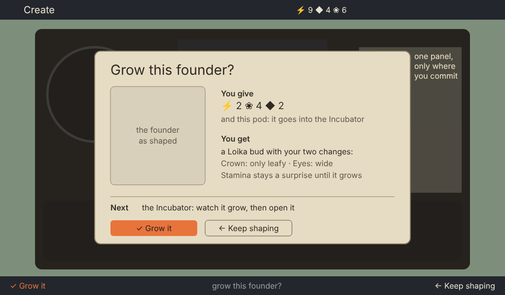

# The Station's decision points: is it a "click-accept-fest"?

Ticket T-20261016-44. A position paper for the owner, not a spec. Two signed sections (UI/UX, game designer) and a joint recommendation. Read at station-gate 54bde362.

The owner, 2026-10-16 13:16: "it's a 'click-accept-fest', you need better bigger modal screens to explain what is going on, and to let the user chose the navigation and actions. otherwise you get lost on what you're doing."

**How the loop was counted.** The face's WebAssembly build is not committed and its toolchain (emsdk) is not in the game designer's environment, so the game designer did not play it live. The count below is reconstructed from the face's recorded journeys at 54bde362 (`prototypes/face/golden/journey-{home,create,incubator,vivarium}.json`: each key, the screen it landed on and the bottom line's verb after it) and the screens' strings (`prototypes/ui/specs/station/*.json`). If the UI/UX designer played it live, their count is the one to trust where the two differ.

---

## UI/UX

*Signed: UI/UX designer, 2026-10-16.*

**The count.** I take the game designer's table below as the reference: 12 ✓ presses, from the recorded journeys. I read the same path from the intents (`prototypes/station/src/intents/*.mjs` at 54bde362) and reach the same shape: 11 presses without reading a chapter, 14 with one.

**The diagnosis is right; the proposed cure is half right.** You get lost for three reasons, none of which is "the screens are too small":

1. **One key does three different jobs, and the same object changes job.**
   - ✓ on a pod identifies it (you spend ◆), and the next ✓ on the same pod opens Create (you go somewhere).
   - ✓ on a chapter tab opens its page (free), and on the page the same ✓ reads it (◆ 3).
   - Only the bottom line's words say which, at 16 px, at the screen's edge.
2. **Presses land you in another room without saying so.**
   - Home's ✓ jumps wherever the need is.
   - The crate report's ✓ jumps to Pods.
   - Grow jumps to the Incubator.
   - Open hatches and then jumps to the Vivarium, where ← no longer leads back.
   
   Each jump is correct by the rules, but the player never chose the destination, and nothing at the landing says "you are here because…".
3. **The irreversible commitments look like everything else.** Return to the wild, Grow (the pod is used up) and the Probe upgrade are guarded only by "✓ again" on a small plate. The guard asks you to press twice; it does not show what you lose.

**Why "bigger modals everywhere" would make it worse.** A modal on every action adds a press to every action. That turns 11 presses into about 20, all of them accepts: the click-accept-fest the owner named, only bigger. The cure is a modal where a decision is, and *none* where there is no decision.

**What I recommend instead:**

1. **A decision panel at each real commitment, and only there.**
   - **Where:** Identify, Read, Grow it, Open, Return to the wild, Fit the upgrade (the game designer confirms the list).
   - **What it shows:** a large panel (640 × 392, over the dimmed screen) with *what you give*, *what you get*, and *where you go next*, plus two named choices: `✓ Grow it` / `← Keep shaping`.
   - **What it costs in presses:** it replaces the "✓ again" arming, so Return to the wild and the upgrade cost the same two presses as today, but now you can read them. Identify, Grow and Open gain one press each, so the game designer's 12-press loop goes to 15 (not about 20). Each added press is one where the player is actually choosing.
   - **Repeats:** a free, repeatable action (turning a drum, opening a page) gets no panel.
2. **✓ never changes meaning on the same object.**
   - Spending and moving are two different targets: Identify and Read are actions with a price on the panel, and Create is reached by its own "Shape a founder" control. The pod itself only ever *opens*.
   - This removes the most confusing press without adding one.
3. **An arrival line after every jump.**
   - **What:** for 2 seconds, the ribbon names where you are and why ("Incubator: your Loika bud is growing"; "Pods: one new pod from the crate").
   - **Behaviour:** no press is needed, and the next key dismisses it.
   - **Back:** ← always returns to where the jump came from until you move on.
4. **The bottom line stays the one place that says what ✓ does.** It must always name the destination when ✓ leaves the screen ("✓ Grow it → Incubator").

**The example** (rough, 1×, layout only; the face's type sizes 16, 20 and 28): the Grow panel on Create. Today's single Grow press becomes the panel plus ✓. The added press is the one where the player commits the pod and its price, and the panel says what that buys and where they go next.

*station-decision-points/uiux-grow-panel.png (source: uiux-grow-panel.svg).*

**Cost.**
- **Building:** one panel component, drawn by the face's existing words (a plate, text, a picture slot); one arrival ribbon (the existing ribbon look).
- **Specs:** the per-screen edits are small, because each commitment already has its strings for price and consequence.

---

## Game designer

### The loop, press by press

From Home with the Companion docked and two crates in the bay, to a named young mibi. It reads two chapters, shapes nothing and keeps the suggested name, which is the shortest normal first loop.

| # | Where | ✓ says | What it does | Kind | Can the player tell what it does and where they land? |
| --- | --- | --- | --- | --- | --- |
| 1 | Home | Open Cargo | Goes to Cargo | Navigation | Yes |
| 2 | Cargo | Open the bay | Opens every crate, about 3 s each. Presses are eaten meanwhile | Payoff (gains, spends nothing) | What it does, yes. But then several seconds pass with no control |
| 3 | Cargo, the report card | See the new pods | Goes to Pods | Navigation | Yes |
| 4 | Pods, the collection | Open | Opens one pod's overview | Navigation | **No.** "Open" also means go to a module (#1, #10), open the crates (#2) and hatch (#11) |
| 5 | The pod | Identify ◆ 1 | Spends 1 Data; the species shows | **Decision** (spend, a gate) | Yes |
| 6 | The pod | Read Coat ◆ n | Spends Data; the page shows | **Decision** (spend, which chapter) | Yes |
| 7 | The pod | Read Face ◆ n | The same | **Decision** | Yes |
| 8 | The pod | Create from this pod | Goes to Create | Navigation | Mostly. "Create" doesn't say that nothing is spent yet |
| 9 | Create | Grow it ⚡ 2 ❀ 4 ⧗ 20 | Spends, commits the founder, then **jumps** to the Incubator | **Decision** (the big one) | The price, yes. The landing, **no**: the player didn't choose the Incubator |
| — | | | *The wait* | | |
| 10 | Home | Open the Incubator | Goes to the Incubator | Navigation | Yes |
| 11 | Incubator | Open | Hatches it; then **jumps** to the young mibi | Payoff | What it does, yes. The landing, no |
| 12 | The young mibi | Keep Moss | Accepts a name the Station suggested | **Decision** with a default | **No.** ✓ accepts a name the player never chose; most will press it without reading |

Leaving takes three ← presses, back to Home.

**12 ✓ presses: 5 decisions, 2 payoffs, 5 navigation.** Two of the decisions (Grow it, the name) end in a jump the player did not choose. One word, "Open", covers four different acts: going to a module, opening the crates, looking at a pod and hatching. Irreversible acts add a second ✓ ("Again: return Moss", "✓ again"), which teaches the player to press ✓ twice without reading. That is the click-accept-fest: not too many decisions, but **decisions and navigation that look and feel the same**, so the player stops reading and presses through.

### Which presses are real decisions

A press is a decision when it **spends**, **commits something that can't be undone**, or **chooses between paths that lead to different games**. In the whole Station:

| Decision | Why it matters |
| --- | --- |
| Identify a pod (◆ 1), or return it to the wild (❀ +1) | The first fork for every pod: learn it, or let it go |
| Read a chapter (◆ n), and which one | Where Data goes; the core of research |
| Turning a gene on Create | The creative choice; free, reversible until Grow |
| **Grow it** | The big commitment: one pod becomes one fixed mibi, for a price |
| Grow now (❀ n) | Time against Essence |
| **Cross them** | The second big commitment |
| Naming | A choice the player keeps for the mibi's whole life |
| Take with you / bring home | Who goes on the next trip |
| **Return to the wild** (pod or mibi) | Irreversible |
| Spending a sitting | Rare and irreversible |
| Mend (⚡ each) and the upgrade | Spending Energy on the Probe |

Everything else is navigation or a payoff: going to a screen, opening the bay, opening a hatched bud, greeting, looking.

### What should go, and what should change

1. **Navigation is not confirmation.** Home's ✓ on a module should go there, and that is fine. But when Home's line already says what needs you ("two crates wait in the bay"), its ✓ should **do** it: open the bay in one press, not two (#1 + #2). The same holds for "your Loika is ready" (#10 + #11). That cuts two presses from every loop.
2. **One verb, one act.** "Open" stays only for opening something physical: the bay, the bud. Going somewhere says where: "Go to Pods", "Look at this pod", "Shape a founder". This is wording; it costs nothing to build and fixes the "where will I land?" problem in #4 and #8.
3. **No jump the player didn't choose.** After a big commitment the player is asked where to go, as part of the decision panel below. "Grow it" ends with "watch it grow / back to the pods / Home"; the hatch ends with "say hello to Moss / Home". The rule stays that ← always goes up one level.
4. **The real decisions get a decision panel; nothing else does.** This is where the owner is right. For the five commitments (Grow it, Cross them, Grow now when it is more than a few Essence, Return to the wild, spending a sitting), ✓ opens one larger panel over the screen. It shows what will happen (the founder, large), what it costs, what can't be undone, and two or three named choices, with "not yet" always one of them. The panel replaces the "✓ again" double press. Reads and Identify **don't** get a panel: they are small, frequent and already show their price on the page, and a panel on every read would be a new accept-fest.
5. **Naming is a choice, not a default.** The hatch panel offers the suggested name beside "choose another". It is never accepted by a bare ✓ on a line the player didn't read.
6. **Payoffs keep their ceremony, but give control back.** Opening the bay and hatching are the game's rewards and should feel like events. While one plays, ✓ skips to its end instead of being eaten.

With 1–6 the same loop is **8 ✓ presses: 5 decisions, each with its consequence on screen, 2 payoffs and 1 navigation.** It's fewer presses, and each one is a press the player means.

### How the player should choose navigation and actions

- **Pad = where; ✓ = do; ← = up.** It is the current model and it is right. What failed is that the bottom line is the only place the verb is written, small and far from the eye, while focus sits on the picture.
- **Say the next step where the eye is.** Every screen answers "what is this for, and what next?" (the purpose-first rule): Create's slip, the Incubator's slip and card, Home's line. The return signals (specs/station-return-signals.md) are the Station-wide half of this: one line, one lamp meaning, a ring for every wait.
- **The player chooses the path at forks, not the Station.** The forks are after Identify (read, shape a founder, or return it), after Grow (watch it, or go on), and after the hatch (meet it, or go Home). Each fork is a short set of named choices in the panel, never a silent jump.

---

## Joint

*Draft by the game designer, to be amended by UI/UX. Where we disagree goes here once both sections are written.*

**Where we disagree.** *(UI/UX to add.)*

**Recommendation for the owner (3 lines).**
1. Yes to bigger screens, but only for the few real decisions (Grow it, Cross them, Return to the wild, a large Grow now, spending a sitting). Each shows its consequence and named choices, including where to go next; every other press gets fewer screens, not more.
2. Cut the ceremony: Home's ✓ does what its line says needs you, one verb means one act ("Open" only for the bay and the bud), and no jump lands the player somewhere they didn't choose.
3. Show every choice's options, cost and outcome before the press, on the page or in the panel (the work list below). The loop drops from 12 ✓ presses to about 8, and each one is a decision the player means.

---

## The work list

*Draft by the game designer, for UI/UX to amend. The owner, 13:19: "allowing the user be intentional, show the options and costs, and the actions and outcomes makes the game more engaging, invites to explore and make choices." The lead turns this list into spec and build tickets.*

### Decision points, screen by screen

Each one shows its options, its cost and its outcome **before** the press. "On the page" means the choice is drawn where the eye already is, with no extra screen. "Panel" means the larger decision panel from the game designer's section, point 4, which also offers where to go next.

| Screen | Decision | Options shown | Cost shown | Outcome shown before the press | Form |
| --- | --- | --- | --- | --- | --- |
| Pods, a sealed pod | What to do with this pod | Identify · Return to the wild · Not now | ◆ 1 · ❀ +1 | "the species shows" (and "a new species: its page opens in the Library" for a first) · "its well frees; it is gone" | On the page, three named choices |
| Pods, a pod's chapters | Which chapter to read | Every unread chapter, with its glint | ◆ n on each tab | "shows both copies of its traits"; the glint says "something new here" | On the page (the rail) |
| Pods, an identified pod | How to make a founder | Shape a founder · Grow it as it is | Grow's full price on both | "nothing is spent until Grow" | On the page |
| Create | Each gene | The drum's faces (the pod's own looks) | ◆ 1 each changed, in the line | The founder's part changes as the drum turns | On the page (the gene bench) |
| Create | **Grow it** | Grow it · Keep shaping; then Watch it grow · Back to the pods · Home | ⚡ ❀ ◆ and the wait | The founder large, its changes, what stays a surprise, "the pod is used; this can't be undone" | **Panel** |
| Incubator | Wait or grow now | Wait · Grow now | free, "about n min" · ❀ n | "it opens now" | On the page; a **panel** when the price is more than a few Essence |
| Incubator | The hatch, then the name | Keep "Moss" · Choose another; then Say hello · Take it with you · Home | none | The young mibi, its name, where it will live | **Panel** (after the payoff) |
| Vivarium, up close | Who goes on the next trip | Take with you · Bring home | none | "goes at the next dock" · "home at the next dock" | On the page |
| Vivarium, up close | **Return to the wild** | Return it · Keep it | ❀ +2 | "gone for good; its place remembers it and later sheds one pod of its line" | **Panel** (replaces "Again: return Moss") |
| Cross | Pick the partner | Each eligible adult, with kin in words | — | The forecast for the pair | On the page |
| Cross | **Cross them** | Cross them · Pick another; then Watch it grow · Home | ⚡ 2 ❀ 4, 20 min | The forecast, the kin, "one child, its own mibi" | **Panel** |
| Vivarium, up close | **Spend a sitting** | Sit for a portrait · Not now | the sitting | "a portrait comes to the bay in a few hours"; the warning when a held sitting would be lost | **Panel** |
| Probe bench | Mend | Mend a plate · Leave it | ⚡ 1 each | "Shield n of n for the next trip" | On the page |
| Probe bench | **Upgrade** | Fit it · Not now | ⚡ 12 ◆ 4 | "reaches further; carries 3 pods" | **Panel** |
| Library | Pin a wish | Each look in the field guide | free | "pods and pairs that carry it glint" | On the page |

### Ceremony to remove, ranked

Ranked by how often the player meets it and how much it costs them.

1. **Home → Cargo → Open the bay.** Home's ✓ on "crates wait in the bay" opens the bay in one press. It happens on every trip.
2. **Home → Incubator → Open.** Home's ✓ on "your Loika is ready" goes straight to the hatch. It happens for every mibi.
3. **"✓ again" double presses** (Return to the wild, the pod's return arm). The panel replaces them, so ✓ never means "press twice to be sure".
4. **Eaten presses during the bay's opening and the hatch.** ✓ skips to the end instead of doing nothing.
5. **Jumps after Grow it, Cross them and the hatch.** The panel's "where next" choices replace them. No press is saved, but the landing becomes the player's choice.
6. **"Open" for four acts.** "Open" stays for the bay and the bud; the rest say where they go ("Look at this pod", "Go to the Incubator").
7. **The bare "Keep Moss".** It becomes the hatch panel's name choice.
